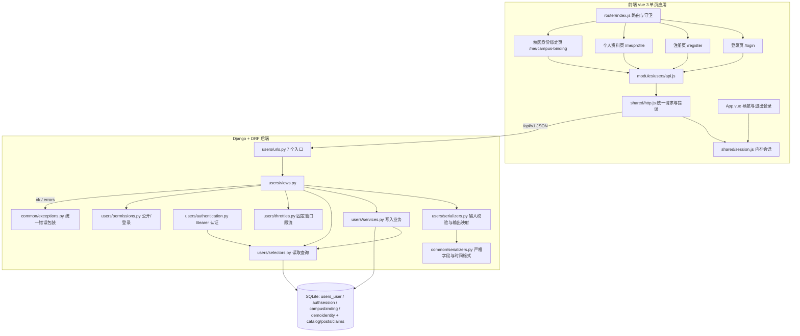
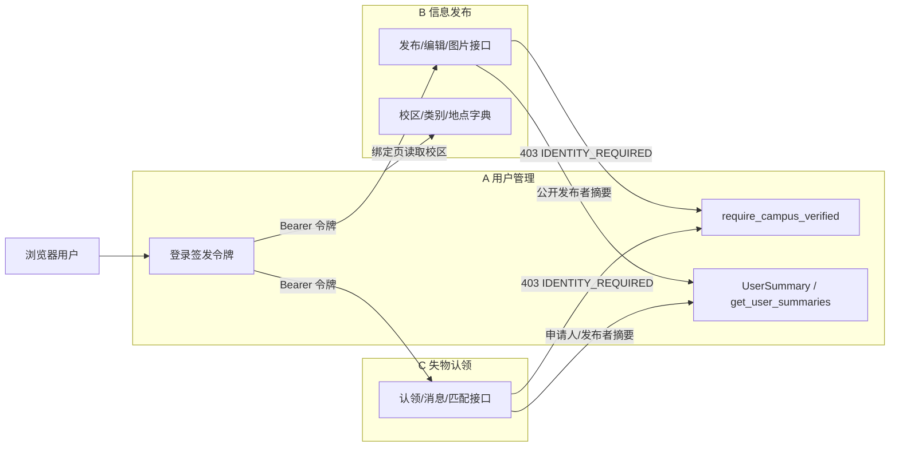
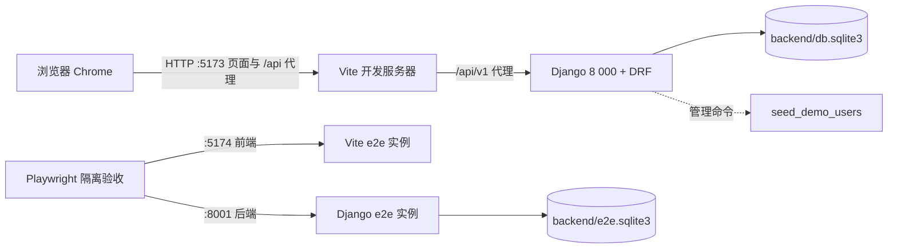

# 成员 A：用户管理子系统概要设计

## 1. 文档信息与版本

| 项目 | 内容 |
|---|---|
| 文档名称 | 校园失物招领系统——成员 A 用户管理子系统概要设计 |
| 文档编号 | DES-A-HLD-001 |
| 文档版本 | v1.0 |
| 编写日期 | 2026-11-02 |
| 作者 | 成员 A（用户管理） |
| 文档状态 | 定稿（依据后端定稿快照；接口语义以共同契约与实现为准） |
| 上游文档 | [需求规格说明书](../requirements/A-用户管理-需求规格说明书.md)、[共同字段与接口约定](../共同字段与接口约定.md)、[项目文件结构说明](../项目文件结构说明.md) |
| 下游文档 | [详细设计](A-用户管理-详细设计.md)、[数据库设计](../数据库设计.md)、[测试计划](../test/A-用户管理-测试计划.md)、[测试用例](../test/A-用户管理-测试用例.md) |

### 1.1 版本记录

| 版本 | 日期 | 修订说明 | 修订人 |
|---|---|---|---|
| v1.0 | 2026-11-02 | 依据后端定稿快照首次编写：总体架构、模块划分、技术选型、关键决策、接口总览、错误码、安全与非功能设计、风险与追踪矩阵；已按 CR-A-08 对齐“身份被占用返回 409” | 成员 A |

## 2. 设计目标与原则

### 2.1 目标

1. **可交付**：在课程周期内交付可运行的注册登录、校园身份绑定、个人资料管理与四个前端页面，并支撑成员 B/C 的身份前置条件。
2. **安全最小面**：密码不以明文或可逆形式存储；令牌可撤销、服务端只存摘要；响应不泄露学号、绑定码与任何认证秘密。
3. **语义一致**：7 个接口的路径、字段、状态码、错误码与[共同字段与接口约定](../共同字段与接口约定.md)第 2、3.2、3.3、4 节逐条对齐；不改变 C 的认领规则与 B 的信息状态规则。
4. **可回归**：A 的正式路由替换 `demo` 适配入口后，C 的既有后端 52 项测试与前端 21 项测试保持通过。
5. **可追踪**：每条 FR/NFR 能沿“需求 → 设计章节 → 代码文件 → 测试用例 → 结果记录”链路定位（见第 11 节）。

### 2.2 设计原则

| 原则 | 落地方式 |
|---|---|
| 契约先行 | 字段、路径、错误码先由共同契约冻结；实现偏离需走变更控制 |
| 单一职责分层 | `views` 只做 HTTP 编排；`serializers` 只做输入校验与输出映射；`services` 只做写入业务；`selectors` 只做读取；`permissions/throttles` 做访问控制 |
| 失败一致 | 所有错误经 `common/exceptions.py` 统一包装；字段错误进 `errors`，非字段错误给 `code/message` |
| 默认拒绝 | 严格字段白名单；未绑定用户不允许进入 B/C 写业务；无效令牌一律 401 |
| 演示可辨识 | 认证方式固定 `demo`，页面文案明确“演示认证，不是真实学校认证” |
| 事务最小化 | 只有绑定这种“多表 + 认证标记”操作使用显式事务；读路径不参与事务 |
| 测试隔离 | 测试库、e2e 库与演示库分离；限流默认在测试中关闭 |

## 3. 总体架构

### 3.1 分层架构

### 3.2 模块划分

| 模块 | 后端构成 | 前端构成 | 对外能力 |
|---|---|---|---|
| 注册登录 | `RegisterView/LoginView/LogoutView`、`RegisterInput/LoginInput/EmptyInput`、`register_user/login_user/issue_session/revoke_session`、`BearerAuthentication`、`LoginRequired/PublicAccess` | `LoginPage.vue`、`RegisterPage.vue`、`api.js` 的 `register/login/logout` | 账号生命周期、令牌签发与撤销 |
| 校园身份绑定 | `CampusBindingView`、`CampusBindingInput`、`bind_campus`、`CampusBinding/DemoIdentity` 模型、`seed_demo_users` 命令 | `CampusBindingPage.vue`、`CampusBindingForm.vue` | 演示认证、脱敏绑定视图、一次性绑定码 |
| 个人资料 | `MeView`、`UpdateProfileInput`、`user_self/update_profile/current_user` | `ProfilePage.vue` | `UserSelf` 读写、`session.user` 同步 |
| 跨子系统身份能力 | `require_campus_verified`、`user_summary`、`get_user_summaries`、`issue_session`、`get_user_summaries` 的映射式返回 | — | 供 B/C 调用的稳定函数 |
| 个人中心入口 | 路由与导航（无独立后端） | `router/index.js`、`App.vue`、`routes.js` 四个路由 | 守卫、回跳、认证徽标 |

### 3.3 与 B/C 的协作关系

| 协作方向 | 接口/函数 | 约定 | 责任边界 |
|---|---|---|---|
| A → B/C | `require_campus_verified(user)` | 未认证抛 `BusinessError("IDENTITY_REQUIRED", …, 403)` | A 提供判定，B/C 在自己的入口调用 |
| A → B/C | `user_summary(user)`、`get_user_summaries(user_ids)` | 只返回 `id/nickname/is_campus_verified/verification_mode` | A 保证不泄露隐私字段 |
| A → B/C | `issue_session(user)` | 返回 `(token, session)`，签名不变 | C 的 52 项测试依赖该签名 |
| A → B/C | `BearerAuthentication` + `request.user` | 无效令牌 401；公开接口携带无效令牌也 401 | B/C 不自行解析令牌 |
| B → A | `/meta/campuses`（校区字典） | 绑定页读取；不可用时前端降级文本输入 | 当前未挂载，属已知限制 |
| 公共路由 | `config/urls.py` 顺序 `users → claims → demo(DEMO_MODE)` | A 正式路由先注册，接管 demo 的登录/登出/本人资料入口 | 不重复挂载同一路径 |

### 3.4 部署视图

课程第一版为**单机、单进程、单数据库**部署：前端由 Vite 开发服务器提供并把 `/api` 代理到 Django；后端 SQLite 文件与演示数据同机。浏览器验收启动独立后端 `8001`、独立前端 `5174` 与 `e2e.sqlite3`，不触碰演示库。未包含生产反向代理、HTTPS、静态资源 CDN 与多实例部署。

## 4. 技术选型与理由

| 层 | 选型 | 理由 | 代价/限制 |
|---|---|---|---|
| 后端框架 | Django 5.2.18 | 自带用户模型、密码哈希、管理命令、迁移与测试工具，课程环境成熟 | 重框架，学习成本高于轻量框架 |
| API 层 | DRF 3.16.1 | 认证类、序列化器、异常处理扩展点清晰，便于实现严格校验与统一错误 | 默认行为需逐项覆盖（如认证失败格式） |
| 数据库 | SQLite | 零配置、单文件、便于演示与备份 | 写事务串行、无真实行锁；不适合多机 |
| 会话实现 | 服务端随机令牌 + 摘要 | 可撤销、不依赖第三方、与共同契约一致 | 需自建会话表；令牌仅内存保存 |
| 密码存储 | Django `set_password` | 成熟 PBKDF2 实现，自动加盐 | 测试中为提速仅替换测试哈希器 |
| 前端框架 | Vue 3 + Vite | 与 C 的既有工程一致，组合式 API 便于页面级状态 | 需自行处理路由守卫与错误展示 |
| 前端测试 | Vitest + @vue/test-utils | 组件级快速回归，mock HTTP 即可 | 不覆盖真实网络与浏览器布局 |
| 浏览器验收 | Playwright + 本机 Chrome | 真实页面流程与 390px 布局 | 依赖本机 Chrome；不跨浏览器矩阵 |
| 语言 | JavaScript（非 TypeScript） | 与团队既定技术栈一致，学生熟悉 | 缺少编译期类型检查，靠测试与评审 |

## 5. 关键设计决策

| 编号 | 决策 | 背景与替代方案 | 理由与后果 |
|---|---|---|---|
| KD-01 | 演示身份绑定：预置“校区 + 学号 + 一次性绑定码”，一次性码只存 SHA-256 摘要，绑定后身份作废 | 替代方案：接真实学校认证（无接口、周期长）；或允许客户端任意填写学号即认证（不可信、不符合契约） | 课程内可验证、可复现；页面明确“演示认证”。后果：不具备真实认证效力，需在文档与页面声明 |
| KD-02 | 服务端可撤销令牌：登录签发 32 字节随机令牌，服务端存 SHA-256 摘要、24 小时过期、登出删除会话 | 替代方案：Django 会话 Cookie（跨域/前端分离不便）；JWT（撤销需黑名单） | 撤销语义简单、无第三方依赖。后果：每次请求多一次摘要查询；前端刷新后需重新登录 |
| KD-03 | 严格字段白名单：未知/只读字段、重复参数、非对象 JSON 一律 400 | 替代方案：忽略未知字段（易让客户端误以为写入成功，契约禁止） | 契约 §2.1/§3.3 要求；后果：客户端新增字段需先改契约 |
| KD-04 | 隐私脱敏：学号仅返回末 4 位掩码，绑定码/摘要/密码永不返回 | 替代方案：返回完整学号（泄露风险）；返回空（无法核对绑定） | 与共同契约 §3.3 一致；后果：页面只能展示掩码 |
| KD-05 | 绑定事务化 + 唯一约束兜底：事务内锁身份、建绑定、置 `used_by`、置用户认证标记；任一步失败整体回滚；`(campus, student_no)` 唯一 | 替代方案：分步写入、无事务（可能出现“身份已用但用户未认证”的半成品） | 满足 NFR-A-03；SQLite 使用 `IMMEDIATE` 写锁串行化。后果：并发绑定败者返回 409 |
| KD-06 | 占用与错误的错误码分离：本用户已绑定/身份被他人占用 → 409 `DUPLICATE_RESOURCE`；身份不存在、绑定码摘要不匹配 → 400 `VALIDATION_ERROR`（归 `binding_code`） | 初版曾把“身份被他人占用”归入 400；Lead 复核后按共同契约 §4 改为 409（CR-A-08） | 客户端可据状态码区分“冲突”与“填错码”；后果：SRS/TC/测试同步修正 |
| KD-07 | 限流固定窗口 + 配置开关：登录按 IP 10 次/分钟，绑定按用户 5 次/分钟；`RATE_LIMIT_ENABLED` 默认在测试中关闭 | 替代方案：DRF 内置限流类（粒度与键不完全匹配）；不实现限流（不满足 FR-A-10） | 实现简单、可测试；后果：`LocMemCache` 单进程计数，多实例部署不共享 |
| KD-08 | 前端内存会话 + 路由守卫：令牌只存内存；未登录访问受保护页面跳 `/login?next=`，`next` 仅接受站内相对路径；退出登录保持跳 `/demo` | 替代方案：localStorage 持久化（XSS 风险、刷新保持）；退出跳 `/login`（破坏 C 的 Playwright 用例） | 与共同契约 §2.2 一致；后果：刷新需重新登录 |

## 6. 接口总览

全部以 `/api/v1` 为前缀、不带结尾斜杠；成功统一 `{code, message, data}`，失败另含对象 `errors`。

| 方法 | 路径 | 权限 | 请求 | 成功响应 |
|---|---|---|---|---|
| POST | `/auth/register` | 匿名 | `username, password, nickname` | 201 `UserSelf`（无令牌） |
| POST | `/auth/login` | 匿名 | `username, password` | 200 `{access_token, token_type, expires_at, user}` |
| POST | `/auth/logout` | 登录 | 空对象 | 200 `data:null` |
| GET | `/users/me` | 登录 | 无 | 200 `UserSelf` |
| PATCH | `/users/me` | 登录 | 可选 `nickname, bio`，至少一个 | 200 `UserSelf` |
| GET | `/users/me/campus-binding` | 登录 | 无 | 200 绑定视图或 `null` |
| POST | `/users/me/campus-binding` | 登录且未绑定 | `campus_id, student_no, binding_code` | 201 绑定视图 |

`UserSelf`：`id`（字符串）、`username`、`nickname`、`bio`、`is_campus_verified`、`verification_mode`、`created_at`、`updated_at`（UTC ISO8601）。
绑定视图：`campus_id`、`student_no_masked`、`verification_mode`、`verified_at`。
方法/路径与响应结构的逐字段规格、JSON 示例与错误表见[详细设计](A-用户管理-详细设计.md)第 3 节。

## 7. 异常与错误码策略

| HTTP | `code` | 典型场景 | `errors` |
|---|---|---|---|
| 400 | `VALIDATION_ERROR` | 字段缺失/超长/格式错、未知或只读字段、重复参数、非对象 JSON、绑定码不匹配、身份不存在 | 字段 → 消息数组 |
| 401 | `UNAUTHENTICATED` | 登录账号密码错误/账号禁用、无令牌、令牌格式错、过期/已撤销 | 空对象（登录失败统一文案） |
| 403 | `IDENTITY_REQUIRED` | 已登录但未完成校园身份绑定，访问 B/C 写业务 | 空对象 |
| 409 | `DUPLICATE_RESOURCE` | 注册账号重复、本用户已绑定、校园身份已被他人占用、并发绑定败者 | 空对象 |
| 429 | `RATE_LIMITED` | 登录 10 次/分钟或绑定 5 次/分钟超限 | 空对象；响应头 `Retry-After` |
| 500 | `INTERNAL_ERROR` | 未捕获异常 | 空对象；不返回堆栈、SQL、路径 |

策略要点：

1. **统一包装**：成功走 `common.responses.ok(data, status)`；异常由 `common.exceptions.exception_handler` 统一生成 `code/message/data/errors`，业务异常用 `BusinessError(code, message, status)`。
2. **字段错误可定位**：序列化器校验失败时 `errors` 为 `{字段: [消息]}`；前端按字段展示。
3. **不泄露**：500 只返回“服务暂时不可用”；日志记录异常栈但不返回给客户端；401 登录失败不区分“账号不存在/密码错误/账号禁用”。
4. **状态码语义稳定**：同一场景不得在不同入口返回不同状态码（CR-A-08 的原因）。
5. **认证先于业务**：认证失败 401 由认证类抛出，早于序列化器校验，避免向未认证请求泄露字段校验细节。

## 8. 安全设计

| 关注点 | 设计措施 | 验证用例 |
|---|---|---|
| 密码 | Django 密码哈希（PBKDF2，自动加盐）；只写不读；响应不返回 | TC-A-051 |
| 令牌 | 32 字节随机令牌；服务端仅存 SHA-256 摘要；24 小时过期；登出删除会话；明文只在登录响应出现一次 | TC-A-052、TC-A-014 |
| 会话隔离 | 每次登录新建独立 `AuthSession`；登出只删当前会话 | TC-A-013、TC-A-015 |
| 输入校验 | `StrictSerializer` 白名单 + 长度/正则；密码、令牌、绑定码不裁剪空白；非字符串拒绝 | TC-A-003～006、TC-A-026 |
| 越权 | 身份取自令牌，请求中的 `user_id`/`applicant_id` 等只读字段被拒绝；B/C 入口再次校验认证 | TC-A-044、TC-A-074 |
| 隐私 | 学号脱敏；公开摘要仅四字段；绑定码摘要不还原；日志不打印令牌/密码 | TC-A-031、TC-A-043、TC-A-053 |
| 限流 | 登录按 IP、绑定按用户固定窗口计数；429 + `Retry-After` | TC-A-045～048 |
| 前端 | 文本插值渲染用户输入（不用 `v-html`）；`next` 拒绝 `//` 与绝对 URL；提交期间禁用按钮 | TC-A-060、TC-A-067、TC-A-071 |
| 传输 | 本地演示使用 HTTP；生产部署需 TLS（范围外，文档声明） | — |
| 错误信息 | 统一错误包装；500 不回显内部信息；错误文案不包含账号是否存在 | TC-A-010、TC-A-011、TC-A-054 |

## 9. 非功能设计

| 需求 | 设计手段 | 说明 |
|---|---|---|
| NFR-A-01 安全 | 哈希、摘要、脱敏、统一错误包装、限流 | 见第 8 节 |
| NFR-A-02 隐私 | `UserSummary` 固定四字段；`UserSelf` 仅本人 | 公开接口只返回摘要 |
| NFR-A-03 一致性 | 绑定事务 + 唯一约束 + 锁身份；失败回滚 | 并发败者 409；见详细设计第 6 节 |
| NFR-A-04 可维护性 | `views/serializers/services/selectors/permissions/throttles` 分层；公共 `common` 复用 | 文件职责见详细设计第 8 节 |
| NFR-A-05 兼容性 | 保留 C 依赖的函数签名；只移除 demo 三条路由；前端保持 `/demo` 退出行为 | 回归用例 TC-A-072～076 |
| NFR-A-06 可用性 | 前后端双重校验、字段级错误、提交禁用、390px 布局 | 前端设计见详细设计第 10 节 |
| NFR-A-07 可复现 | 幂等初始化命令；测试库/e2e 库隔离；限流测试开关 | 见详细设计第 7 节与测试计划 |

### 9.1 性能与容量

- 所有接口为单行/少量行查询，无 N+1：`/users/me` 按主键查询；绑定查询 `select_related("campus")`；登录按 `token_digest` 唯一索引定位。
- 密码校验是主要耗时（PBKDF2）；测试为提速使用 MD5 哈希器，生产配置不变。
- 容量假设：课程演示规模（单机、注册用户量级 ≤ 1 万、并发 ≤ 数十）。未做压力测试，不承诺 SLA。

## 10. 风险与备选方案

| 编号 | 风险 | 影响 | 备选/缓解 |
|---|---|---|---|
| R1 | 演示认证被误解为真实认证 | 验收表述不实 | 页面固定文案、文档声明；验收用例检查文案 |
| R2 | SQLite 无行锁，并发绑定可能双成功 | 数据不一致 | `IMMEDIATE` 事务 + 唯一约束兜底 + 并发用例；备选：换 PostgreSQL 后重验 |
| R3 | `LocMemCache` 限流不跨进程 | 多实例限流失效 | 明确为单进程演示；备选：Redis 缓存后端 |
| R4 | B 的 `/meta/campuses` 未挂载 | 绑定页无法选择校区 | 前端降级文本输入；初始化保证 `campus_main` |
| R5 | 前端仅内存会话 | 刷新需重新登录 | 与共同契约一致；备选：后续增加刷新令牌（需改契约） |
| R6 | 严格校验与 B/C 的字段扩展冲突 | 联调时 400 | 契约变更流程先行；错误信息明确指出未知字段 |

## 11. 需求追踪（FR → 设计章节 → 代码 → 测试）

| 需求 | 设计章节 | 代码文件 | 测试用例 |
|---|---|---|---|
| FR-A-01 注册 | 3.2、5（KD-03）、6、详细设计 3.1/4.1/5 | `users/serializers.py`（RegisterInput）、`services.py`（register_user）、`views.py`、`urls.py` | TC-A-001～007 |
| FR-A-02 登录 | 3.2、5（KD-02）、6、详细设计 3.2/4.2/6 | `services.py`（login_user、issue_session）、`views.py`、`authentication.py` | TC-A-008～013 |
| FR-A-03 登出 | 5（KD-02）、6、详细设计 4.3/6 | `services.py`（revoke_session）、`views.py`、`authentication.py` | TC-A-014～016 |
| FR-A-04 查看资料 | 3.2、6、详细设计 4.4 | `selectors.py`（current_user）、`serializers.py`（user_self）、`views.py` | TC-A-021、022 |
| FR-A-05 改资料 | 5（KD-03）、6、详细设计 4.5/5 | `serializers.py`（UpdateProfileInput）、`services.py`（update_profile） | TC-A-023～028 |
| FR-A-06 查看绑定 | 5（KD-04）、6、详细设计 4.6 | `selectors.py`（get_campus_binding）、`serializers.py`（binding_view/mask_student_no） | TC-A-029、031、039 |
| FR-A-07 提交绑定 | 5（KD-01/05/06）、6、详细设计 4.7/6/8/9 | `services.py`（bind_campus）、`models.py`、`migrations/0002`、`selectors.py` | TC-A-030、032～038、049、050 |
| FR-A-08 令牌校验 | 5（KD-02）、6、7、详细设计 4/6 | `authentication.py`、`config/settings.py` | TC-A-008、014、017～020 |
| FR-A-09 身份能力 | 3.3、6、详细设计 11/13 | `services.py`（require_campus_verified、user_summary、get_user_summaries）、`permissions.py` | TC-A-040～044、074、075 |
| FR-A-10 限流 | 5（KD-07）、6、详细设计 9 | `throttles.py`、`config/settings.py` | TC-A-045～048 |
| FR-A-11 演示初始化 | 5（KD-01）、3.4、详细设计 4.7/11 | `management/commands/seed_demo_users.py`、`scripts/*` | TC-A-055～058 |
| FR-A-12 前端页面 | 3.1、3.3、详细设计 12 | `frontend/src/modules/users/**`、`router/index.js`、`App.vue` | TC-A-059～071 |
| NFR-A-01 | 8、9.1 | 见第 8 节各文件 | TC-A-051～054 |
| NFR-A-02 | 8、9 | `services.py`（user_summary） | TC-A-043、053、070 |
| NFR-A-03 | 5（KD-05）、10（R2）、详细设计 8 | `services.py`、`models.py` | TC-A-033、038、049、050 |
| NFR-A-04 | 3.1、9 | `backend/users/**`、`backend/common/**` | TC-A-006、026、044、077 |
| NFR-A-05 | 3.3、7、10 | `config/urls.py`、`demo/urls.py`、`services.py` | TC-A-072～076 |
| NFR-A-06 | 9、详细设计 10 | 前端页面与组件 | TC-A-059～071 |
| NFR-A-07 | 9、详细设计 9/11 | `settings.py` 的 TEST 配置、初始化命令、`scripts/verify.ps1` | TC-A-055、072、078 |

执行结果统一记录在 `docs/test/A-用户管理-测试报告.md` 与 `docs/verify/A-用户管理-完整性验证报告.md`，本文不预填结论。

## 12. 变更记录

| 版本 | 日期 | 变更内容 | 变更人 | 影响 |
|---|---|---|---|---|
| v1.0 | 2026-11-02 | 首次编写概要设计；接口语义按后端定稿快照与共同契约固定，绑定“身份被占用”按 CR-A-08 定为 409 | 成员 A | 作为详细设计与数据库设计的输入 |
