# 成员 A：用户管理子系统详细设计

## 1. 文档信息与版本

| 项目 | 内容 |
|---|---|
| 文档名称 | 校园失物招领系统——成员 A 用户管理子系统详细设计 |
| 文档编号 | DES-A-LLD-001 |
| 文档版本 | v1.1 |
| 编写日期 | 2026-11-02 |
| 作者 | 成员 A（用户管理） |
| 文档状态 | 定稿（依据后端与前端定稿快照） |
| 上游文档 | [概要设计](A-用户管理-概要设计.md)、[需求规格说明书](../requirements/A-用户管理-需求规格说明书.md)、[数据库设计](../数据库设计.md)、[共同字段与接口约定](../共同字段与接口约定.md) |
| 说明 | 文中路径省略公共前缀 `/api/v1`；JSON 字段为 `snake_case`；时间示例为 UTC ISO8601；错误响应统一含 `code/message/data/errors` |

### 1.1 版本记录

| 版本 | 日期 | 修订说明 | 修订人 |
|---|---|---|---|
| v1.0 | 2026-11-02 | 首次编写：模型与类设计、7 接口规格与示例、校验矩阵、6 个时序图、状态图、事务与并发、限流与脱敏算法、分层与前端设计、与 C 的集成契约、代码清单与追踪矩阵；已按 CR-A-08 将“身份被占用”定为 409 | 成员 A |
| v1.1 | 2026-11-02 | 按 verifier 文档偏差 DV-A-01/02/04 修正：登录响应示例 `message` 改为“操作成功”并注明不参与业务判断；限流伪代码改为 `cache.add`+`cache.incr` 原子计数（含 `ValueError` 回退）；补充 `require_user(token)` 由 `BearerAuthentication`+`IsAuthenticated` 等价提供 | 成员 A |

## 2. 设计概述

### 2.1 范围

本文细化成员 A 的**实现层设计**：数据模型与约束、7 个 HTTP 接口的完整规格、输入校验矩阵、关键流程时序、会话与绑定状态、事务与并发、限流与脱敏算法、后端文件职责、前端页面/路由/守卫/错误处理，以及与成员 B/C 的集成契约与追踪矩阵。

### 2.2 与概要设计的关系

- 概要设计回答“怎么分层、为什么这样选”；本文回答“字段、分支、状态码、文件、函数与测试在哪里”。
- 本文所有接口语义与《共同字段与接口约定》第 4 节一致；与契约冲突之处以共同契约为准。
- 数据库表结构细节见[数据库设计](../数据库设计.md)，本文只描述模型在业务上的含义与约束。

### 2.3 通用约定

| 约定 | 说明 |
|---|---|
| 认证头 | `Authorization: Bearer <access_token>`；缺失视为匿名；格式错误/无效/过期/已撤销 → 401 `UNAUTHENTICATED` |
| 请求体 | 仅接受 `application/json`；非对象（数组、字符串、null）→ 400 |
| 成功响应 | `{ "code": "OK", "message": "操作成功", "data": <对象或 null> }` |
| 错误响应 | `{ "code": <错误码>, "message": <中文说明>, "data": null, "errors": {...} }` |
| 字段校验失败文案 | 统一 `message="请检查填写内容"`，细节在 `errors` |
| 文本处理 | 昵称、账号等普通文本去首尾空白；密码、令牌、绑定码**不裁剪** |
| ID | 对外一律字符串（如 `"12"`）；内部为自增整数 |
| 时间 | 统一 UTC ISO8601，格式 `%Y-%m-%dT%H:%M:%S.%fZ`（由 `common/serializers.py:timestamp` 生成） |

## 3. 模型与类设计

### 3.1 类图

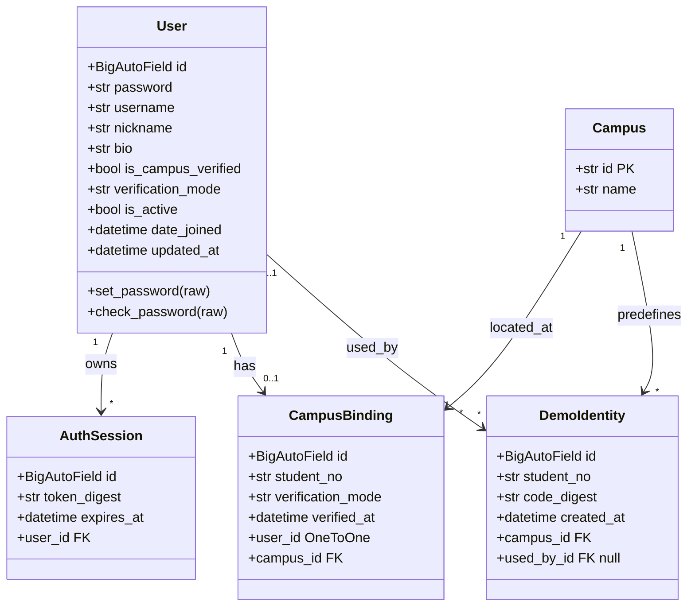

### 3.2 模型字段与约束（业务视角）

| 模型 | 字段 | 类型/长度 | 约束与说明 |
|---|---|---|---|
| `User` | `id` | BigAutoField | 主键；对外字符串 |
| | `username` | CharField(150, unique) | Django 框架列；业务层强制 4～32 位字母/数字/下划线并统一小写；注册后不可改 |
| | `password` | CharField(128) | Django 密码哈希；仅写不读 |
| | `nickname` | CharField(30) | 必填，1～30 字（去首尾空白后校验） |
| | `bio` | CharField(200, blank) | 默认空串，0～200 字 |
| | `is_campus_verified` | BooleanField | 默认 `false`；仅绑定服务与初始化命令写入 |
| | `verification_mode` | CharField(16, null) | 默认 `null`；演示绑定后为 `"demo"` |
| | `date_joined` | DateTimeField | 注册时间；接口 `created_at` 取自该列 |
| | `updated_at` | DateTimeField(auto_now) | 最近修改时间 |
| | 框架保留列 | `last_login`、`is_superuser`、`is_staff`、`is_active`、`first_name`、`last_name`、`email` | 由 `AbstractUser` 继承；A 的接口不使用、不返回；`is_active=false` 的账号不能登录 |
| `AuthSession` | `id` | BigAutoField | 会话主键 |
| | `user` | ForeignKey(User, CASCADE) | 一个用户可有多条（多端登录） |
| | `token_digest` | CharField(64, unique) | 令牌 SHA-256 十六进制摘要；唯一索引 |
| | `expires_at` | DateTimeField | 登录时刻 + 24 小时；无独立索引（依赖摘要唯一索引定位） |
| `CampusBinding` | `id` | BigAutoField | 绑定主键 |
| | `user` | OneToOneField(User, CASCADE) | 一用户最多一条；`related_name="campus_binding"` |
| | `campus` | ForeignKey(Campus, PROTECT) | 校区不可删除 |
| | `student_no` | CharField(20) | 6～20 位字母/数字（序列化器校验）；与 `campus` 联合唯一，仅服务端内部使用 |
| | `verification_mode` | CharField(16, default="demo") | 第一版固定 `demo` |
| | `verified_at` | DateTimeField(auto_now_add) | 绑定时间；模型默认按该列倒序 |
| `DemoIdentity` | `id` | BigAutoField | 演示身份主键 |
| | `campus` | ForeignKey(Campus, PROTECT) | 所属校区 |
| | `student_no` | CharField(20) | 与 `campus` 联合唯一 |
| | `code_digest` | CharField(64) | 一次性绑定码的 SHA-256 十六进制摘要；不存明文 |
| | `used_by` | ForeignKey(User, SET_NULL, null) | 使用者；非空即视为已使用；用户删除时置空保留审计 |
| | `created_at` | DateTimeField(auto_now_add) | 创建时间 |

### 3.3 响应结构定义

| 结构 | 字段与类型 | 可见范围 |
|---|---|---|
| `UserSelf` | `id:string`、`username:string`、`nickname:string`、`bio:string`、`is_campus_verified:bool`、`verification_mode:string/null`、`created_at:datetime`、`updated_at:datetime` | 仅本人（`/auth/register`、`/auth/login`、`/users/me`） |
| `UserSummary` | `id:string`、`nickname:string`、`is_campus_verified:bool`、`verification_mode:string/null` | 公开（B 的发布者、C 的申请人/发布者） |
| 绑定视图 | `campus_id:string`、`student_no_masked:string`、`verification_mode:string`、`verified_at:datetime` | 仅本人 |
| 登录结果 | `access_token:string`、`token_type:"Bearer"`、`expires_at:datetime`、`user:UserSelf` | 登录响应一次性返回 |

### 3.4 服务函数契约

| 函数 | 位置 | 输入 → 输出 | 异常 |
|---|---|---|---|
| `register_user(username, password, nickname)` | `users/services.py` | 校验后创建用户 → `User` | 账号重复 `BusinessError("DUPLICATE_RESOURCE", …, 409)` |
| `login_user(username, password)` | 同上 | 转小写认证 → `User` | 失败 `BusinessError("UNAUTHENTICATED", "账号或密码错误", 401)` |
| `issue_session(user)` | 同上 | 生成令牌与摘要、24 小时过期 → `(token, session)` | — |
| `revoke_session(session)` | 同上 | 删除会话 → `None` | — |
| `update_profile(user, data)` | 同上 | 逐字段赋值并保存 → `User` | 由序列化器提前校验 |
| `bind_campus(user, campus_id, student_no, binding_code)` | 同上 | 事务内完成绑定 → `CampusBinding` | 409/400，见 4.7 |
| `require_campus_verified(user)` | 同上 | 未认证抛 `BusinessError("IDENTITY_REQUIRED", …, 403)` | 403 |
| `user_summary(user)` / `get_user_summaries(user_ids)` | 同上 | 公开摘要 / `{id: summary}` 映射 | — |
| `current_user(user)` / `get_campus_binding(user)` / `get_campus(campus_id)` / `get_demo_identity(campus, student_no, lock)` | `users/selectors.py` | 读取查询；`lock=True` 时 `select_for_update()` | 用户不存在时 401 |

## 4. 接口详细规格

### 4.1 POST `/auth/register`

权限：匿名（`PublicAccess`）。请求：

```json
{ "username": "Alice_01", "password": "Passw0rd!", "nickname": " 小林 " }
```

成功 201：

```json
{
  "code": "OK",
  "message": "操作成功",
  "data": {
    "id": "12",
    "username": "alice_01",
    "nickname": "小林",
    "bio": "",
    "is_campus_verified": false,
    "verification_mode": null,
    "created_at": "2026-11-02T02:00:00.123456Z",
    "updated_at": "2026-11-02T02:00:00.123456Z"
  }
}
```

错误：

| HTTP | code | 触发 | errors 示例 |
|---|---|---|---|
| 400 | `VALIDATION_ERROR` | username 非 4～32 位字母/数字/下划线；password 非 8～64；nickname 非 1～30；未知/只读字段；非对象/重复参数 | `{"username": ["账号需为 4～32 位字母、数字或下划线"]}` |
| 409 | `DUPLICATE_RESOURCE` | 账号已存在（含仅大小写不同，因统一小写） | `{}` |

处理：`StrictSerializer` 白名单校验 → 长度/正则 → `username.lower()` → 昵称去空白 → 唯一性预检查 → `set_password` → 保存。**不签发令牌**。

### 4.2 POST `/auth/login`

权限：匿名。请求：

```json
{ "username": "alice_01", "password": "Passw0rd!" }
```

成功 200：

```json
{
  "code": "OK",
  "message": "操作成功",
  "data": {
    "access_token": "随机令牌明文（仅此一次返回）",
    "token_type": "Bearer",
    "expires_at": "2026-11-03T02:00:00.123456Z",
    "user": { "id": "12", "username": "alice_01", "nickname": "小林", "bio": "", "is_campus_verified": false, "verification_mode": null, "created_at": "2026-11-02T02:00:00.123456Z", "updated_at": "2026-11-02T02:00:00.123456Z" }
  }
}
```

> `message` 由统一响应封装 `common.responses.ok()` 固定返回“操作成功”，属于展示性文案，**不参与业务判断**；前端只依据 HTTP 状态码与 `code` 字段判定结果（共同契约 §2.3：不解析中文 `message` 判断业务结果）。

错误：

| HTTP | code | 触发 |
|---|---|---|
| 400 | `VALIDATION_ERROR` | 缺字段、非字符串、未知字段 |
| 401 | `UNAUTHENTICATED` | 账号不存在、密码错误、`is_active=false`；文案统一“账号或密码错误” |
| 429 | `RATE_LIMITED` | 同一 IP 1 分钟内第 11 次；响应头 `Retry-After: <秒>` |

处理顺序：先限流（`enforce_login_rate_limit`）→ 严格校验 → `authenticate`（账号转小写）→ 独立会话签发。

### 4.3 POST `/auth/logout`

权限：登录。请求：`{}`。

成功 200：`{ "code": "OK", "message": "操作成功", "data": null }`

错误：401 `UNAUTHENTICATED`（无令牌、格式错误、已撤销、已过期）。处理：`EmptyInput` 校验（拒绝多余字段）→ 删除 `request.auth` 对应 `AuthSession`。

### 4.4 GET `/users/me`

权限：登录。成功 200：`data` 为 `UserSelf`（见 4.1 示例的 data 部分），由 `selectors.current_user` 重新读取最新记录后序列化。错误：401。

### 4.5 PATCH `/users/me`

权限：登录。请求（至少一个字段）：

```json
{ "nickname": "小周", "bio": "软件工程 2024 级" }
```

成功 200：修改后的完整 `UserSelf`。错误：

| HTTP | code | 触发 |
|---|---|---|
| 400 | `VALIDATION_ERROR` | 空对象；`nickname` 非 1～30；`bio` 超 200；未知/只读字段（`username`、`is_campus_verified`、`verification_mode`、`password`、`password_hash`、`id` 等） |
| 401 | `UNAUTHENTICATED` | 未登录/令牌无效 |

处理：`UpdateProfileInput` 校验（`nickname` 1～30、`bio` ≤200 且允许空串；`validate` 拒绝空对象）→ `update_profile` 逐字段赋值保存 → `user_self` 输出。

### 4.6 GET `/users/me/campus-binding`

权限：登录。成功 200：

未绑定：

```json
{ "code": "OK", "message": "操作成功", "data": null }
```

已绑定：

```json
{
  "code": "OK",
  "message": "操作成功",
  "data": {
    "campus_id": "campus_main",
    "student_no_masked": "****0004",
    "verification_mode": "demo",
    "verified_at": "2026-11-02T03:00:00.123456Z"
  }
}
```

错误：401。处理：`get_campus_binding(user)`（`select_related("campus")`）→ 无记录返回 `null`。

### 4.7 POST `/users/me/campus-binding`

权限：登录且未绑定（视图权限为登录；已绑定由服务返回 409）。请求：

```json
{ "campus_id": "campus_main", "student_no": "20260004", "binding_code": "e2e-binding-0001" }
```

成功 201：

```json
{
  "code": "OK",
  "message": "操作成功",
  "data": {
    "campus_id": "campus_main",
    "student_no_masked": "****0004",
    "verification_mode": "demo",
    "verified_at": "2026-11-02T03:00:00.123456Z"
  }
}
```

错误与判定顺序（与 `views.py → serializers → services.bind_campus` 的实际调用顺序一致）：

| 顺序 | 条件 | HTTP | code | errors |
|---|---|---|---|---|
| 1 | 限流超限（第 6 次/分钟/用户，先于字段校验执行） | 429 | `RATE_LIMITED` | `{}`；`Retry-After` |
| 2 | 字段格式：`campus_id` 缺失/非字符串/超 64；`student_no` 非 6～20 位字母数字；`binding_code` 非 6～64；未知/只读字段 | 400 | `VALIDATION_ERROR` | 对应字段数组 |
| 3 | 当前用户已有绑定 | 409 | `DUPLICATE_RESOURCE` | `{}`（消息“已完成校园身份绑定”） |
| 4 | `campus_id` 不存在 | 400 | `VALIDATION_ERROR` | `{"campus_id": ["校区不存在"]}` |
| 5 | 身份存在但已被他人占用（`used_by` 非空） | 409 | `DUPLICATE_RESOURCE` | `{}`（消息“该校园身份已被绑定”） |
| 6 | 身份不存在，或绑定码摘要不匹配 | 400 | `VALIDATION_ERROR` | `{"binding_code": ["绑定码无效或已被使用"]}` |
| 7 | 并发写入触发数据库唯一约束 | 409 | `DUPLICATE_RESOURCE` | `{}` |

处理（事务内）：

1. 事务外或事务开始时检查本用户是否已绑定（409）。
2. 校验收校区存在（400，归 `campus_id`）。
3. 计算 `binding_code` 的 SHA-256 摘要。
4. 进入 `transaction.atomic()`：`select_for_update()` 锁定演示身份；身份 `used_by` 非空 → 409；身份为空或摘要 `hmac.compare_digest` 不匹配 → 400 归 `binding_code`。
5. 创建 `CampusBinding`（捕获 `IntegrityError` → 409）；置 `DemoIdentity.used_by=user`；置 `User.is_campus_verified=True`、`verification_mode="demo"`。
6. 提交事务；返回 `binding_view(binding)`（学号脱敏）。

### 4.8 认证与权限入口

| 入口 | 权限类 | 说明 |
|---|---|---|
| `POST /auth/register`、`POST /auth/login` | `PublicAccess`（`AllowAny`） | 匿名可访问；携带无效令牌仍由认证类返回 401 |
| `POST /auth/logout`、`GET/PATCH /users/me`、`GET/POST /users/me/campus-binding` | `LoginRequired`（`IsAuthenticated`） | 无有效令牌 401 |

`BearerAuthentication.authenticate`：拆分请求头 → 无头返回 `None`（匿名）→ 非两段或首段非 `bearer` 抛 `AuthenticationFailed("登录令牌格式错误")` → `sha256(token)` 查询 `token_digest` 且 `expires_at > now`、`user.is_active=True` → 返回 `(user, session)`；查不到抛 `AuthenticationFailed("令牌无效或已过期")`。`authenticate_header` 返回 `"Bearer"`，使 401 响应带 `WWW-Authenticate`。

> 共同契约 §7.3 建议 A 提供 `require_user(token)` 函数；本实现未新增同名函数，而是用 DRF 的 `BearerAuthentication`（解析并校验令牌，建立 `request.user`/`request.auth`）加 `IsAuthenticated` 权限类**等价提供**：缺失或无效令牌返回 401 `UNAUTHENTICATED`，通过后 B/C 直接从 `request.user`（及 `request.auth` 会话）使用身份。这样既保持“无效即 401”的契约行为，也避免在认证类之外再造一层令牌解析。

## 5. 校验矩阵

| 接口 | 字段 | 规则 | 错误归属 |
|---|---|---|---|
| register | `username` | 必填字符串；`^[A-Za-z0-9_]{4,32}$`；去空白后校验；存小写 | `username` |
| register | `password` | 必填字符串；8～64；不裁剪空白 | `password` |
| register | `nickname` | 必填字符串；去空白后 1～30 字 | `nickname` |
| register | 其他字段 | 未知/只读字段拒绝；重复参数拒绝；非对象拒绝 | 对应字段 / `non_field_errors` |
| login | `username` | 必填字符串；1～32；转小写后认证 | `username` |
| login | `password` | 必填字符串；1～64；不裁剪 | `password` |
| logout | — | 必须为空对象；传其他字段 400 | 对应字段 |
| me PATCH | `nickname` | 可选；去空白后 1～30 | `nickname` |
| me PATCH | `bio` | 可选；≤200；允许空串；去空白 | `bio` |
| me PATCH | 整体 | 至少一个字段，空对象 400 | `non_field_errors` |
| me PATCH | 其他字段 | 只读字段（`id/username/is_campus_verified/verification_mode/created_at/updated_at/password*`）一律拒绝 | 对应字段 |
| binding POST | `campus_id` | 必填字符串；不裁剪；≤64 | `campus_id` |
| binding POST | `student_no` | 必填字符串；`^[A-Za-z0-9]{6,20}$`；去空白 | `student_no` |
| binding POST | `binding_code` | 必填字符串；6～64；不裁剪（区分大小写与空格） | `binding_code` |
| binding POST | 整体 | 已绑定 409；校区不存在 400；身份占用 409；身份不存在/码不匹配 400 归 `binding_code` | 见 4.7 |
| 全部 | 请求体 | 必须是 JSON 对象；数组/字符串/null → 400 `non_field_errors` | `non_field_errors` |

## 6. 关键流程时序

### 6.1 注册

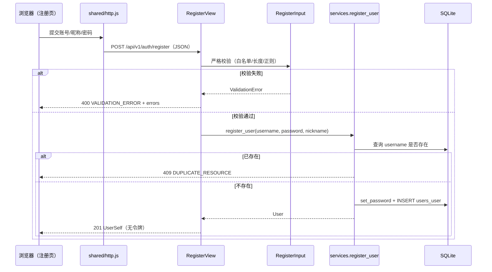

### 6.2 登录

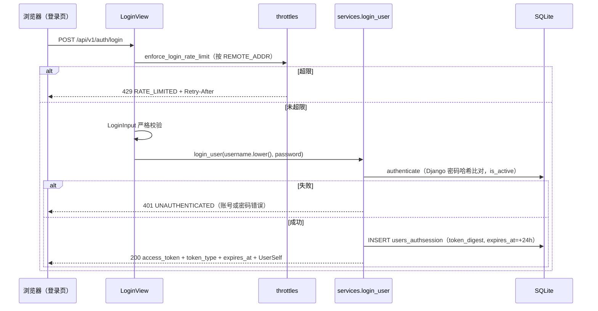

### 6.3 登出

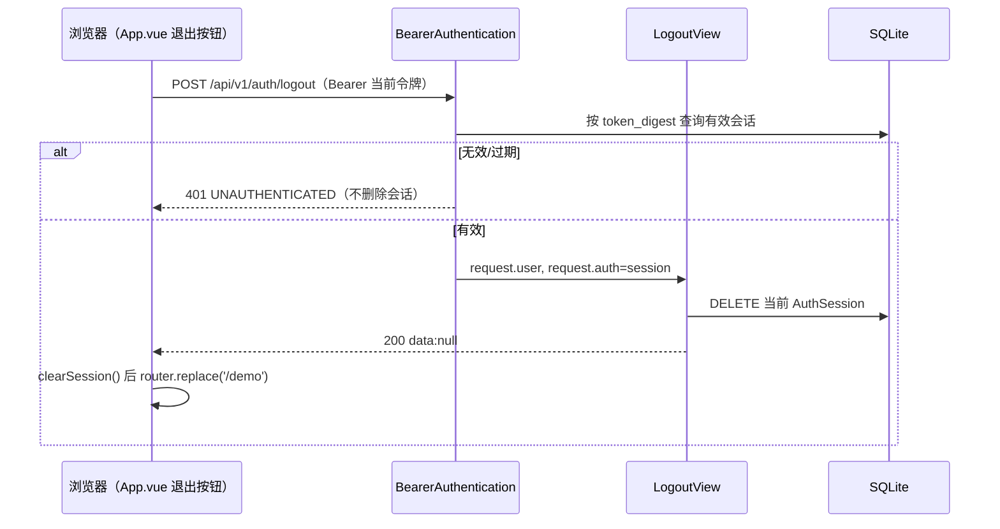

### 6.4 修改资料

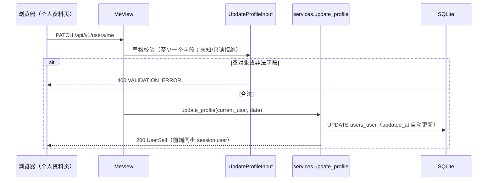

### 6.5 绑定成功

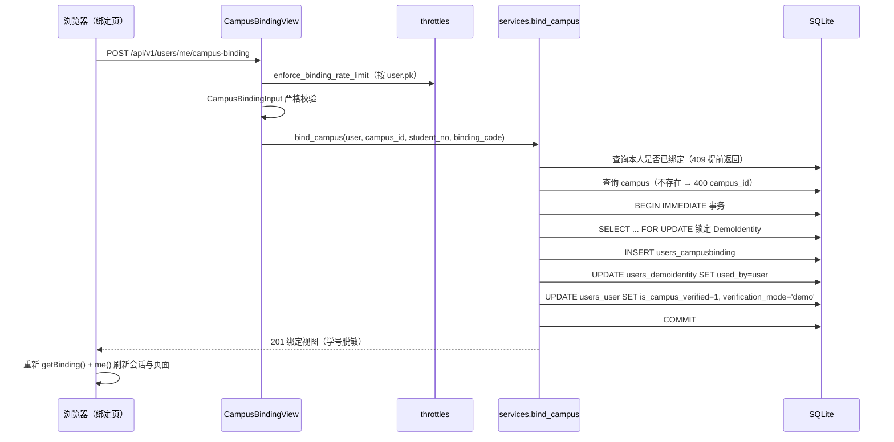

### 6.6 绑定失败

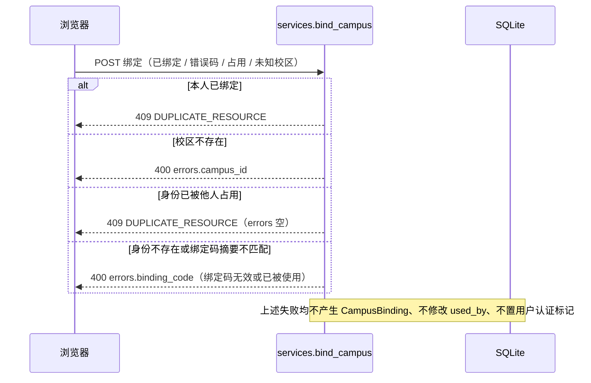

## 7. 会话与绑定状态

### 7.1 认证会话状态

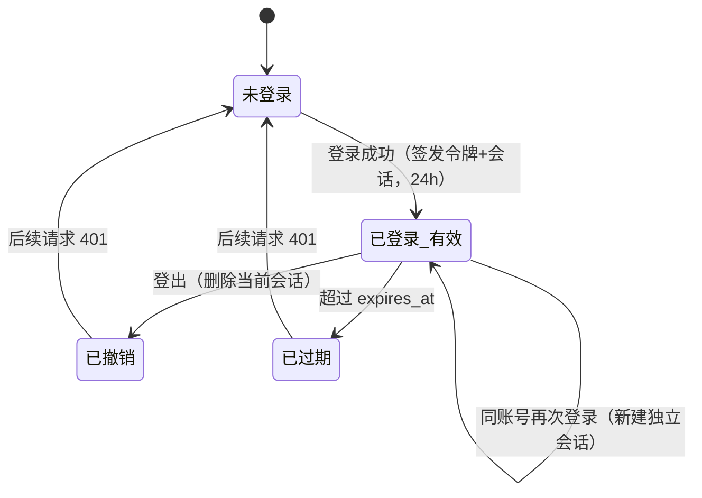

| 状态 | 判定依据 | 接口行为 |
|---|---|---|
| 未登录 | 无 `Authorization` 头 | 公开接口正常；受保护接口 401 |
| 已登录（有效） | 摘要命中且 `expires_at > now` 且用户 `is_active` | 受保护接口正常 |
| 已撤销 | 会话记录被登出删除 | 401 `UNAUTHENTICATED` |
| 已过期 | `expires_at <= now` | 401 `UNAUTHENTICATED` |

### 7.2 校园身份绑定状态

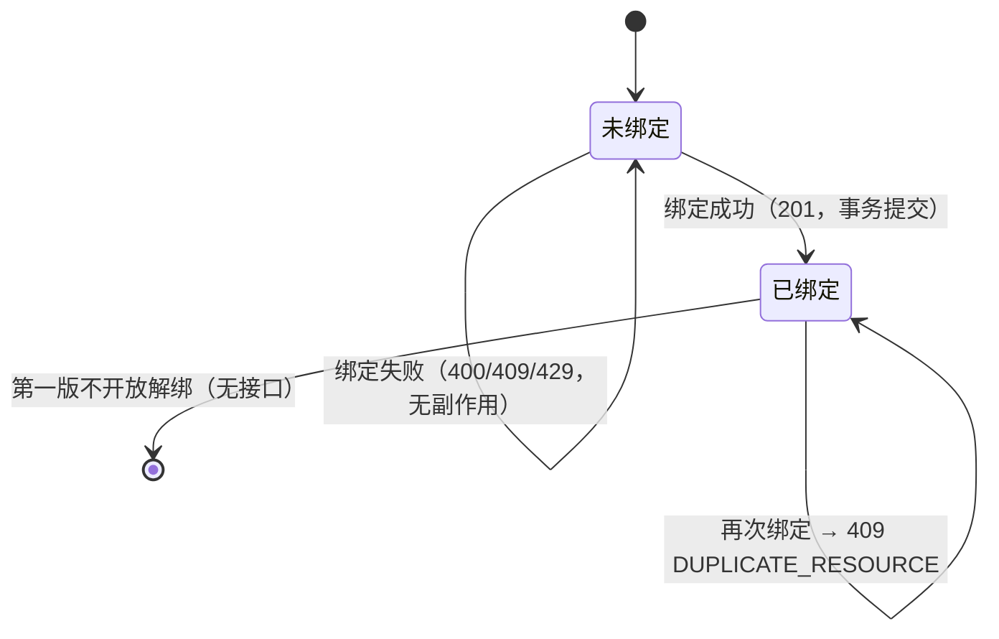

| 状态 | `CampusBinding` | `User.is_campus_verified` | `DemoIdentity.used_by` |
|---|---|---|---|
| 未绑定 | 不存在 | `false` | 未被当前用户占用 |
| 已绑定 | 一条 | `true` | 当前用户 |
| 绑定失败 | 不变 | 不变 | 不变（不消耗身份） |

## 8. 事务与并发设计

### 8.1 绑定事务步骤

| 步骤 | 操作 | 失败处理 |
|---|---|---|
| 1 | 查询本用户绑定是否存在 | 存在 → 409，无需事务 |
| 2 | 校验校区存在 | 不存在 → 400 `campus_id` |
| 3 | 计算绑定码摘要 | — |
| 4 | `transaction.atomic()` 开始；`select_for_update()` 读取身份 | 身份不存在/摘要不匹配 → 400 `binding_code` |
| 5 | 校验身份未被使用 | 已使用 → 409 `DUPLICATE_RESOURCE` |
| 6 | 创建 `CampusBinding` | `IntegrityError` → 409 |
| 7 | 置 `DemoIdentity.used_by` | 异常 → 事务回滚 |
| 8 | 置 `User.is_campus_verified/verification_mode` | 异常 → 事务回滚 |
| 9 | 提交 | 任一步异常整体回滚，用户状态与身份均不变 |

### 8.2 SQLite 说明

- 数据库配置 `OPTIONS={"timeout": 20, "transaction_mode": "IMMEDIATE"}`：事务开始即获取写锁，跨进程串行化写操作；因此并发绑定会串行执行，后到者读到已提交的 `used_by` 后返回 409。
- SQLite 不支持真正的行锁，`select_for_update()` 在本项目是“事务内锁定读取”的语义声明，最终唯一性由 `(campus, student_no)` 数据库唯一约束兜底。
- 并发测试使用线程 + 屏障 + 独立数据库连接访问同一测试库文件，避免“顺序调用冒充并发”。

### 8.3 并发失效模式与防线

| 失效模式 | 防线 |
|---|---|
| 两个用户同时绑定同一身份 | `IMMEDIATE` 事务串行 + 事务内读 `used_by` + 唯一约束；败者 409 |
| 同一用户并发提交两次绑定 | 事务内检查 + `CampusBinding.user` 一对一唯一；败者 409 |
| 注册同名账号并发 | `username` 唯一约束 + `IntegrityError` 转 409 |
| 认证标记与绑定记录不一致 | 同一事务提交；失败回滚 |

### 8.4 锁定顺序

绑定只涉及单个 `DemoIdentity`、单条 `CampusBinding`、单个 `User`，无跨表循环加锁；固定顺序为“先身份、后绑定、再用户”，与 C 的“先信息、后申请”锁顺序无关，不产生跨模块等待环。

## 9. 限流算法

### 9.1 固定窗口

```
window = RATE_LIMIT_WINDOW_SECONDS = 60
bucket = floor(now / window)
key = "rate-limit:{scope}:{identity}:{bucket}"
timeout = window + 1
# cache.add 原子创建窗口计数键；键已存在则 cache.incr 原子自增，避免 get+set 并发少计
if cache.add(key, 1, timeout=timeout):
    count = 1
else:
    try:
        count = cache.incr(key)
    except ValueError:
        # 键在 add 与 incr 之间过期/被清理：重新原子建键后再自增
        count = 1 if cache.add(key, 1, timeout=timeout) else cache.incr(key)
if count > limit: 429，Retry-After = max(1, int(window - now % window))
```

计数采用 `cache.add` + `cache.incr` 的**原子操作**：`add` 只在键不存在时创建并返回 `True`，`incr` 原子自增且不改变键的 TTL，因此并发请求不会像 `get`+`set` 那样互相覆盖而少计；窗口到期后计数键自动过期删除。`incr` 抛 `ValueError`（键已过期或被清理）时回退为重新 `add`，覆盖毫秒级竞态。

| 限流 | `scope` | `identity` | `limit` | 触发 |
|---|---|---|---|---|
| 登录 | `login-ip` | `REMOTE_ADDR` | 10 次/分钟 | 第 11 次 |
| 绑定 | `binding-user` | `request.user.pk` | 5 次/分钟 | 第 6 次 |

### 9.2 配置与开关

| 配置 | 默认 | 说明 |
|---|---|---|
| `RATE_LIMIT_ENABLED` | `(not TESTING) and DJANGO_RATE_LIMIT=="1"` | `manage.py test` 时自动关闭，避免跨用例累积；限流用例用 `override_settings(RATE_LIMIT_ENABLED=True)` 开启并清缓存 |
| `LOGIN_RATE_LIMIT` / `BINDING_RATE_LIMIT` | 10 / 5 | 窗口内上限 |
| `RATE_LIMIT_WINDOW_SECONDS` | 60 | 固定窗口长度 |
| `CACHES.default` | `LocMemCache` | 单进程内存计数；多实例部署不共享，属已知限制；e2e 环境显式 `DJANGO_RATE_LIMIT=0` |
| 响应 | 429 `RATE_LIMITED` | DRF `Throttled(wait=秒)` 生成 `Retry-After` 头 |

### 9.3 边界说明

- 计数在业务校验之前执行：即使请求字段非法，也会消耗一次额度（可防止借非法请求探测）。
- 固定窗口在窗口边界存在瞬时双倍流量可能（整分钟切换）；课程演示可接受，明确不做滑动窗口。
- 限流键基于 `REMOTE_ADDR`，反向代理后需取真实客户端 IP（部署范围外，文档声明）。

## 10. 脱敏算法

### 10.1 学号脱敏

```
mask_student_no(student_no):
    keep = student_no[-4:]
    return "*" * max(0, len(student_no) - 4) + keep
```

| 输入学号 | 输出 `student_no_masked` |
|---|---|
| `20260004` | `****0004` |
| `20260001` | `****0001` |
| `ABCD1234EFGH5678WXYZ`（20 位） | `****************WXYZ` |
| 少于 4 位（理论不可达，序列化器要求 6～20） | 原样保留 |

### 10.2 不得出现在响应中的内容

| 内容 | 位置 | 说明 |
|---|---|---|
| 密码明文/哈希 | 所有响应 | 仅数据库哈希列 |
| `token_digest` | 所有响应 | 仅服务端内部 |
| `student_no` 明文 | 绑定视图 | 只出 `student_no_masked` |
| `binding_code` | 所有响应 | 只在请求中出现；服务端只存摘要 |
| 完整学号 | 公开摘要/错误消息/日志 | 公开摘要无学号字段；日志不打印请求体敏感字段 |
| 堆栈/SQL/路径 | 500 响应 | `INTERNAL_ERROR` 统一文案 |

## 11. 后端分层与文件职责

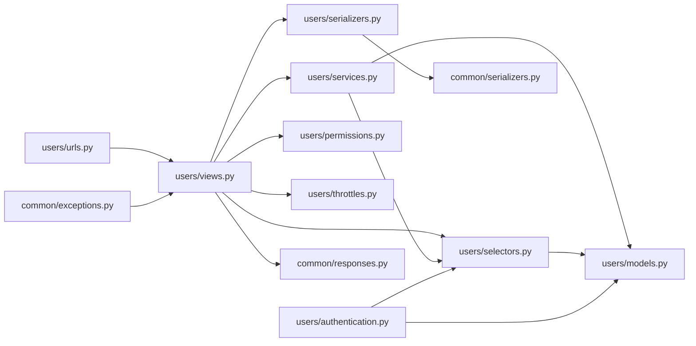

| 文件 | 职责 | 关键内容 |
|---|---|---|
| `users/urls.py` | 7 个路径注册（无结尾斜杠） | register/login/logout/me/campus-binding |
| `users/views.py` | HTTP 编排：权限、校验、调用服务、组织响应 | 5 个视图类；`ok()` 包装；限流入口 |
| `users/serializers.py` | 入参校验与出参映射 | `RegisterInput/LoginInput/UpdateProfileInput/CampusBindingInput`、`user_self`、`binding_view`、`mask_student_no` |
| `users/services.py` | 会改数据的业务与跨子系统能力 | 注册/登录/登出/改资料/绑定；`require_campus_verified`、`user_summary`、`get_user_summaries`、`issue_session` 保持签名 |
| `users/selectors.py` | 只读查询 | `current_user`、`get_campus_binding`、`get_campus`、`get_demo_identity` |
| `users/authentication.py` | Bearer 认证扩展点 | 摘要比对、过期与 `is_active` 检查、401 文案 |
| `users/permissions.py` | 权限类 | `PublicAccess`、`LoginRequired` |
| `users/throttles.py` | 固定窗口限流 | 登录按 IP、绑定按用户；429 + `Retry-After` |
| `users/models.py` | 4 个模型与约束 | `User/AuthSession/CampusBinding/DemoIdentity` |
| `users/migrations/0002_*.py` | 结构变更 | 两张新表与唯一约束；依赖 catalog.0001 |
| `users/management/commands/seed_demo_users.py` | 演示数据初始化 | 幂等、6 身份、补绑定、`--reset-codes`、`DEMO_BINDING_CODE` |
| `common/serializers.py` | 共享校验与时间格式 | `StrictSerializer`、`timestamp`、`IdField`、`validated`、`paginate`、`numeric_id` |
| `config/settings.py` | 配置 | `AUTH_USER_MODEL`、DRF 认证/异常处理器、限流开关、SQLite `IMMEDIATE`、缓存 |
| `config/urls.py` | 路由顺序 | `users → claims → demo(DEMO_MODE)`；404/500 处理器 |
| `demo/urls.py`、`demo/views.py` | 演示接口 | 移除登录/登出/本人资料，仅保留演示物品与撤回/恢复 |

## 12. 前端设计

### 12.1 组件与依赖

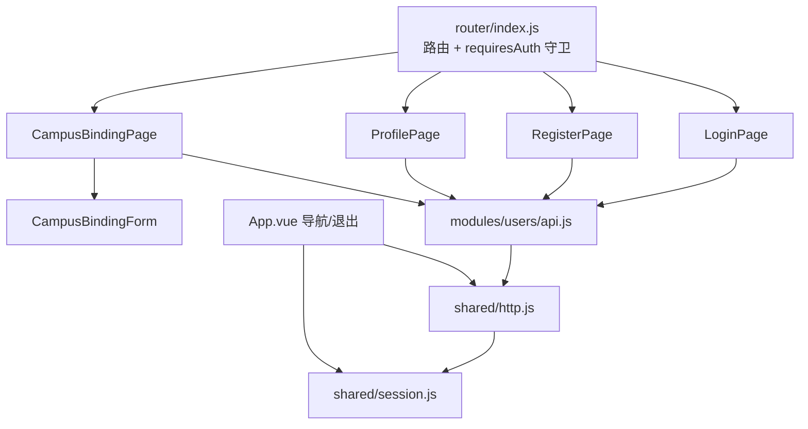

### 12.2 路由表

| 路径 | 组件 | `requiresAuth` | 行为 |
|---|---|---|---|
| `/login` | `LoginPage.vue` | 否 | 登录；支持 `?next=`、`?registered=1`、`?username=` |
| `/register` | `RegisterPage.vue` | 否 | 注册；成功后跳 `/login?registered=1&username=` |
| `/me/profile` | `ProfilePage.vue` | 是 | 进入即 `me()`，保存后同步 `session.user` |
| `/me/campus-binding` | `CampusBindingPage.vue` | 是 | 进入即 `getBinding()` + 校区列表；成功后重读并刷新会话 |
| `/` | 重定向 | — | 已登录 → `/demo`；未登录 → `/login` |
| `/demo` | `DemoPage.vue`（C） | 否 | 演示工作台（保持不变） |
| `/claims/**`、`/me/claims` | C 的页面 | C 决定 | 不修改 |

### 12.3 守卫与回跳

```
beforeEach(to):
  if to.meta.requiresAuth and not session.token:
      return { path: '/login', query: { next: to.fullPath } }
```

- 登录成功后 `safeNext(route.query.next) || '/demo'`；`safeNext` 仅接受以 `/` 开头且不以 `//` 开头的字符串，拒绝开放重定向。
- `App.vue` 监听 `session.token`：令牌丢失且当前路由需要登录时跳 `/demo?next=`（保持 C 的既有行为）；主动退出时先 `clearSession()` 再 `replace('/demo')`。
- 已登录用户访问 `/login` 不强制跳转（保留手动切换账号场景）。

### 12.4 页面行为要点

| 页面 | 加载 | 校验 | 错误展示 | 成功行为 |
|---|---|---|---|---|
| 登录 | 读 `?registered/username` 预填 | 账号/密码非空 | `errorText(err)` 顶部提示 | `setSession(data)` 后回跳 `next` |
| 注册 | — | 账号正则、昵称 1～30、密码 8～64、两次一致 | 字段错误在输入下；409 单独提示 | 跳 `/login?registered=1&username=`，不写会话 |
| 资料 | `me()` 并刷新 `session.user` | 昵称 1～30、简介 ≤200 | 字段错误/加载失败（可重试） | `updateMe` → 同步会话 → “资料已保存” |
| 绑定 | `Promise.allSettled([getBinding(), campuses()])` | 校区必选/必填、学号 6～20、绑定码 6～64 | 409 冲突提示；400 字段错误归位 | 重读 `getBinding()` + `me()`，显示“演示认证” |

校区降级：`/meta/campuses` 请求失败或返回空数组时 `campusFallback=true`，`CampusBindingForm` 渲染文本输入并默认 `campus_main`，同时显示“成员 B 字典接口尚未接入的已知限制”说明。

### 12.5 请求与错误处理

- `shared/http.js:request`：拼接 `/api/v1` 前缀与查询串；有令牌时加 `Authorization`；解析 JSON；`response.ok` 为假或 `code!=="OK"` 抛 `ApiError(message, status, code, errors)`。
- 401 仅在 `session.token` 与请求发出时一致时清会话，避免旧请求的 401 清掉新登录会话。
- `errorText(error)` 优先拼接 `errors` 字段消息，否则用 `message`；页面据此展示字段级错误。

## 13. 与 B/C 的集成契约

### 13.1 提供给 C 的函数（签名保持不变）

| 函数 | C 的调用点 | 行为 |
|---|---|---|
| `require_campus_verified(user)` | C 的认领创建等写入口 | 未认证抛 `BusinessError("IDENTITY_REQUIRED", "发起认领前请完成校园身份绑定（当前为演示认证）", 403)` |
| `user_summary(user)` | `ClaimView` 的 `applicant/publisher` | 固定四字段 |
| `get_user_summaries(user_ids)` | 列表批量摘要 | 返回 `{str(pk): summary}`，只含存在的用户 |
| `issue_session(user)` | 演示登录与正式登录 | 返回 `(token, session)`；C 的契约测试依赖 |
| `BearerAuthentication` | DRF 默认认证类 | 建立 `request.user/request.auth` |

### 13.2 与 C 的回归边界

- C 的 52 项后端测试与 21 项前端组件测试必须保持通过（NFR-A-05）。
- `demo/urls.py` 移除 `auth/login`、`auth/logout`、`users/me` 后，`config/urls.py` 中 `users.urls` 先注册，`resolve("/api/v1/auth/login")` 命中 `users.views.LoginView`（已有测试断言）。
- 公开 `PostSummary.publisher` 使用 `UserSummary`，不含账号/简介/学号。
- 前端 `App.vue` 保留演示工作台、我的认领、收到的申请与认证徽标；退出登录仍跳 `/demo`。

## 14. 代码清单与追踪矩阵

| 需求 | 设计章节 | 代码文件 | 测试文件/类 | 测试用例 | 结果 |
|---|---|---|---|---|---|
| FR-A-01 | 3、4.1、5、6.1 | `users/{serializers,services,views,urls}.py`、`common/serializers.py` | `users/tests/test_auth.py::RegisterTests` | TC-A-001～007 | 见测试报告 |
| FR-A-02 | 3、4.2、6.2、9 | `users/{services,views}.py`、`authentication.py`、`config/settings.py` | `test_auth.py::LoginTests` | TC-A-008～013 | 见测试报告 |
| FR-A-03 | 4.3、6.3、7.1 | `users/{services,views}.py`、`authentication.py` | `test_auth.py::LogoutTests` | TC-A-014～016 | 见测试报告 |
| FR-A-04 | 3.3、4.4、6.4 | `users/{selectors,serializers,views}.py` | `test_profile.py::ProfileViewTests` | TC-A-021、022 | 见测试报告 |
| FR-A-05 | 4.5、5、6.4 | `users/{serializers,services}.py` | `test_profile.py::ProfileUpdateTests` | TC-A-023～028 | 见测试报告 |
| FR-A-06 | 3.3、4.6、10 | `users/{selectors,serializers}.py` | `test_campus_binding.py::CampusBindingTests`、`tests/test_identity_integration.py` | TC-A-029、031、039 | 见测试报告 |
| FR-A-07 | 4.7、5、6.5/6.6、8 | `users/{services,serializers,views,models}.py`、`migrations/0002` | `test_campus_binding.py::CampusBindingTests`、`CampusBindingConcurrencyTests` | TC-A-030、032～038、049、050 | 见测试报告 |
| FR-A-08 | 4.8、6.2/6.3、7.1 | `users/authentication.py`、`config/settings.py` | `test_auth.py::BearerAuthTests`、`LogoutTests` | TC-A-008、014、017～020 | 见测试报告 |
| FR-A-09 | 3.4、4.8、13 | `users/services.py`、`permissions.py` | `tests/test_identity_integration.py::IdentityIntegrationTests` | TC-A-040～044、074、075 | 见测试报告 |
| FR-A-10 | 9 | `users/throttles.py`、`config/settings.py` | `test_auth.py::LoginRateLimitTests`、`test_campus_binding.py::BindingRateLimitTests` | TC-A-045～048 | 见测试报告 |
| FR-A-11 | 9、4.7 | `management/commands/seed_demo_users.py`、`scripts/{setup,verify,e2e_backend}` | `test_campus_binding.py::SeedDemoUsersTests` | TC-A-055～058 | 见测试报告 |
| FR-A-12 | 12 | `frontend/src/modules/users/**`、`router/index.js`、`App.vue` | `modules/users/tests/*.spec.js`、`tests/e2e/users.spec.js` | TC-A-059～071 | 见测试报告 |
| NFR-A-01 | 10、12.5 | `authentication.py`、`serializers.py`、`common/exceptions.py` | `test_auth.py`、`test_profile.py` | TC-A-030、051～054 | 见测试报告 |
| NFR-A-02 | 3.3、10.2、13 | `services.user_summary`、`serializers.binding_view` | `test_identity_integration.py` | TC-A-043、053、070 | 见测试报告 |
| NFR-A-03 | 8、6.5/6.6 | `services.bind_campus`、`models.py` | `CampusBindingConcurrencyTests` | TC-A-033、038、049、050 | 见测试报告 |
| NFR-A-04 | 11、5 | `backend/users/**`、`backend/common/**` | `test_auth.py`、`test_campus_binding.py` | TC-A-006、026、044、077 | 见测试报告 |
| NFR-A-05 | 13、12.3 | `config/urls.py`、`demo/*`、`services.py`、`App.vue` | `test_identity_integration.py`、C 的 `tests/*` | TC-A-072～076 | 见测试报告 |
| NFR-A-06 | 12.2～12.5 | 前端四个页面与组件 | 前端组件测试、`e2e/users.spec.js` | TC-A-059～071 | 见测试报告 |
| NFR-A-07 | 8.2、9.2 | `settings.py`（TEST/限流开关）、初始化命令、`scripts/verify.ps1` | 全量测试命令 | TC-A-055、072、078 | 见测试报告 |

测试规模：后端 `tests users.tests` 共 105 项（既有 52 项 + 用户管理新增 53 项，Lead 复核口径）；前端既有 21 项与用户模块新增组件测试、浏览器验收结果见 `docs/test/A-用户管理-测试报告.md`。

## 15. 已知限制与后续演进

| 限制 | 影响 | 后续方向 |
|---|---|---|
| 演示认证不是真实学校认证 | 不能用于真实身份核验 | 接入学校认证服务后扩展 `verification_mode` |
| `/meta/campuses` 未挂载（B 未提供） | 绑定页降级文本输入 | B 提供字典接口后删除降级分支 |
| 令牌仅内存保存 | 刷新需重新登录 | 引入刷新令牌需先改共同契约 |
| 限流 `LocMemCache` 单进程 | 多实例不共享计数 | 换 Redis 缓存后端 |
| SQLite 写事务串行 | 高并发写入受限 | 迁移 PostgreSQL 后重跑并发用例 |
| 无解绑/换绑、无密码找回 | 绑定后不可撤回 | 第二版按需求扩展，需管理员或审核 |
| 统一错误包装固定 | 特殊头部（如 `Retry-After`）依赖 DRF 异常行为 | 增加针对 429 头的回归断言 |

## 16. 变更记录

| 版本 | 日期 | 变更内容 | 变更人 | 影响 |
|---|---|---|---|---|
| v1.0 | 2026-11-02 | 首次编写详细设计；绑定“身份被他人占用”按 CR-A-08 定为 409 `DUPLICATE_RESOURCE`，400 仅保留身份不存在/绑定码不匹配；校验矩阵与追踪矩阵按定稿代码对齐 | 成员 A | SRS/测试用例/过程说明同步修正 |
