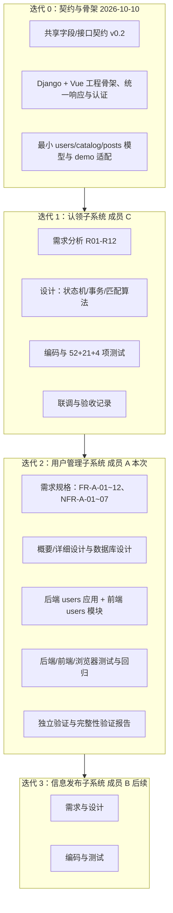

# 成员 A：用户管理子系统软件工程过程说明

| 项目 | 内容 |
|---|---|
| 文档名称 | 校园失物招领系统——成员 A 用户管理子系统软件工程过程说明 |
| 文档版本 | v1.2 |
| 编写日期 | 2026-11-02 |
| 作者 | 成员 A（用户管理） |
| 文档状态 | 过程记录与过程规范，供课程验收与实验报告引用 |
| 适用范围 | 用户管理子系统（注册登录、校园身份绑定、个人资料管理）的迭代过程；涉及三人协作接口的部分仅记录 A 的职责与对接方式 |
| 依据 | 课程《课程项目说明》、[共同字段与接口约定](../共同字段与接口约定.md)、[项目文件结构说明](../项目文件结构说明.md) |

## 1. 过程模型

### 1.1 选择与理由

项目采用**增量 + 迭代**的过程模型：先把全项目共享的契约与工程骨架作为第 0 次迭代固定下来，再按子系统增量交付；每个子系统内部按“需求分析 → 设计 → 编码 → 测试 → 验证”一轮迭代推进，下一轮在前面成果上修正与扩展。

选择理由：

1. 课程要求三人分工，各自独立完成至少两个功能模块，但系统只有一个后端、一个前端、一套数据库，必须先有共享契约才能并行；
2. 课程项目周期短、需求相对稳定，不适合一次性瀑布式的长周期文档冻结，也不适合无设计的敏捷试错；
3. 成员 C 的认领子系统先行落地并留下大量可复用的契约与验收数据，A/B 作为后续增量接入，需要明确的继承关系与回归门槛。

### 1.2 迭代划分与阶段产物

每次迭代的阶段与产物固定为五段，便于课程按阶段评价：

| 阶段 | 主要活动 | 产物 | 完成标志 |
|---|---|---|---|
| 需求分析 | 边界确认、角色与用例、需求编号、业务规则、验收标准 | 需求规格说明书、测试用例需求映射 | 需求评审通过、编号与契约一致 |
| 系统设计 | 架构与分层、数据模型、接口规格、校验矩阵、时序与状态、事务与并发 | 概要设计、详细设计、数据库设计 | 设计评审通过、可据此编码 |
| 编码 | 后端应用与前端模块实现、迁移、初始化命令 | 可运行代码、迁移文件、命令脚本 | 静态检查与自测通过 |
| 测试 | 单元、接口、集成与并发、前端组件、浏览器验收 | 测试计划、测试用例、自测记录 | 用例执行完毕、无 P0 缺陷 |
| 验证与交付 | 独立复核、回归、文档一致性检查、验收结论 | 测试报告、完整性验证报告 | 准出标准满足、Lead 统一提交 |

## 2. 角色与职责

### 2.1 团队角色

| 角色 | 承担者 | 职责 |
|---|---|---|
| 项目负责人（Lead） | 团队负责人 | 下发并维护需求与接口约定；划分写作用域；协调接口分歧；收尾统一提交、更新 README/验收文档与目录说明 |
| 成员 A（用户管理） | 本文作者 | 用户管理子系统需求、设计、编码、测试、文档；个人中心入口框架；为 B/C 提供身份能力 |
| 成员 B（信息发布） | 队友 | 信息发布与维护、列表详情浏览、搜索筛选；维护 `catalog` 校区/类别/地点字典 |
| 成员 C（失物认领） | 队友 | 认领流程、站内沟通、规则匹配；已先行交付并可回归的 `claims` 模块 |
| 验证角色 | 队友（独立于实现者） | 独立执行测试命令、逐条核对代码与真实行为、撰写测试报告与完整性验证报告 |
| 后端/前端实现角色 | 队友 | 分别落地 A 的后端接口与前端页面，遵守契约第 3、4 节写作用域 |

### 2.2 成员 A 的个人贡献边界

A 的个人贡献以“身份与账户基础层”为界，可独立说明如下：

| 类别 | A 负责（个人贡献） | A 不负责（协作/他人在先） |
|---|---|---|
| 需求 | 用户管理子系统全部需求（FR-A-01～12、NFR-A-01～07）、业务规则、验收标准 | B/C 的功能需求与认领规则、信息状态规则 |
| 设计 | 用户模型与会话/绑定设计、7 个接口规格、校验与限流、脱敏、前端四个页面与路由守卫 | 全库 ER 中 posts/claims 部分（合作确认）、B 的字典数据、C 的状态机 |
| 编码 | `backend/users/**`、`frontend/src/modules/users/**`、A 负责的初始化命令与演示路由迁移、公共骨架维护 | `backend/claims/**`、`backend/posts/**` 业务逻辑、`workflows/**` |
| 测试 | 用户模块后端/前端测试、浏览器验收用例与文档 | C 的 52 项既有测试维护（仅保证不破坏）、B 的发布与图片测试 |
| 文档 | 需求规格、概要/详细设计、数据库设计、测试计划与用例、过程说明、个人报告 | C 的联调与验收记录、B 的文档、Lead 的 README 与目录说明 |

个人贡献判定的证据：写作用域（契约第 3.6/4.1 节）、代码文件归属、文档作者与版本记录、Git 提交（由 Lead 统一收尾）。

### 2.3 A 与 B/C 的协作接口

| 接口 | A 提供 | 调用方 | 约束 |
|---|---|---|---|
| `require_campus_verified(user)` | 未认证抛 403 `IDENTITY_REQUIRED` | B、C | 签名与错误码保持稳定；C 已在适配阶段调用 |
| `user_summary(user)` / `get_user_summaries(user_ids)` | 公开摘要 `id/nickname/is_campus_verified/verification_mode` | B、C | 只含公开字段；不含账号、学号、简介 |
| `issue_session(user)` | 签发令牌与会话 | 登录流程 | 返回令牌明文与会话对象 |
| `require_user(token)` 语义 | Bearer 认证类建立 `request.user` | B、C 的所有受保护接口 | 无效令牌 401；公开接口携带无效令牌同样 401 |
| 校区字典 `/meta/campuses` | 由 B 提供 | A 的绑定页 | 接口不可用时前端降级为文本输入 |

跨模块原则：A 只提供函数与数据契约，不代替 B/C 校验其业务权限；B/C 也不能绕过 A 的身份认证直接信任客户端身份字段。

## 3. 阶段计划与实际执行

### 3.1 计划与执行对照

执行情况按“本轮迭代收尾时点（2026-11-02，实现与独立验证均已完成）”记录；验证结论以验证角色的测试报告与完整性验证报告为准，本文只记录阶段状态与产物。

| 阶段 | 计划内容 | 计划时间 | 实际状态（收尾时点） | 产物 |
|---|---|---|---|---|
| 契约与骨架 | 冻结共享字段、响应格式、认证与错误码 | 2026-10-10 前 | 已完成（共同契约 v0.2，C 已按此实现） | [共同字段与接口约定](../共同字段与接口约定.md) |
| A 需求分析 | 需求编号、用例、业务规则、验收标准 | 2026-11-02 | 已完成 | 本需求规格、测试用例与计划 |
| A 需求评审 | 与 Lead/B/C 对齐编号与接口语义 | 2026-11-02 | 已完成（评审记录见第 4 节） | 契约 v1.0 第 2 节为硬约束 |
| A 系统设计 | 概要设计、详细设计、数据库设计 | 2026-11-02 | 已完成（概要/详细/数据库设计 v1.0；详细设计按 verifier 偏差修正为 v1.1） | 设计文档三份 |
| A 编码 | 后端 users 应用、前端 users 模块、初始化命令、路由迁移 | 2026-11-02 | 后端已完成并定稿（7 接口、模型/迁移、初始化命令）；前端模块已完成 | 代码、迁移、命令 |
| A 自测 | 后端 API 测试、前端组件测试、浏览器验收 | 2026-11-02 | 后端 `tests users.tests` 105 项、前端 47 项、浏览器 5 项全部通过（验证角色独立复核记录见测试报告） | 测试文件与执行记录 |
| 回归与验证 | 全量回归、独立复核、测试报告与验证报告 | 实现完成后 | 已完成（验证角色出具测试报告与完整性验证报告；无未关闭缺陷） | 测试报告、完整性验证报告 |
| 文档偏差修正 | 按 verifier 实测修正文档（DV-A-01～05） | 2026-11-02 | 已完成（详细设计 v1.1、测试计划 v1.1、测试用例 v1.2、过程说明 v1.2、报告环境段） | CR-A-09 |
| 收尾提交 | README、目录说明、联调验收追加、Git 提交 | 验收后 | 待 Lead 统一执行（不在本文档写作用域内） | 最终仓库状态 |

### 3.2 本轮迭代的里程碑

| 里程碑 | 判定条件 | 状态 |
|---|---|---|
| M1 需求基线 | 需求规格与测试用例完成，编号与契约第 2 节一致 | 已完成 |
| M2 设计基线 | 概要/详细/数据库设计完成并通过设计检查单 | 已完成（详细设计 v1.1） |
| M3 功能完成 | 7 个接口与 4 个页面按契约可用，初始化命令可执行 | 已完成 |
| M4 测试完成 | 78 条用例执行，P0 全通过，回归门禁通过 | 已完成（验证角色：后端 105、前端 47、浏览器 5、独立脚本 34 项；见测试报告） |
| M5 验收完成 | 测试报告与完整性验证报告给出准出结论 | 已完成（判定可交付，B 未实现接口按“不可执行”标注） |

## 4. 需求评审记录

### 4.1 评审组织方式

| 项目 | 内容 |
|---|---|
| 评审形式 | 依据需求规格、设计文档与接口共同约定的书面评审 + 文档交叉检查；接口相关分歧由项目负责人裁定并写回需求/设计文档 |
| 评审材料 | 需求规格 v1.1、共同字段与接口约定 v0.2、测试用例 v1.2、C 的实现与验收记录 |
| 评审人 | Lead（契约与边界裁定）、成员 A（需求与设计自检）、验证角色（独立复核需求可测性）、B/C（身份与公开摘要接口确认） |
| 记录位置 | 本节与需求规格、设计文档的对应条款；评审结论进入需求规格版本记录 |
| 判定标准 | 需求可测、编号唯一、接口语义与共同契约一致、与 B/C 边界无重叠 |

### 4.2 评审问题与结论

| 编号 | 评审问题 | 结论 | 落点 |
|---|---|---|---|
| RV-01 | 登录失败是否区分“账号不存在/密码错误/账号禁用” | 不区分，统一 401 与“账号或密码错误”，避免账号枚举 | BR-A-04、FR-A-02；契约 §3.3 |
| RV-02 | 注册成功后是否自动登录 | 不自动登录、不返回令牌；前端跳转登录页并提示注册成功 | FR-A-01、FR-A-12；契约 §3.2、§4.2 |
| RV-03 | 校园身份能否由客户端提交认证结果 | 不能；只接受预置校区+学号+一次性绑定码匹配且未使用的身份 | BR-A-07、FR-A-07；契约 §3.3 |
| RV-04 | 令牌如何保存与失效 | 服务端只存 SHA-256 摘要，24 小时有效，登出即撤销；前端内存保存 | FR-A-08、BR-A-03、BR-A-15；契约 §3.2、共同契约 §2.2 |
| RV-05 | 学号是否返回给本人 | 绑定视图只返回脱敏学号（保留末 4 位） | BR-A-10、FR-A-06；共同契约 §3.3 |
| RV-06 | 限流是否影响既有 52 项回归 | 限流可配置，测试默认关闭；限流用例用 `override_settings` 单独开启并清缓存 | FR-A-10、NFR-A-07；契约 §3.3 |
| RV-07 | 演示登录/登出/本人资料与正式路由是否重复 | 移除 `demo` 中三条入口，由 `users` 正式路由接管；demo 保留演示专用接口 | FR-A-09、NFR-A-05；契约 §3.4 |
| RV-08 | 时间格式如何保证 B/C 一致 | 将 `timestamp` 序列化函数放入 `common/serializers.py`，users 与 posts 共用 | FR-A-04；契约 §3.2 |
| RV-09 | 退出登录后跳转哪里 | 保持跳转 `/demo`，不改为 `/login`，避免破坏 C 的 Playwright 用例 | FR-A-12；契约 §4.3 |
| RV-10 | 校区字典接口不可用时绑定页如何处理 | 降级为文本输入（默认 `campus_main`）并显示已知限制说明 | FR-A-12、NFR-A-06；契约 §4.2 |
| RV-11 | 绑定并发如何保证只成功一次 | 事务内锁定演示身份 + 数据库唯一约束兜底；并发用例验证 | NFR-A-03、FR-A-07；契约 §3.3 |
| RV-12 | 需求与测试编号如何统一 | 以契约第 2 节为唯一编号源：FR-A-01～12、NFR-A-01～07、TC-A-001 起连续编号 | 需求规格第 6/7 节、测试用例第 3 节 |

### 4.3 评审结论

需求基线（v1.0）通过评审，可作为设计与测试输入。评审未发现与共同契约冲突的需求项；如后续实现中确需偏离契约，按第 9 节变更控制处理，不静默改语义。

## 5. 设计与代码评审检查单

### 5.1 设计评审检查单

| 序号 | 检查项 | 判定依据 |
|---|---|---|
| D-01 | 需求是否都有设计与代码落点（追踪矩阵完整） | 需求规格附录 A |
| D-02 | 分层是否符合 `views/serializers/services/selectors/permissions/throttles` 约定 | 契约 §3.6、项目文件结构说明第 2 节 |
| D-03 | 接口路径、方法、权限与共同契约第 4 节一致，不带结尾斜杠 | 共同契约 §4、契约 §3.2 |
| D-04 | 响应包装与错误码使用统一实现，不重复造格式 | `common/responses.py`、`common/exceptions.py` |
| D-05 | 数据模型约束齐备：一用户一绑定、校区+学号唯一、令牌摘要唯一、外键保护删除 | 契约 §3.1 |
| D-06 | 事务边界正确：绑定与认证标记同事务，失败整体回滚 | NFR-A-03 |
| D-07 | 敏感数据设计：不返回密码/哈希/学号明文/绑定码 | NFR-A-01、BR-A-10 |
| D-08 | 与 B/C 的协作接口签名与语义保持稳定 | 第 2.3 节协作接口表 |
| D-09 | 前端路由、守卫与导航行为不破坏 C 的既有页面 | 契约 §4.3 |
| D-10 | 设计文档含架构、ER、时序、状态、校验矩阵等要求章节 | 契约 §5 文档清单 |

### 5.2 代码评审检查单

| 序号 | 检查项 | 判定依据 |
|---|---|---|
| C-01 | 所有输入经严格序列化器校验，未知/只读字段 400 | 契约 §3.3、NFR-A-04 |
| C-02 | 账号统一小写；密码不裁剪、不打印、不写日志 | BR-A-01、BR-A-02 |
| C-03 | 令牌仅存摘要，登出只删除当前会话，过期与撤销均 401 | BR-A-03、BR-A-05 |
| C-04 | 登录失败文案统一，不泄露账号是否存在或是否禁用 | BR-A-04 |
| C-05 | 绑定校验顺序正确：已绑定 409 → 字段格式 → 身份与码 → 事务写入 | FR-A-07 |
| C-06 | 绑定失败不改变用户标记、不消耗演示身份（回滚验证） | NFR-A-03 |
| C-07 | 限流键为 IP/用户 ID，超限 429 且带 `Retry-After` | FR-A-10 |
| C-08 | 初始化命令幂等；非演示模式拒绝执行；不泄露已使用身份的码 | FR-A-11 |
| C-09 | 前端不在页面拼接口路径，统一走 `modules/users/api.js` 与 `shared/http.js` | 项目文件结构说明 §4.1 |
| C-10 | 前端使用文本插值渲染用户输入，不使用 `v-html`；提交期间禁用按钮 | NFR-A-06 |
| C-11 | 未引入对 `claims/**`、`posts/**` 业务逻辑的修改；demo 仅移除被接管的路由 | 契约 §3.6、NFR-A-05 |
| C-12 | 迁移文件由模型生成，不改动 `0001`，`makemigrations --check` 无变化 | 契约 §3.1 |

### 5.3 评审方式与记录

- 设计与代码评审采用“检查单逐项勾选 + 关键路径走查”的方式，走查路径：注册 → 登录 → 绑定 → 改资料 → 登出 → 旧令牌失效 → 未认证访问 C 接口 403。
- 验证角色执行独立复核，不复用实现者结论；复核发现的问题按严重度登记，修复后回归对应用例。
- 评审记录随测试报告与验证报告归档；本文档只固定检查单与组织方式，不预填未执行的评审结论。

## 6. 配置管理与版本记录

### 6.1 版本控制

| 项目 | 约定 |
|---|---|
| 仓库 | 单一 Git 仓库，前后端同仓；当前迭代在特性分支 `feat/member-a-user-management` 上进行，由 Lead 收尾合并并统一提交 |
| 提交粒度 | 按“后端/前端/测试/文档”分主题提交；不提交内部协作草稿、`.venv/`、`node_modules/`、`dist/`、数据库文件、日志 |
| 提交信息 | 说明改动范围与需求编号（如 `FR-A-07`），便于追踪 |
| 分支纪律 | 成员在各自写作用域内修改；公共文件（`config/settings.py`、`common/serializers.py`、`shared/http.js`、路由与 `App.vue`）由指定负责人修改，改动前在协作文件说明 |
| 禁止操作 | 不执行 `git commit/push`（由 Lead 统一执行）；不修改他人模块业务逻辑；不改已有迁移 `0001` |
| 数据库 | 迁移文件进仓库；`db.sqlite3`、`e2e.sqlite3` 不入库；测试使用独立库 |

### 6.2 文档版本

| 文档 | 版本 | 状态 |
|---|---|---|
| 需求规格说明书 | v1.1 | 已完成（CR-A-08 对齐 409） |
| 测试计划 | v1.1 | 已完成（DV-A-03/05 修正） |
| 测试用例 | v1.2（78 条） | 已完成（TC-A-033/049 对齐 409；TC-A-020/041/075 标注 B 依赖） |
| 软件工程过程说明（本文） | v1.2 | 已完成（登记 verifier 文档偏差修正） |
| 概要设计 | v1.0 | 已完成（按后端定稿快照） |
| 详细设计 | v1.1 | 已完成（DV-A-01/02/04 修正） |
| 数据库设计 | v1.0 | 已完成 |
| 测试报告 / 完整性验证报告 | 已完成 | 验证角色产出（`docs/test/`、`docs/verify/`） |
| 个人课程报告 | 已完成 | `docs/reports/A-用户管理.md` |

版本规则：需求或接口语义变化时必须更新对应文档版本并记录变更；文档中的需求编号冻结，不改号、不复用。

### 6.3 环境与依赖配置

- 后端解释器固定为项目内 `.venv`；依赖版本以 `requirements.txt` 为准，团队不各选版本。
- 前端依赖以 `package.json` 与锁文件为准。
- 环境变量示例写入 `backend/.env.example`（`DJANGO_DEBUG`、`DJANGO_DEMO_MODE`、`DJANGO_DB_PATH`、`DJANGO_RATE_LIMIT`、`DEMO_BINDING_CODE` 等，不含真实值）。
- 演示数据初始化通过 `scripts/setup.ps1` 与 `seed_demo_users` 命令完成，保证新环境可复现。
- pip 安装使用清华镜像（网络受限环境的既定方案）。

## 7. 质量保证活动

| 活动 | 频次/时机 | 责任人 | 输出 |
|---|---|---|---|
| 需求评审 | 需求基线完成时 | A + Lead + 验证角色 | 评审结论、需求规格 v1.0（v1.1 为 CR-A-08 修订） |
| 设计评审 | 设计文档完成后 | A + Lead | 设计检查单结果 |
| 代码评审 | 编码完成、提交前 | 实现者自查 + Lead/验证角色抽查 | 代码检查单结果 |
| 静态检查 | 每次后端改动后 | 实现者 | `manage.py check`、迁移一致性 |
| 自动化测试 | 编码阶段随功能补充，交付前全量 | 实现者与验证角色 | 后端 105 项、前端基线 21 项 + 新增用例执行记录 |
| 浏览器验收 | 前后端联通后 | 前端实现者与验证角色 | Playwright 记录、截图 |
| 回归门禁 | 交付前 | 验证角色 | 全量命令结果 |
| 文档一致性检查 | 验证阶段 | 验证角色 | 文档与实现差异清单 |
| 缺陷跟踪 | 全周期 | 执行人登记、Lead 汇总 | 缺陷记录与复验结论 |

质量门禁（与测试计划准出标准一致）：`manage.py check` 0 issues；`makemigrations --check --dry-run` 无变化；后端 `tests users.tests` 共 105 项全通过（既有 52 项不回归）；前端 `npm test` 全通过（既有 21 项不回归）；`npm run build` 成功；P0 用例全部通过；响应中无敏感数据泄露。

## 8. 度量

| 度量项 | 目标/口径 | 当前值（编写时） |
|---|---|---|
| 功能需求数 | 契约第 2 节固定清单 | 12（FR-A-01～12） |
| 非功能需求数 | 契约第 2 节固定清单 | 7（NFR-A-01～07） |
| 业务规则数 | 需求规格第 5 节 | 15（BR-A-01～15） |
| 用例规约数 | 需求规格第 4.3 节 | 9（UC-A-01～09） |
| 对外接口数 | 契约 §3.2 | 7（方法+路径组合） |
| 测试用例数 | 测试用例文档 | 78（P0 30 条、P1 48 条；13 个用例组） |
| 需求覆盖率 | 有对应用例的需求比例 | 19/19 = 100%（FR 12/12、NFR 7/7；验证角色报告覆盖分析确认） |
| 测试通过率 | 执行通过数 / 用例总数 | 后端 105/105、前端 47/47、浏览器 5/5、独立验收脚本 34/34；P0/P1 无未通过项（测试报告 §8/§10，B 未实现接口按“不可执行”标注） |
| 回归基线 | C 的既有测试 | 后端 52 项、前端 21 项（全部通过，未回归） |
| 代码规模（收尾快照） | `backend/users/**` 与 `frontend/src/modules/users/**` 实测行数 | 后端生产代码约 600 行 Python（含 2 个迁移与初始化命令）、新增测试约 730 行（`users/tests` 646 + 身份集成 80）；前端约 1000 行（源码约 534、组件测试约 473） |
| 缺陷密度 | 缺陷数 / 千行代码 | 3 项缺陷均已修复关闭（D-A-01～03，见测试报告 §6），无未关闭缺陷 |
| 文档数 | 课程要求交付 | 8 份（需求 1、设计 3、测试计划/用例 2、过程 1、个人报告 1） |

说明：度量值为本轮迭代收尾时点的统计快照，测试与覆盖率口径以验证角色测试报告为准；后续 B 接入或需求变更后需重新统计。

## 9. 风险管理

| 编号 | 风险 | 影响 | 概率 | 应对措施 | 责任 |
|---|---|---|---|---|---|
| R-A-01 | 演示认证被误解为真实学校认证 | 验收表述不实、用户信任受损 | 中 | 页面固定“演示认证”文案与说明；文档声明边界；验收用例检查文案 | A |
| R-A-02 | SQLite 并发能力有限，绑定/注册并发语义依赖实现 | 并发下可能出现锁等待或双重成功 | 中 | `IMMEDIATE` 写事务；事务内锁定身份；数据库唯一约束兜底；并发测试用独立连接；不承诺生产规模 | A |
| R-A-03 | 依赖 B 的校区字典与 `/meta/campuses` 接口 | 绑定页校区列表不可用，流程受阻 | 高 | 字典数据由初始化命令保证 `campus_main` 存在；前端降级为文本输入并提示限制 | A + B |
| R-A-04 | 依赖 C 的既有 52+21 项测试与接口行为 | 迁移演示路由或改认证后回归失败 | 中 | 保持 `require_campus_verified`/`UserSummary`/会话接口签名；只移除 demo 三条路由；交付前跑全量回归 | A + C |
| R-A-05 | 限流开关影响全量测试 | 既有测试被 429 干扰，误判回归失败 | 中 | 限流默认关闭，仅限流用例开启并清缓存；配置项集中在 settings | A |
| R-A-06 | 网络受限、依赖安装失败 | 环境无法搭建，测试无法执行 | 中 | 使用项目内已装依赖与清华镜像；记录版本基线；脚本化初始化 | A + Lead |
| R-A-07 | 写作用域重叠导致文件冲突 | 覆盖他人改动、回归失败 | 中 | 遵守事先约定的写作用域；公共文件改动前先沟通并记录；项目负责人最终审阅 diff | 全体 |
| R-A-08 | 文档与实现不一致 | 课程验收扣分、追踪矩阵失真 | 中 | 需求编号冻结；验证阶段做文档一致性检查；实现偏离时走变更控制 | A + 验证角色 |
| R-A-09 | 时间进度风险（编码与文档并行） | 设计文档与验证报告延迟 | 中 | 需求与用例先完成，设计待模型定稿立即补充；验证角色提前准备复核脚本 | Lead + A |

## 10. 变更控制记录

| 编号 | 变更内容 | 原因 | 影响范围 | 决策与落点 | 日期 |
|---|---|---|---|---|---|
| CR-A-01 | 统一需求编号为 FR-A/NFR-A/UC-A/TC-A 体系 | 三人协作需要可追踪的编号源 | 需求、设计、测试、报告 | 契约第 2 节冻结编号；本需求规格与测试用例采用 | 2026-11-02 |
| CR-A-02 | 限流默认关闭，仅在测试中按需开启 | 避免限流干扰既有 52 项回归 | 认证与绑定接口、测试 | `RATE_LIMIT_ENABLED` 可配置；限流用例 `override_settings` | 2026-11-02 |
| CR-A-03 | 移除 `demo` 中登录/登出/本人资料三条路由 | 正式路由接管，避免路径与方法重复 | 后端 URL、演示前端 | 契约 §3.4；`users/urls.py` 提供正式入口 | 2026-11-02 |
| CR-A-04 | `timestamp` 序列化函数下沉到 `common/serializers.py` | users 与 posts 共用时间格式，避免复制 | 公共模块、posts、users | 契约 §3.2 | 2026-11-02 |
| CR-A-05 | 绑定采用事务内锁定身份 + 唯一约束兜底 | SQLite 行锁语义受限，需保证并发唯一 | 绑定服务、模型约束、并发测试 | 契约 §3.3、NFR-A-03 | 2026-11-02 |
| CR-A-06 | 绑定页校区列表降级方案 | B 的字典接口尚未提供或可能失败 | 前端绑定页、测试用例 | 契约 §4.2；TC-A-065 | 2026-11-02 |
| CR-A-07 | 注册重复统一稳定返回 409 | 并发与已存在场景需要一致响应 | 注册接口、错误码 | 契约 §3.3；TC-A-002、007 | 2026-11-02 |
| CR-A-08 | 绑定“校园身份已被他人占用”由 400 改为 409 `DUPLICATE_RESOURCE`；400 仅保留“身份不存在/绑定码摘要不匹配”并归 `binding_code` | 后端复核发现与共同契约 §4“同一校园身份被重复绑定返回 409”不一致；Lead 裁定对齐契约 | 影响 SRS（UC-A-07、FR-A-07、接口摘要、AC-A-06）、测试用例（TC-A-033、TC-A-049）、后端 `users/services.py` 与 `test_campus_binding.py`、概要/详细设计接口规格；不涉表结构 | 契约 §4 与 §3.3；SRS v1.1、测试用例 v1.1、详细设计 v1.1；绑定服务先判占用再判码 | 2026-11-02 |
| CR-A-09 | 按 verifier 独立验证发现的 5 项文档偏差修正文档（仅文档）：DV-A-01 登录响应示例 `message` 改为“操作成功”并注明不参与业务判断；DV-A-02 限流伪代码改为 `cache.add`+`cache.incr` 原子计数；DV-A-03 测试计划环境版本按实测更新（Python 3.12.14 / Node 24.16.0 / npm 11.13.0 / Playwright 1.64.0）；DV-A-04 补充 `require_user(token)` 由 `BearerAuthentication`+`IsAuthenticated` 等价提供；DV-A-05 标注 TC-A-020/041/075 对 B 未实现接口的依赖与 A 侧替代验证 | 验证角色实测发现文档与实现/环境不一致，不影响功能与交付判定 | 详细设计 v1.1、测试计划 v1.1、测试用例 v1.2、过程说明 v1.2、个人报告环境段；不涉代码与表结构 | 详细设计 §4.2/§4.8/§9.1、测试计划 §2.2/§3.1、测试用例 TC-A-020/041/075；verifier 测试报告 §7 登记 DV 编号 | 2026-11-02 |

变更流程：提出变更 → 评估对需求编号/接口/测试的影响 → 若涉及共享字段或跨子系统接口，先更新共同契约并通知 B/C → Lead 确认后实施 → 更新相关文档版本与追踪矩阵 → 回归受影响用例。未走流程的偏离视为缺陷。

## 11. 过程小结

本轮迭代按“契约先行、需求冻结、分层实现、测试前置、独立验证”的方式组织：先用共同的字段与接口契约固定三人边界，再用可追踪的需求编号把需求、设计、代码与 78 条测试用例串起来，最后通过验证角色的独立复核保证结论可信。交付基线为需求规格（v1.1）、测试计划（v1.1）、测试用例（v1.2）、概要设计（v1.0）、详细设计（v1.1）、数据库设计（v1.0）、过程说明（v1.2）与个人报告；后端 `tests users.tests` 105 项、前端 47 项、浏览器 5 项全部通过，验证角色独立脚本 34 项通过并判定 A 模块可交付。验证发现的 3 项缺陷已修复（绑定占用错误码、初始化命令打印顺序、前端退出跳转），5 项文档偏差已按 CR-A-09 关闭。已知的过程不足是编码与文档并行推进、设计文档产出滞后于需求，后续通过“模型定稿即补设计、验证前完成文档一致性检查”来控制；B 的发布接口与 `/meta/campuses` 未接入，相关用例待 B 完成后补做联调。
