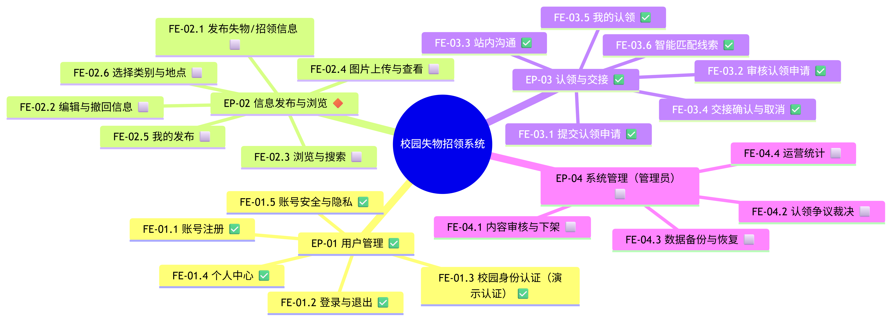
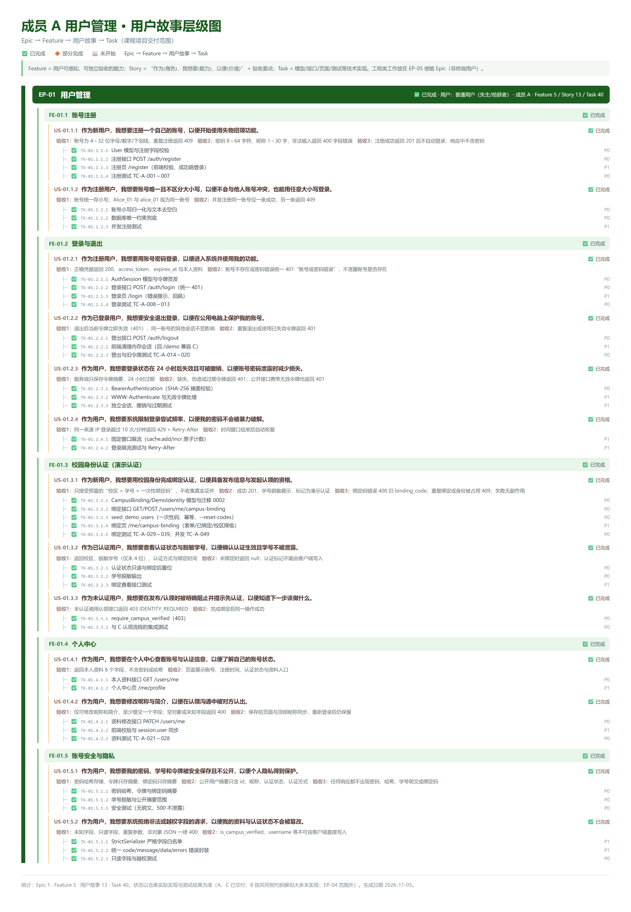
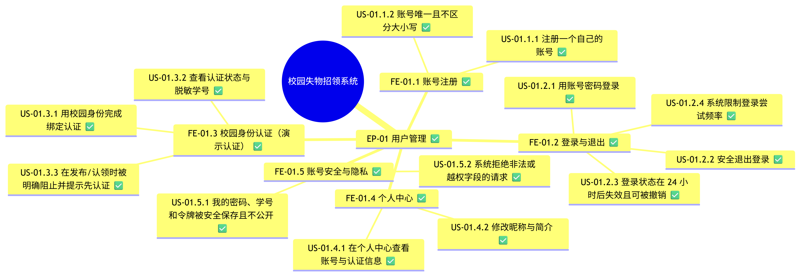

# 校园失物招领系统：Epic / Feature / Story / Task 思维导图（v2）

> 版本：v2.0　日期：2026-11-05　修订：按敏捷规范重做 Feature 与 Story（v1 把“前端框架/初始化/测试/文档”当成 Feature、把技术任务当成 Story，已修正）
> 状态图例：✅ 已完成　🔶 部分完成　⬜ 未开始　优先级：P0 必须、P1 重要、P2 增强

## 1. 本版修订说明（为什么改）

v1 有两个不符合敏捷规范的问题：

| 问题 | v1 错误示例 | v2 正确做法 |
|---|---|---|
| Feature 不是用户可感知能力 | “前端框架与工程化”“初始化与演示数据”“测试与文档” | 这些属于**技术任务/使能工作**，不再作为产品 Feature；统一收进 EP-05 使能 Epic，并明确“非终端用户” |
| Story 不是用户故事 | “注册账号与唯一性”“绑定接口 GET/POST” | 统一改为 **作为⟨角色⟩，我想要⟨能力⟩，以便⟨价值⟩**，并附验收要点（AC） |

**判定标准（写这张图时遵守）**

- **Epic**：一条对某类用户有独立价值的业务主线（或明确标注的使能史诗）。
- **Feature**：用户（含管理员）能感知、能独立验收的一组能力，名称里不出现“框架/接口/测试/文档”等技术词。
- **Story**：`作为<角色>，我想要<能力>，以便<价值>`，一句话能讲给非技术用户听，并配 2～4 条验收要点。
- **Task**：技术实现活动（模型/接口/页面/测试/脚本/文档），只对开发团队有意义，不是用户故事。

## 2. 统计（区分产品 Backlog 与交付保障）

- **产品 Backlog（面向用户/管理员）：4 个 Epic、21 个 Feature、40 个用户故事、103 个 Task（82 条验收要点）**——全部是用户（含管理员）可感知的能力与用户故事。
- **交付保障（使能 Epic EP-05，非产品功能）：5 个 Feature、5 个用户故事、13 个 Task**——测试、文档、部署、协作等工程工作，明确不属于产品 Feature，只作为交付保障记录。
- 全项目合计：Epic 5 个、Feature 26 个、用户故事 45 个、Task 116 个（验收要点 92 条）；Task 状态：✅ 81、🔶 2、⬜ 33。

## 3. 产品思维导图（总览：4 个用户价值 Epic → Feature）

## 4. 成员 A 模块层级图（Epic → Feature → Story → Task）

## 5. 成员 A 模块思维导图（放射状视觉版，Epic → Feature → Story）

## 6. 全项目层级图（含 Task，文件较大）

> 图片为相对路径，Markdown 预览可直接显示；看不清时双击 `docs/process/` 下同名 PNG 放大。
> 可搜索 HTML：`mindmap-A-tree.html`、`mindmap-full-tree.html`；可导入 Excel/Jira 的清单：`backlog.csv`；Mermaid 源：`mindmap-overview.mmd`、`mindmap-A-radial.mmd`。

## 7. Epic 一览

| Epic | 名称 | 目标用户 | 负责人 | Feature | Story | Task | 状态 |
|---|---|---|---|---:|---:|---:|---|
| EP-01 | 用户管理 | 普通用户（失主/拾获者） | 成员 A | 5 | 13 | 40 | ✅ 已完成 |
| EP-02 | 信息发布与浏览 | 失主与拾获者 | 成员 B | 6 | 12 | 29 | 🔶 部分完成 |
| EP-03 | 认领与交接 | 失主与拾获者 | 成员 C | 6 | 11 | 28 | ✅ 已完成 |
| EP-04 | 系统管理（管理员） | 管理员 | 未分配 | 4 | 4 | 6 | ⬜ 未开始 |
| EP-05 | 交付保障（使能 Epic，非产品功能） | 开发/验收团队（非终端用户） | 成员 A | 5 | 5 | 13 | ✅ 已完成 |

> 注：EP-05 是**使能 Epic**，用于记录测试、文档、部署、协作等交付保障工作，不属于面向用户的产品 Feature；产品思维导图（第 3 节）不包含它。

## 8. 分层清单（Epic → Feature → 用户故事 → Task）

- ✅ **EP-01 用户管理**（用户：普通用户（失主/拾获者）；负责人：成员 A）
  - ✅ **FE-01.1 账号注册**
    - ✅ **US-01.1.1** 作为新用户，我想要注册一个自己的账号，以便开始使用失物招领功能。
      - 验收：账号为 4～32 位字母/数字/下划线，重复注册返回 409
      - 验收：密码 8～64 字符、昵称 1～30 字，非法输入返回 400 字段错误
      - 验收：注册成功返回 201 且不自动登录，响应中不含密码
      - ✅ `TK-01.1.1.1` User 模型与注册字段校验（P0）
      - ✅ `TK-01.1.1.2` 注册接口 POST /auth/register（P0）
      - ✅ `TK-01.1.1.3` 注册页 /register（前端校验、成功跳登录）（P1）
      - ✅ `TK-01.1.1.4` 注册测试 TC-A-001～007（P0）
    - ✅ **US-01.1.2** 作为注册用户，我想要账号唯一且不区分大小写，以便不会与他人账号冲突，也能用任意大小写登录。
      - 验收：账号统一存小写；Alice_01 与 alice_01 视为同一账号
      - 验收：并发注册同一账号仅一条成功，另一条返回 409
      - ✅ `TK-01.1.2.1` 账号小写归一化与文本去空白（P0）
      - ✅ `TK-01.1.2.2` 数据库唯一约束兜底（P0）
      - ✅ `TK-01.1.2.3` 并发注册测试（P1）
  - ✅ **FE-01.2 登录与退出**
    - ✅ **US-01.2.1** 作为注册用户，我想要用账号密码登录，以便进入系统并使用我的功能。
      - 验收：正确凭据返回 200、access_token、expires_at 与本人资料
      - 验收：账号不存在或密码错误统一 401“账号或密码错误”，不泄露账号是否存在
      - ✅ `TK-01.2.1.1` AuthSession 模型与令牌签发（P0）
      - ✅ `TK-01.2.1.2` 登录接口 POST /auth/login（统一 401）（P0）
      - ✅ `TK-01.2.1.3` 登录页 /login（错误提示、回跳）（P1）
      - ✅ `TK-01.2.1.4` 登录测试 TC-A-008～013（P0）
    - ✅ **US-01.2.2** 作为已登录用户，我想要安全退出登录，以便在公用电脑上保护我的账号。
      - 验收：退出后当前令牌立即失效（401），同一账号的其他会话不受影响
      - 验收：重复退出或使用已失效令牌返回 401
      - ✅ `TK-01.2.2.1` 登出接口 POST /auth/logout（P0）
      - ✅ `TK-01.2.2.2` 前端清理内存会话（回 /demo 兼容 C）（P1）
      - ✅ `TK-01.2.2.3` 登出与旧令牌测试 TC-A-014～020（P0）
    - ✅ **US-01.2.3** 作为用户，我想要登录状态在 24 小时后失效且可被撤销，以便账号密码泄露时减少损失。
      - 验收：服务端只保存令牌摘要，24 小时过期
      - 验收：缺失、伪造或过期令牌返回 401；公开接口携带无效令牌也返回 401
      - ✅ `TK-01.2.3.1` BearerAuthentication（SHA-256 摘要校验）（P0）
      - ✅ `TK-01.2.3.2` WWW-Authenticate 与无效令牌处理（P1）
      - ✅ `TK-01.2.3.3` 独立会话、撤销与过期测试（P1）
    - ✅ **US-01.2.4** 作为用户，我想要系统限制登录尝试频率，以便我的密码不会被暴力破解。
      - 验收：同一来源 IP 登录超过 10 次/分钟返回 429 + Retry-After
      - 验收：时间窗口结束后自动恢复
      - ✅ `TK-01.2.4.1` 固定窗口限流（cache.add/incr 原子计数）（P1）
      - ✅ `TK-01.2.4.2` 登录限流测试与 Retry-After（P1）
  - ✅ **FE-01.3 校园身份认证（演示认证）**
    - ✅ **US-01.3.1** 作为新用户，我想要用校园身份完成绑定认证，以便具备发布信息与发起认领的资格。
      - 验收：只接受预置的“校区 + 学号 + 一次性绑定码”，不收集真实证件
      - 验收：成功 201、学号脱敏展示、标记为演示认证
      - 验收：绑定码错误 400 归 binding_code；重复绑定或身份被占用 409；失败无副作用
      - ✅ `TK-01.3.1.1` CampusBinding/DemoIdentity 模型与迁移 0002（P0）
      - ✅ `TK-01.3.1.2` 绑定接口 GET/POST /users/me/campus-binding（P0）
      - ✅ `TK-01.3.1.3` seed_demo_users（一次性码、幂等、--reset-codes）（P0）
      - ✅ `TK-01.3.1.4` 绑定页 /me/campus-binding（表单/已绑定/校区降级）（P1）
      - ✅ `TK-01.3.1.5` 绑定测试 TC-A-029～039、并发 TC-A-049（P0）
    - ✅ **US-01.3.2** 作为已认证用户，我想要查看认证状态与脱敏学号，以便确认认证生效且学号不被泄露。
      - 验收：返回校区、脱敏学号（仅末 4 位）、认证方式与绑定时间
      - 验收：未绑定时返回 null；认证标记不能由客户端写入
      - ✅ `TK-01.3.2.1` 认证状态只读与绑定后置位（P0）
      - ✅ `TK-01.3.2.2` 学号脱敏输出（P0）
      - ✅ `TK-01.3.2.3` 绑定查看接口测试（P1）
    - ✅ **US-01.3.3** 作为未认证用户，我想要在发布/认领时被明确阻止并提示先认证，以便知道下一步该做什么。
      - 验收：未认证调用认领接口返回 403 IDENTITY_REQUIRED
      - 验收：完成绑定后同一操作成功
      - ✅ `TK-01.3.3.1` require_campus_verified（403）（P0）
      - ✅ `TK-01.3.3.2` 与 C 认领流程的集成测试（P0）
  - ✅ **FE-01.4 个人中心**
    - ✅ **US-01.4.1** 作为用户，我想要在个人中心查看账号与认证信息，以便了解自己的账号状态。
      - 验收：返回本人资料 8 个字段，不含密码或哈希
      - 验收：页面展示账号、注册时间、认证状态与资料入口
      - ✅ `TK-01.4.1.1` 本人资料接口 GET /users/me（P0）
      - ✅ `TK-01.4.1.2` 个人中心页 /me/profile（P1）
    - ✅ **US-01.4.2** 作为用户，我想要修改昵称与简介，以便在认领沟通中被对方认出。
      - 验收：仅可修改昵称和简介，至少提交一个字段；空对象或未知字段返回 400
      - 验收：保存后页面与顶部昵称同步，重新登录后仍保留
      - ✅ `TK-01.4.2.1` 资料修改接口 PATCH /users/me（P0）
      - ✅ `TK-01.4.2.2` 前端校验与 session.user 同步（P1）
      - ✅ `TK-01.4.2.3` 资料测试 TC-A-021～028（P0）
  - ✅ **FE-01.5 账号安全与隐私**
    - ✅ **US-01.5.1** 作为用户，我想要我的密码、学号和令牌被安全保存且不公开，以便个人隐私得到保护。
      - 验收：密码哈希存储、令牌只存摘要、绑定码只存摘要
      - 验收：公开用户摘要只含 id、昵称、认证状态、认证方式
      - 验收：任何响应都不出现密码、哈希、学号明文或绑定码
      - ✅ `TK-01.5.1.1` 密码哈希、令牌与绑定码摘要（P0）
      - ✅ `TK-01.5.1.2` 学号脱敏与公开摘要范围（P0）
      - ✅ `TK-01.5.1.3` 安全测试（无明文、500 不泄露）（P0）
    - ✅ **US-01.5.2** 作为用户，我想要系统拒绝非法或越权字段的请求，以便我的资料与认证状态不会被篡改。
      - 验收：未知字段、只读字段、重复参数、非对象 JSON 一律 400
      - 验收：is_campus_verified、username 等不可由客户端直接写入
      - ✅ `TK-01.5.2.1` StrictSerializer 严格字段白名单（P1）
      - ✅ `TK-01.5.2.2` 统一 code/message/data/errors 错误封装（P1）
      - ✅ `TK-01.5.2.3` 只读字段与越权测试（P0）
- 🔶 **EP-02 信息发布与浏览**（用户：失主与拾获者；负责人：成员 B）
  - ⬜ **FE-02.1 发布失物/招领信息**
    - ⬜ **US-02.1.1** 作为拾获者，我想要发布招领信息，以便让失主看到并联系我。
      - 验收：必填标题、类别、描述、地点、拾获时间；招领必须填写保管说明
      - 验收：创建成功返回 201、状态为进行中，发布者由登录身份生成
      - 验收：未登录 401、未完成认证 403
      - 🔶 `TK-02.1.1.1` Post 模型与状态枚举（最小模型已有）（P0）
      - ⬜ `TK-02.1.1.2` 创建接口 POST /posts（P0）
      - ⬜ `TK-02.1.1.3` 发布页 /posts/new（P1）
      - ⬜ `TK-02.1.1.4` 发布权限与字段测试（P0）
    - ⬜ **US-02.1.2** 作为失主，我想要发布寻物信息，以便让拾获者看到并提供线索。
      - 验收：寻物信息不接受保管说明（固定为 null）
      - 验收：可附带 0～6 张图片
      - ⬜ `TK-02.1.2.1` 统一发布接口支持 lost 类型（P0）
      - ⬜ `TK-02.1.2.2` 发布页类型切换（P1）
  - ⬜ **FE-02.2 编辑与撤回信息**
    - ⬜ **US-02.2.1** 作为发布者，我想要编辑我发布的信息，以便修正描述或补充细节。
      - 验收：仅本人、且信息处于进行中/已撤回时可编辑
      - 验收：不可修改类型、状态、发布者；未知字段返回 400
      - ⬜ `TK-02.2.1.1` 编辑接口 PATCH /posts/{id}（P0）
      - ⬜ `TK-02.2.1.2` 编辑页与权限测试（P1）
    - ⬜ **US-02.2.2** 作为发布者，我想要撤回或恢复我发布的信息，以便暂时下架或重新开放。
      - 验收：撤回后公开不可见，待审申请自动关闭；恢复后重新开放且不恢复旧申请
      - 验收：重复撤回/恢复幂等
      - ⬜ `TK-02.2.2.1` 撤回/恢复接口与事务联动（P0）
      - ⬜ `TK-02.2.2.2` 页面操作按钮与状态显示（P1）
    - ⬜ **US-02.2.3** 作为失主，我想要把寻物信息标记为已找回，以便结束展示。
      - 验收：仅本人进行中的寻物信息可执行，状态变为已完成
      - 验收：招领信息不能绕过双方确认直接完成
      - ⬜ `TK-02.2.3.1` 自行找回接口 resolve（P1）
      - ⬜ `TK-02.2.3.2` 状态操作测试（P1）
  - ⬜ **FE-02.3 浏览与搜索**
    - ⬜ **US-02.3.1** 作为访客，我想要浏览公开的失物/招领列表，以便快速发现与自己相关的信息。
      - 验收：默认展示进行中与交接中信息，分页 20 条/页，排序稳定
      - 验收：未登录也可浏览
      - ⬜ `TK-02.3.1.1` 公开列表接口 GET /posts（P0）
      - ⬜ `TK-02.3.1.2` 列表页与空状态（P1）
      - ⬜ `TK-02.3.1.3` 分页与排序测试（P1）
    - ⬜ **US-02.3.2** 作为访客，我想要查看信息详情，以便判断物品是否相关。
      - 验收：返回完整详情与公开用户摘要；撤回信息仅本人可见
      - 验收：不存在或无权查看返回 404
      - ⬜ `TK-02.3.2.1` 详情接口 GET /posts/{id}（P0）
      - ⬜ `TK-02.3.2.2` 详情页（P1）
    - ⬜ **US-02.3.3** 作为访客，我想要按关键词、类别、校区、地点、时间筛选，以便缩小查找范围。
      - 验收：筛选条件按 AND 组合，关键词按 OR 匹配标题/描述
      - 验收：未知字典 ID 返回 400；无结果返回空列表且分页结构一致
      - ⬜ `TK-02.3.3.1` 查询参数校验与筛选实现（P1）
      - ⬜ `TK-02.3.3.2` 筛选组件与 URL 同步（P2）
  - ⬜ **FE-02.4 图片上传与查看**
    - ⬜ **US-02.4.1** 作为发布者，我想要为信息上传最多 6 张图片，以便展示物品特征，方便辨认。
      - 验收：单张 ≤5MiB，仅支持 jpeg/png/webp，校验真实内容
      - 验收：图片顺序由 image_ids 决定；只能绑定本人上传的图片
      - ⬜ `TK-02.4.1.1` 上传接口与内容校验（P1）
      - ⬜ `TK-02.4.1.2` 图片绑定与整体替换（P1）
      - ⬜ `TK-02.4.1.3` 上传组件（P2）
    - ⬜ **US-02.4.2** 作为访客/参与者，我想要受控地查看信息图片，以便辨认物品且撤回后不可再看到。
      - 验收：公开信息图片可匿名读取；撤回后仅发布者可读
      - 验收：图片响应 Cache-Control: no-store
      - ⬜ `TK-02.4.2.1` 受控读取接口 /post-images/{id}/content（P1）
      - ⬜ `TK-02.4.2.2` 撤回后的图片权限测试（P1）
  - ⬜ **FE-02.5 我的发布**
    - ⬜ **US-02.5.1** 作为发布者，我想要在个人中心查看我发布的信息，以便统一管理我发布的内容。
      - 验收：按类型/状态筛选、分页，默认包含本人全部状态
      - ⬜ `TK-02.5.1.1` 我的发布接口 GET /users/me/posts（P1）
      - ⬜ `TK-02.5.1.2` 我的发布页 /me/posts（P2）
  - ⬜ **FE-02.6 选择类别与地点**
    - 🔶 **US-02.6.1** 作为发布者，我想要从固定字典中选择类别和地点，以便信息规范、可被准确筛选。
      - 验收：校区/类别/地点来自字典接口，ID 全局唯一
      - 验收：已被使用的字典项不得删除或重新解释
      - 🔶 `TK-02.6.1.1` catalog 模型（最小模型已有）（P1）
      - ⬜ `TK-02.6.1.2` 字典接口 /meta/campuses、categories、locations（P0）
      - ⬜ `TK-02.6.1.3` 前端字典选择组件（绑定页已降级待接入）（P2）
- ✅ **EP-03 认领与交接**（用户：失主与拾获者；负责人：成员 C）
  - ✅ **FE-03.1 提交认领申请**
    - ✅ **US-03.1.1** 作为失主，我想要对招领信息提交私有证明，以便向拾获者证明物品是我的。
      - 验收：只可对进行中的招领信息申请，且不能是本人发布
      - 验收：证明 10～1000 字，仅申请双方可见；未认证 403、重复申请 409
      - ✅ `TK-03.1.1.1` Claim 模型与条件唯一约束（P0）
      - ✅ `TK-03.1.1.2` 创建申请接口 POST /claims（P0）
      - ✅ `TK-03.1.1.3` 申请页 /claims/new（P1）
      - ✅ `TK-03.1.1.4` 认领规则测试 TC-A-029～050（P0）
    - ✅ **US-03.1.2** 作为失主，我想要同一物品只保留一条有效申请，以便避免重复打扰拾获者。
      - 验收：同一用户对同一信息最多一条待审/已同意申请（数据库约束）
      - 验收：并发申请仅一条成功，另一条 409
      - ✅ `TK-03.1.2.1` 条件唯一约束与并发控制（P0）
      - ✅ `TK-03.1.2.2` 并发申请测试（P0）
  - ✅ **FE-03.2 审核认领申请**
    - ✅ **US-03.2.1** 作为拾获者，我想要审阅申请并同意或拒绝，以便选择真正的失主。
      - 验收：仅信息发布者可审核；拒绝必须说明原因
      - 验收：同意后信息进入交接中，拒绝后申请终态只读
      - ✅ `TK-03.2.1.1` 同意/拒绝接口与权限校验（P0）
      - ✅ `TK-03.2.1.2` 详情页审核交互（P1）
    - ✅ **US-03.2.2** 作为拾获者，我想要同意一条申请时其他竞争申请自动关闭，以便一件物品只交给一个人。
      - 验收：一条招领信息最多一条已同意申请；其余待审申请关闭
      - 验收：并发同意仅一条成功，另一条 409
      - ✅ `TK-03.2.2.1` 事务内锁定与竞争申请关闭（P0）
      - ✅ `TK-03.2.2.2` 并发同意测试（P0）
  - ✅ **FE-03.3 站内沟通**
    - ✅ **US-03.3.1** 作为认领双方，我想要在申请内私密沟通，以便核实物品细节并约定交接。
      - 验收：仅申请双方可读写，非参与者返回 404
      - 验收：终态申请只能查看历史，不能发送新消息（409）
      - ✅ `TK-03.3.1.1` 消息接口 POST/GET /claims/{id}/messages（P0）
      - ✅ `TK-03.3.1.2` 消息权限与终态校验（P0）
      - ✅ `TK-03.3.1.3` 聊天组件 ClaimChat（P1）
    - ✅ **US-03.3.2** 作为认领双方，我想要消息增量刷新且不重复，以便不丢消息、不重复显示。
      - 验收：按 after_id 增量读取、每批最多 100 条；客户端按消息 ID 去重
      - 验收：切换会话或退出登录时停止轮询，不串会话
      - ✅ `TK-03.3.2.1` 游标查询与有序返回（P1）
      - ✅ `TK-03.3.2.2` 轮询 composable 与去重（P1）
      - ✅ `TK-03.3.2.3` 消息前端测试（P1）
  - ✅ **FE-03.4 交接确认与取消**
    - ✅ **US-03.4.1** 作为认领双方，我想要各自确认交接，以便只有双方都确认才算真正完成。
      - 验收：单方确认只记录时间，状态保持交接中
      - 验收：双方都确认后申请与招领信息同时完成；重复确认不覆盖首次时间
      - ✅ `TK-03.4.1.1` 确认交接接口与状态联动（P0）
      - ✅ `TK-03.4.1.2` 双确认/重复确认测试（P0）
    - ✅ **US-03.4.2** 作为认领双方，我想要在双方确认前取消交接，以便应对临时变更。
      - 验收：已同意且双方未确认时任一方可取消，物品重新开放
      - 验收：已有一方确认后取消返回 409
      - ✅ `TK-03.4.2.1` 取消逻辑与阶段权限（P0）
      - ✅ `TK-03.4.2.2` 取消/重开测试（P0）
    - ✅ **US-03.4.3** 作为拾获者，我想要撤回信息时相关待审申请自动关闭，以便物品状态与申请状态保持一致。
      - 验收：撤回与关闭申请在同一事务内完成，任一步失败整体回滚
      - 验收：恢复信息后不恢复历史申请
      - ✅ `TK-03.4.3.1` 撤回与关闭申请事务联动（P0）
      - ✅ `TK-03.4.3.2` 故障回滚注入测试（P0）
  - ✅ **FE-03.5 我的认领**
    - ✅ **US-03.5.1** 作为申请者/发布者，我想要分别查看我申请的和我收到的申请，以便跟踪每一条认领进度。
      - 验收：支持 applicant/publisher 两种视角与状态筛选、分页
      - 验收：只能看到自己参与的申请，不能借筛选获取他人记录
      - ✅ `TK-03.5.1.1` 我的认领接口 GET /users/me/claims（P1）
      - ✅ `TK-03.5.1.2` 列表页 /me/claims（P1）
      - ✅ `TK-03.5.1.3` 越权与筛选测试（P0）
  - ✅ **FE-03.6 智能匹配线索**
    - ✅ **US-03.6.1** 作为失主/拾获者，我想要查看规则匹配到的线索与匹配分，以便更快发现可能对应的信息。
      - 验收：候选满足相反类型、同校区同类别、进行中、非本人及时间条件
      - 验收：返回 0～100 规则分与加分原因，按分数排序；分数仅为参考，不自动申请或完成
      - ✅ `TK-03.6.1.1` 匹配算法与硬条件过滤（P1）
      - ✅ `TK-03.6.1.2` 匹配接口 GET /posts/{id}/matches（P1）
      - ✅ `TK-03.6.1.3` 匹配页与匹配测试（P1）
- ⬜ **EP-04 系统管理（管理员）**（用户：管理员；负责人：未分配）
  - ⬜ **FE-04.1 内容审核与下架**
    - ⬜ **US-04.1.1** 作为管理员，我想要审核并下架违规信息，以便维护校园信息内容秩序。
      - 验收：管理员可查看全部信息并执行下架
      - 验收：操作留痕，普通用户无法访问管理入口
      - ⬜ `TK-04.1.1.1` 管理端接口与权限（P2）
      - ⬜ `TK-04.1.1.2` 管理页面（P2）
  - ⬜ **FE-04.2 认领争议裁决**
    - ⬜ **US-04.2.1** 作为管理员，我想要处理认领双方争议，以便给出公平裁决。
      - 验收：可查看双方证明与沟通记录
      - 验收：裁决结果通知双方并记录原因
      - ⬜ `TK-04.2.1.1` 争议模型与裁决流程（P2）
      - ⬜ `TK-04.2.1.2` 裁决页面与通知（P2）
  - ⬜ **FE-04.3 数据备份与恢复**
    - ⬜ **US-04.3.1** 作为管理员，我想要定期备份并恢复系统数据，以便故障后能恢复数据。
      - 验收：按策略定期备份，支持恢复演练
      - 验收：备份文件不含明文密码等敏感信息
      - ⬜ `TK-04.3.1.1` 备份脚本与恢复流程（P2）
  - ⬜ **FE-04.4 运营统计**
    - ⬜ **US-04.4.1** 作为管理员，我想要查看发布与认领统计，以便了解系统使用情况。
      - 验收：按时间/类别统计并可导出
      - ⬜ `TK-04.4.1.1` 统计接口与报表页（P2）
- ✅ **EP-05 交付保障（使能 Epic，非产品功能）**（用户：开发/验收团队（非终端用户）；负责人：成员 A）
  - ✅ **FE-05.1 自动化测试体系**
    - ✅ **US-05.1.1** 作为开发团队，我想要有一套分层自动化测试，以便每次改动都能快速回归、敢改代码。
      - 验收：后端 105 项、前端 47 项、浏览器 5 项、独立验收 34 项全部通过
      - 验收：users 生产代码行覆盖率 95%（综合 93%）
      - ✅ `TK-05.1.1.1` 后端单元/接口/并发/限流测试（P0）
      - ✅ `TK-05.1.1.2` 前端组件测试（P1）
      - ✅ `TK-05.1.1.3` Playwright 浏览器验收（P1）
      - ✅ `TK-05.1.1.4` 独立验收脚本 acceptance_a.py（P1）
  - ✅ **FE-05.2 软件工程文档体系**
    - ✅ **US-05.2.1** 作为验收教师/后续维护者，我想要有从需求到验证的完整文档，以便能理解系统并据此验收。
      - 验收：需求规格、概要/详细设计、数据库设计、测试计划/用例/报告、完整性验证报告齐全
      - 验收：需求编号可追踪到设计与测试编号
      - ✅ `TK-05.2.1.1` 需求规格与设计文档（P1）
      - ✅ `TK-05.2.1.2` 测试与验证报告（P1）
      - ✅ `TK-05.2.1.3` 过程说明与个人报告（P1）
  - ✅ **FE-05.3 演示数据与初始化**
    - ✅ **US-05.3.1** 作为演示者/验收者，我想要一键初始化演示账号与校园身份，以便快速复现完整业务流程。
      - 验收：初始化命令幂等，输出可用的演示密码与一次性绑定码
      - 验收：不污染既有业务数据
      - ✅ `TK-05.3.1.1` seed_demo 与 seed_demo_users（P0）
      - ✅ `TK-05.3.1.2` setup.ps1 一键初始化（P1）
  - ✅ **FE-05.4 本地部署与开发环境**
    - ✅ **US-05.4.1** 作为开发者，我想要一键启动项目并直接打开代码，以便快速运行、调试与演示。
      - 验收：双击脚本可启动/停止前后端，自动打开浏览器
      - 验收：PyCharm 已配置解释器与运行配置
      - ✅ `TK-05.4.1.1` 启动/停止 bat 与桌面入口（P2）
      - ✅ `TK-05.4.1.2` PyCharm 解释器与运行配置（P2）
  - ✅ **FE-05.5 团队协作与版本管理**
    - ✅ **US-05.5.1** 作为团队，我想要有共同契约与版本记录，以便三人并行开发不冲突、可追溯。
      - 验收：字段、错误码、状态、路径以共同契约为准并冻结编号
      - 验收：Git 分支/提交/迁移/文档版本可追溯
      - ✅ `TK-05.5.1.1` 共同字段与接口约定（P0）
      - ✅ `TK-05.5.1.2` 分支、提交与文档版本管理（P1）

## 9. 建议的迭代切分（课程 3 人小组）

| 迭代 | 目标 | 包含 Epic/Feature | 验收口径 |
|---|---|---|---|
| I0 契约 | 定字段/接口/状态/分工 | EP-05 · FE-05.5 | 共同字段与接口约定确认，三人无歧义 |
| I1 用户管理 MVP | 用户能注册、登录、认证、看资料 | EP-01 全部（P0） | 后端 7 接口 + 前端 4 页面 + 绑定演示可用 |
| I2 内容闭环 | 发布、浏览、搜索、图片 | EP-02（P0/P1） | B 的发布/浏览/图片接口与页面通过验收 |
| I3 认领闭环 | 申请→审核→沟通→交接→完成 | EP-03 全部 | 双方确认完成、撤回/取消/竞争分支通过 |
| I4 质量交付 | 测试、文档、验收、部署 | EP-05（FE-05.1～05.4） | 全量测试通过、完整性验证报告、可复现部署 |
| 后续 | 管理员与真实认证 | EP-04、真实校园认证 | 超出第一版范围，按需排期 |

## 10. 使用与维护

1. 新增需求先写用户故事（角色/能力/价值/验收），再拆 Task；技术工作不得写成 Story。
2. 状态只在验证后更新：Task → Story → Feature → Epic，避免“写完代码就算完成”。
3. 编号与 `docs/requirements/A-用户管理-需求规格说明书.md` 的 FR-A-01～12 对应；B/C 部分对应共同契约章节。
4. 可把 `backlog.csv` 导入 Excel/Jira，或把第 8 节缩进清单粘贴到 XMind/MindMaster 生成树。
5. 每次迭代后对照 `docs/test/A-用户管理-测试报告.md` 与 `docs/verify/A-用户管理-完整性验证报告.md` 更新状态。

---

附：状态依据仓库实际代码与测试（A、C 已交付；B 按共同契约拆解但大多未实现；EP-04 范围外）。生成日期 2026-11-05。
