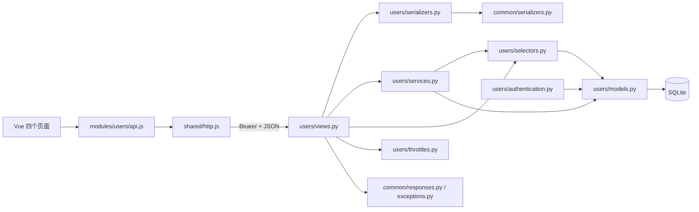
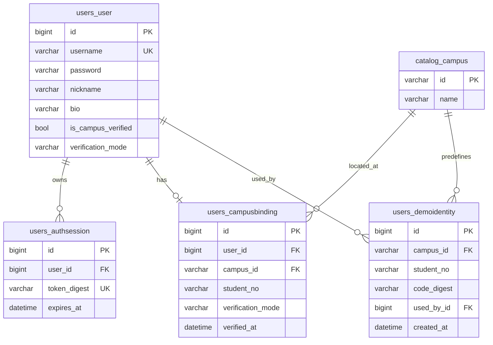
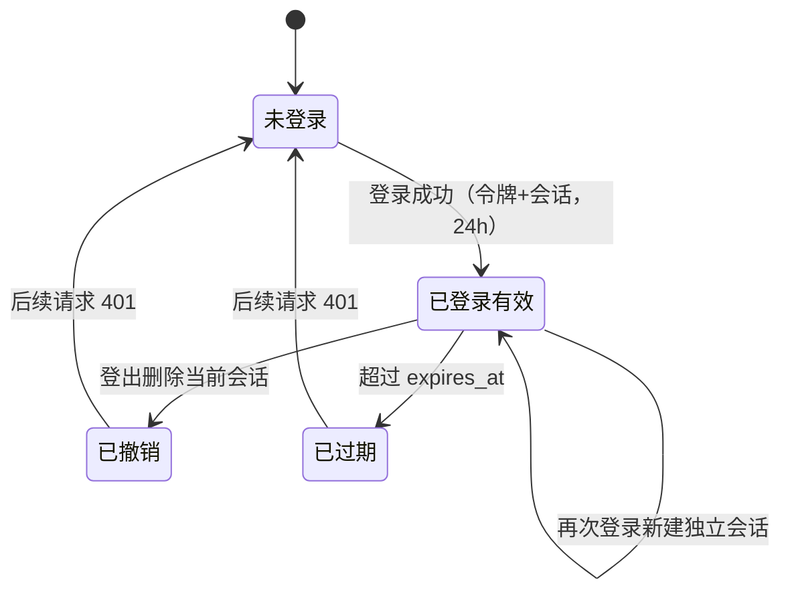
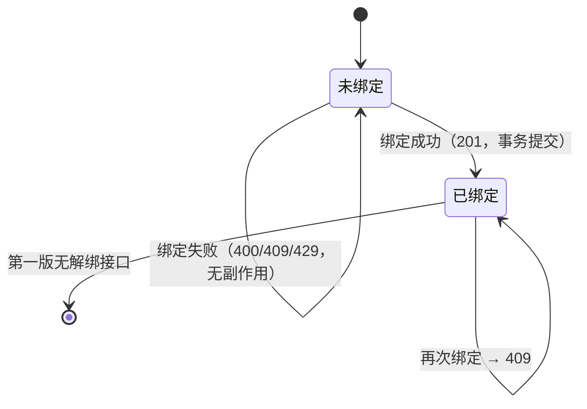

# 成员 A：用户管理子系统

日期：2026-11-02。本文是成员 A 的课程个人报告，覆盖用户管理子系统的需求分析、系统设计、编码成果、测试记录、团队协作边界与已知取舍，可作为实验报告的技术底稿。子系统间的共享字段、接口与状态约定以[共同字段与接口约定](../共同字段与接口约定.md)为准，运行与安装说明见[README](../../README.md)，协作过程见[软件工程过程说明](../process/A-软件工程过程说明.md)。

## 1. 背景、目标与职责

### 1.1 项目背景

校园失物招领系统服务于三个相互依赖的业务：信息发布与浏览（成员 B）、失物认领与沟通（成员 C）、用户与身份管理（成员 A）。三人在同一个 Django + Vue 3 仓库、同一套 SQLite 数据库上并行开发，分别对自己模块的需求、设计、编码、测试与文档负责。

所有业务写操作都要求“已登录、且已完成校园身份核验”：发布信息、发起认领都需要可信的参与者身份。而课程环境无法接入学校统一认证服务，因此第一版必须用可辨识、可复现的**演示认证**替代真实认证，并把这一边界写进页面文案与验收说明，不能声称已完成真实校园认证。

### 1.2 我的目标

1. 交付可运行、可演示的身份与账户基础层：注册、登录、退出、资料维护、校园身份绑定，以及四个可用的前端页面。
2. 为 B/C 提供稳定的内部身份能力：登录身份、认证前置校验、公开用户摘要、会话签发，且不改变 C 已实现的认领规则与 B 的信息状态规则。
3. 用契约驱动的方式保证三人并行不冲突：路径、字段、错误码、状态码全部先冻结再实现。
4. 形成可核对的课程交付物：需求、设计、数据库、测试、过程与报告互相可追踪，测试结论有命令与记录支撑。

### 1.3 我的职责范围

| 类别 | 我负责的内容 | 不属于我的内容 |
|---|---|---|
| 功能模块 | 注册登录、校园身份绑定、个人资料管理；个人中心页面框架与导航 | 信息发布、图片、搜索（B）；认领、消息、匹配（C） |
| 后端 | `backend/users/**` 7 个接口、4 个模型、迁移 `0002`、演示身份初始化命令、限流与认证扩展点 | `posts/**`、`claims/**`、`workflows/**` 的业务逻辑 |
| 前端 | 登录、注册、个人资料、校园身份绑定四个页面及表单组件；路由守卫与退出登录行为 | 演示工作台、我的认领、收到的申请等 C 的页面 |
| 测试 | 53 项后端测试、26 项前端组件测试、1 项浏览器验收用例 | C 的 52 项与前端 21 项既有测试（只保证不回归） |
| 文档 | 需求规格、概要/详细设计、数据库设计、测试计划、78 条测试用例、过程说明、本报告 | C 的报告与联调验收、B 的文档、Lead 的 README 与目录说明 |
| 协作接口 | `require_campus_verified`、`user_summary`、`get_user_summaries`、`issue_session`、Bearer 认证 | 真实学校认证、管理员审核、争议裁决 |

## 2. 需求分析

### 2.1 角色与用例

系统第一版不设管理员。用户管理子系统的参与者与主要用例：

| 角色 | 可做什么 | 关键约束 |
|---|---|---|
| 访客 | 注册账号、登录；浏览公开信息 | 注册成功不自动登录；登录失败统一提示 |
| 已登录用户 | 查看/修改本人资料、查看绑定、提交演示身份绑定、退出登录 | 未绑定时不能进入 B/C 的写业务 |
| 已认证用户 | 具备发布信息与发起认领的前置身份 | 认证标记只由绑定服务写入 |
| 系统/初始化人员 | 执行 `seed_demo_users` 初始化演示身份 | 仅演示模式可运行，幂等 |
| 成员 B/C 后端 | 调用身份能力校验登录与认证、读取公开摘要 | 不能信任客户端提交的身份字段 |

用例规约共 9 个（UC-A-01～09），覆盖注册、登录、登出、资料读/写、绑定读/写、演示数据初始化与未登录访问受保护页面被拦截。每条用例在主流程之外都明确了异常分支与后置条件，例如绑定失败时“用户认证状态与演示身份均不变”。

### 2.2 功能需求

按契约统一编号，共 12 条功能需求，分为三个功能模块与一个跨模块能力：

| 编号 | 需求摘要 | 优先级 |
|---|---|---|
| FR-A-01 | 注册：账号 4～32 位字母/数字/下划线（存小写、唯一）、密码 8～64、昵称 1～30；201 返回本人资料，不签发令牌 | P0 |
| FR-A-02 | 登录：成功返回令牌、类型、过期时间与本人资料；失败统一 401“账号或密码错误” | P0 |
| FR-A-03 | 登出：撤销当前令牌，旧令牌立即失效，不影响其他会话 | P0 |
| FR-A-04 | 查看本人资料：返回 `UserSelf` 全字段，不返回密码/哈希 | P0 |
| FR-A-05 | 修改资料：仅昵称与简介，至少一个字段；未知/只读字段 400 | P0 |
| FR-A-06 | 查看绑定：未绑定 `null`；已绑定返回脱敏学号、校区、认证方式、绑定时间 | P1 |
| FR-A-07 | 演示绑定：只接受预置“校区+学号+一次性绑定码”；成功 201 并置认证标记；已绑定/被占用 409；码不匹配 400 | P0 |
| FR-A-08 | 登录身份校验：Bearer 令牌 24 小时、服务端只存摘要、可撤销；无效令牌 401（公开接口携带无效令牌同样 401） | P0 |
| FR-A-09 | 为 B/C 提供身份能力：未认证 403 `IDENTITY_REQUIRED`；公开摘要只含四个字段 | P0 |
| FR-A-10 | 频率限制：登录每 IP 10 次/分钟，绑定每用户 5 次/分钟；超限 429 + `Retry-After` | P1 |
| FR-A-11 | 演示数据初始化：幂等创建校区与 6 个一次性身份，补绑定已有演示认证账号，输出可用绑定码 | P1 |
| FR-A-12 | 前端四个页面；未登录访问受保护页面跳登录并回跳；成功后刷新内存会话 | P1 |

### 2.3 关键业务规则

需求规格中登记了 15 条业务规则，其中对实现影响最大的几条是：

1. **账号唯一性靠“统一小写”实现**：服务端统一转小写入库，因此“大小写不同”的重复注册也稳定返回 409；数据库 `username` 唯一索引作为最终防线。
2. **密码只以哈希存在**：使用 Django `set_password`，响应、错误消息、日志都不出现明文或哈希；密码与绑定码不裁剪空白。
3. **令牌只存摘要**：登录签发随机令牌，服务端保存其 SHA-256 摘要，24 小时过期；退出登录删除会话，旧令牌立即 401。
4. **登录失败不泄露账号存在性**：账号不存在、密码错误、账号禁用统一 401“账号或密码错误”。
5. **绑定只接受预置身份**：校验“校区存在、学号格式、绑定码摘要、身份未被占用”后才写入；身份不存在或码不匹配是 400（归 `binding_code`），身份已被他人占用与重复绑定是 409 `DUPLICATE_RESOURCE`。
6. **认证标记不可由 HTTP 赋值**：`is_campus_verified`/`verification_mode` 只由绑定服务与初始化命令写入；资料修改接口拒绝这两个字段。
7. **脱敏**：学号只返回末 4 位掩码（`20260004` → `****0004`），绑定码与令牌摘要永不进入响应。
8. **严格字段校验**：未知字段、只读字段、重复参数、非对象 JSON 一律 400，避免客户端误以为修改成功。

### 2.4 非功能需求

| 编号 | 需求 | 度量与验证方式 |
|---|---|---|
| NFR-A-01 | 安全：密码哈希、令牌摘要、响应无敏感值、500 不泄露堆栈 | 响应全文扫描 + 500 场景测试 |
| NFR-A-02 | 隐私：公开摘要仅 `id/nickname/is_campus_verified/verification_mode` | C 的公开信息接口断言 |
| NFR-A-03 | 一致性：绑定与认证标记同事务；一用户一绑定；校区+学号唯一；并发只成功一次 | 并发测试 + 故障注入回滚测试 |
| NFR-A-04 | 可维护性：按 views/serializers/services/selectors/permissions/throttles 分层；严格拒绝未知字段 | 分层走查 + 未知字段测试 |
| NFR-A-05 | 兼容性：正式路由接管 demo 后，C 的 52 项后端与 21 项前端测试仍通过 | 全量回归 |
| NFR-A-06 | 可用性：双重校验、字段级错误、提交禁用、390px 可操作 | 前端组件测试 + 浏览器 390px 验收 |
| NFR-A-07 | 可复现：初始化幂等、测试库隔离、普通演示库不被污染 | 命令重复执行 + 隔离环境核对 |

### 2.5 需求取舍

- **不做真实校园认证**：没有学校接口，且不应收集真实证件；改用预置身份的演示绑定，并在页面与文档中明确标注。
- **不做解绑/换绑、密码找回、修改密码**：第一版范围外，避免引入管理员审核与安全流程；绑定后不可撤回。
- **登录失败不区分原因**：牺牲可诊断性换取不泄露账号是否存在；错误提示对普通用户已足够。
- **令牌只放内存**：避免 localStorage 的 XSS 风险，代价是刷新页面要重新登录；不引入刷新令牌（需先改共同契约）。
- **限流采用固定窗口**：实现简单、可测试；接受窗口边界瞬时双倍流量，不引入 Redis 或滑动窗口。

## 3. 系统设计

### 3.1 分层与调用关系

后端按“HTTP 编排 → 输入校验/输出映射 → 写入业务 → 读取查询”分层，公共能力放在 `common`；前端页面只调用 `modules/users/api.js`，统一经 `shared/http.js` 发请求并维护内存会话。

这样划分的直接收益是：校验规则只写一次（序列化器），写业务与读查询分离（服务/查询函数），认证与限流作为可替换的扩展点，错误包装集中在 `common/exceptions.py`，接口实现不重复造格式。

### 3.2 数据模型

A 负责 4 张表，另引用 B 维护的校区字典：

约束设计要点：`CampusBinding.user` 一对一保证一人一条；`(campus, student_no)` 联合唯一保证同一身份只能被绑定一次；`DemoIdentity.code_digest` 只存摘要；`AuthSession.token_digest` 唯一支撑每次请求的认证查找。`users_user` 含 `AbstractUser` 的框架保留列（`is_active`、`date_joined` 等），A 的接口只使用业务需要的列，文档中区分“业务使用列/框架保留列”，避免把框架字段误当成自有字段。

### 3.3 会话与绑定状态

会话状态与绑定状态是两套机制：会话控制“能否访问受保护接口”，绑定控制“能否进入 B/C 的写业务”。两者都不允许客户端自述，服务端以令牌与数据库记录为准。

### 3.4 事务与并发

绑定是本模块唯一的多表写操作，必须在同一事务内完成三处修改：创建 `CampusBinding`、置 `DemoIdentity.used_by`、置 `User.is_campus_verified/verification_mode`。实现顺序为：先检查是否已绑定（409）→ 校验校区存在（400）→ 计算绑定码摘要 → 进入事务锁定演示身份 → 判断占用（409）/码不匹配（400）→ 写入 → 提交；任一步异常整体回滚。

SQLite 没有真正的行锁，因此数据库配置 `transaction_mode=IMMEDIATE`，事务开始即取得写锁，把并发绑定串行化；`(campus, student_no)` 唯一约束作为最终防线。并发测试用线程屏障同时发起两个绑定请求、各自独立数据库连接，断言“恰一个 201、另一个 409、数据库只有一条绑定”。验证过程中还修复了一个语义问题：后端复核发现“身份已被他人占用”最初被归入 400，与共同契约“同一身份重复绑定返回 409”不一致；按 Lead 复核裁定改为 409 `DUPLICATE_RESOURCE`，并同步修改需求、测试用例与设计文档（变更记录 CR-A-08）。这是契约驱动开发中“文档与代码必须同时对齐”的一个具体例子。

### 3.5 安全与脱敏

| 关注点 | 实现 | 验证 |
|---|---|---|
| 密码 | Django PBKDF2 哈希；只写不读 | 断言库中哈希≠明文、响应无哈希 |
| 令牌 | 32 字节随机令牌；只存 SHA-256 摘要；24 小时；登出删除 | 摘要等值断言、旧令牌 401、独立会话 |
| 越权 | 身份取自令牌；`user_id`、`is_campus_verified` 等只读字段拒绝；B/C 入口再次校验认证 | 伪造字段 400；未认证 403 |
| 学号 | 仅返回末 4 位掩码，长度自适应 | 6 位与 20 位学号脱敏断言 |
| 绑定码 | 只存摘要，使用后身份作废 | 库中无明文；占用/错码分支 |
| 错误信息 | 统一 `code/message/data/errors`；500 不含堆栈；登录失败不泄露账号存在性 | 500 场景与统一文案断言 |
| 前端 | 文本插值、`next` 只接受站内路径、提交禁用按钮 | 组件测试与浏览器验收 |

### 3.6 页面与路由

| 路由 | 页面 | 关键行为 |
|---|---|---|
| `/login` | 登录 | 支持 `?next=` 回跳（拒绝 `//` 与外部 URL）、`?registered=1` 提示；成功后写入内存会话 |
| `/register` | 注册 | 前置校验账号/昵称/密码/确认密码；成功后不自动登录，跳转登录页并带入账号 |
| `/me/profile` | 个人资料 | 进入即读取本人资料并同步 `session.user`；保存后再次同步；展示“演示认证/未认证” |
| `/me/campus-binding` | 校园身份绑定 | 未绑定显示表单，已绑定只读展示；成功后重读绑定与本人资料刷新会话 |
| `/`、未知路径 | 重定向 | 已登录 → `/demo`，未登录 → `/login`；未登录访问受保护页 → `/login?next=` |

个人中心入口框架由 A 提供：路由守卫、导航项与认证徽标。退出登录统一清除内存会话并跳转 `/demo`，保持 C 的既有 Playwright 用例行为不变。绑定页的校区列表来自 B 的 `/meta/campuses`；该接口当前未挂载或请求失败时，页面降级为文本输入并默认 `campus_main`，同时显示“这是已知限制”的说明，不阻断演示流程。

## 4. 编码成果

### 4.1 后端接口（7 个）

| 方法 | 路径（均 `/api/v1` 前缀） | 权限 | 成功 | 主要错误 |
|---|---|---|---|---|
| POST | `/auth/register` | 匿名 | 201 `UserSelf`（无令牌） | 400 字段错误；409 账号重复 |
| POST | `/auth/login` | 匿名 | 200 令牌/类型/过期时间/资料 | 400；401 统一文案；429 |
| POST | `/auth/logout` | 登录 | 200 `data:null` | 401 |
| GET | `/users/me` | 登录 | 200 `UserSelf` | 401 |
| PATCH | `/users/me` | 登录 | 200 `UserSelf` | 400 空对象/未知字段/长度；401 |
| GET | `/users/me/campus-binding` | 登录 | 200 绑定视图或 `null` | 401 |
| POST | `/users/me/campus-binding` | 登录且未绑定 | 201 绑定视图 | 400 字段/身份不存在/码不匹配；409 已绑定或被占用；429 |

这些接口按契约第 3.2/4 节实现：路径不带结尾斜杠，成功响应统一 `code/message/data`，错误另含 `errors` 对象；登录限流按来源 IP、绑定限流按登录用户，超限返回 429 并带 `Retry-After`；公开接口携带无效令牌同样返回 401，便于前端清理失效会话。

### 4.2 后端文件与职责

| 文件 | 职责 |
|---|---|
| `backend/users/models.py` | `User`、`AuthSession`、`CampusBinding`、`DemoIdentity` 及唯一约束 |
| `backend/users/serializers.py` | 4 个严格输入序列化器、`user_self`、`binding_view`、学号脱敏 |
| `backend/users/services.py` | 注册/登录/登出/改资料/绑定；`require_campus_verified`、`user_summary`、`get_user_summaries`、`issue_session`（保持 C 依赖的签名） |
| `backend/users/selectors.py` | 本人资料、绑定、校区、演示身份查询（含事务内锁定读取） |
| `backend/users/authentication.py` | Bearer 令牌解析、摘要比对、过期与禁用判定 |
| `backend/users/permissions.py` / `throttles.py` | 公开/登录权限；固定窗口限流 |
| `backend/users/views.py` / `urls.py` | 5 个视图类与 7 个路径注册 |
| `backend/users/migrations/0002_*.py` | 绑定与演示身份两张表及唯一约束（依赖 catalog.0001） |
| `backend/users/management/commands/seed_demo_users.py` | 幂等初始化：校区、6 个一次性身份、演示账号补绑定、`--reset-codes` |
| `backend/common/serializers.py` | `StrictSerializer`、`timestamp`（users 与 posts 共用）、`IdField`、分页工具 |
| `backend/config/settings.py`、`urls.py`、`demo/*` | 认证/限流配置、路由顺序、移除 demo 中被接管的三个入口 |

规模：`backend/users/**` 约 600 行 Python（含 2 个迁移与初始化命令），新增测试约 730 行（`users/tests` 646 行 + `tests/test_identity_integration.py` 80 行）。

### 4.3 前端页面与文件

| 文件 | 内容 |
|---|---|
| `modules/users/api.js` | 8 个接口调用函数，页面不拼路径 |
| `modules/users/pages/LoginPage.vue` | 登录表单、`next` 安全回跳、注册成功提示 |
| `modules/users/pages/RegisterPage.vue` | 注册表单与即时校验、字段错误、提交禁用 |
| `modules/users/pages/ProfilePage.vue` | 资料加载与保存、会话同步、认证状态 |
| `modules/users/pages/CampusBindingPage.vue` / `components/CampusBindingForm.vue` | 绑定读取/提交、两态展示、校区降级、字段错误 |
| `router/index.js`、`App.vue` | 路由守卫与回跳、导航与退出登录行为 |

前端用户模块约 1000 行（源码约 534 行、组件测试约 473 行）。

### 4.4 测试代码

| 测试文件 | 覆盖 |
|---|---|
| `backend/users/tests/test_auth.py` | 注册、登录、登出、Bearer 认证、登录限流 |
| `backend/users/tests/test_profile.py` | 本人资料读取与修改、边界与只读字段 |
| `backend/users/tests/test_campus_binding.py` | 绑定读/写、错误分支、占用 409、并发唯一、绑定限流、初始化命令 |
| `backend/tests/test_identity_integration.py` | 与 C 的身份集成：401/403、绑定后认领、公开摘要、登出失效、正式路由接管 demo |
| `frontend/src/modules/users/tests/*.spec.js` | 四个页面的渲染、校验、成功/失败、提交禁用、降级与错误提示 |
| `frontend/tests/e2e/users.spec.js` | 注册→登录→绑定→改资料→退出→重登的浏览器流程 |

## 5. 测试与结果

环境：Windows、Python 3.12.14、Django 5.2.18、Django REST framework 3.16.1、Node.js 24.16.0、npm 11.13.0、Vue 3.5.x、Vite 7.3.x、Playwright 1.64.0 + 本机 Chrome、SQLite（版本按本机实测，与测试报告 §1 一致）。

| 检查 | 结果 | 说明 |
|---|---|---|
| 后端自动化测试 | **105/105 通过** | 成员 C 基线 52 项 + 成员 A 新增 53 项（47 项用户模块 + 6 项身份集成） |
| `manage.py check` | 0 issues | 配置、模型与路由系统检查 |
| 迁移一致性 | No changes detected | `makemigrations --check --dry-run` 无待生成迁移 |
| 前端单元测试 | **47/47 通过** | 既有 21 项 + 用户模块新增 26 项（4 个测试文件） |
| Vite 生产构建 | 通过 | `npm run build` 成功 |
| Chrome 浏览器验收 | **5/5 通过** | 成员 C 的 4 项认领回归 + 成员 A 的 1 项用户流程 |

浏览器验收使用隔离后端 `8001`、隔离前端 `5174` 与 `e2e.sqlite3`，并关闭限流（`DJANGO_RATE_LIMIT=0`）：多账号连续用例会累积登录/绑定计数，若不关闭会误触发 429；限流行为本身由后端测试在 `override_settings(RATE_LIMIT_ENABLED=True)` 下单独覆盖。测试库与演示库隔离，测试基类使用 MD5 哈希器只是为了缩短 100+ 用例的密码校验时间，生产配置仍为 PBKDF2。

测试覆盖的重点场景包括：注册重复与并发注册、登录失败统一文案、令牌过期/撤销/格式错误、资料字段边界与只读字段、绑定成功/重复/占用/错码/未知校区/学号格式、绑定并发只成功一次、绑定失败无副作用、登录与绑定限流 429 + `Retry-After`、脱敏与响应无敏感值、未认证访问 C 接口 403、旧令牌失效、公开摘要只含四个字段，以及 C 的 52 项与 21 项回归。需求与用例的对应关系见[测试计划](../test/A-用户管理-测试计划.md)与[测试用例](../test/A-用户管理-测试用例.md)（78 条）；本报告中的数字来自实现与验证阶段的实际运行，独立验收脚本（ACC-A，34 项断言）与逐条需求核对结论见[测试报告](../test/A-用户管理-测试报告.md)与[完整性验证报告](../verify/A-用户管理-完整性验证报告.md)；B 尚未实现的 `/meta/campuses` 与 `POST /posts` 相关用例按“不可执行/以 C 接口替代验证”标注，未计入通过数。

## 6. 团队协作与贡献边界

### 6.1 三人分工

| 成员 | 子系统与模块 | 与其他人的接口 |
|---|---|---|
| A（本人） | 用户管理：注册登录、校园身份绑定、个人资料管理、个人中心框架 | 向 B/C 提供登录身份、`require_campus_verified`、`UserSummary`；依赖 B 的校区字典 |
| B | 信息发布与浏览：发布/编辑/列表详情/搜索/图片；维护校区、类别、地点字典 | 依赖 A 的登录与认证；提供 `/meta/campuses` 等字典接口 |
| C | 失物认领：认领流程、站内沟通、规则匹配（既有成果） | 依赖 A 的身份与公开摘要；依赖 B 的信息状态 |

### 6.2 我的量化贡献

| 交付项 | 数量 |
|---|---|
| 功能模块 | 3 个（注册登录、校园身份绑定、个人资料管理）+ 个人中心入口框架 |
| 后端接口 | 7 个（方法+路径组合） |
| 后端数据模型 / 迁移 | 4 个模型（含 `AbstractUser` 扩展）、迁移 `0002` |
| 前端页面 | 4 个页面 + 绑定表单组件 + 路由守卫 |
| 后端测试 | 53 项（105 项总数 = 52 基线 + 53） |
| 前端测试 | 26 项（47 项总数 = 21 基线 + 26） |
| 浏览器验收用例 | 1 项（用户主流程；另有 C 的 4 项回归） |
| 文档 | 需求规格、概要设计、详细设计、数据库设计、测试计划、78 条测试用例、过程说明、个人报告，共 8 份 |

### 6.3 协作中的关键决策

1. **契约先行**：三人先冻结字段、路径、错误码和状态码，再并行开发；A 的 7 个接口与 B/C 的既有实现没有出现路径或响应结构冲突。
2. **保留 C 的依赖签名**：`require_campus_verified`、`user_summary`、`get_user_summaries`、`issue_session` 的签名与语义保持不变，只做内部扩展；正式路由接管 demo 的三个入口后，C 的 52 项后端与 21 项前端测试仍通过。
3. **错误码对齐走变更控制**：绑定“身份被占用”的响应码从 400 调整为 409 时，同步更新需求、测试用例、设计与代码，并登记变更记录，而不是只改代码。
4. **测试与文档分离**：A 编写测试用例与计划，验证角色独立执行并出具测试报告与完整性验证报告，避免“自己测自己”的结论不可信。

## 7. 已知取舍与后续协作

- **演示认证不是真实校园认证**：第一版用预置“校区+学号+一次性绑定码”模拟核验，页面明确标注“演示认证”，不能用于真实身份核验；接入学校认证服务前，这一限制始终存在。
- **令牌只保存在内存**：刷新页面需重新登录；换成 localStorage 会引入 XSS 风险，增加刷新令牌则需要先修改共同契约。
- **`/meta/campuses` 当前不可用**：B 的字典接口尚未挂载，绑定页降级为文本输入并默认 `campus_main`；B 提供接口后可移除降级分支。
- **限流在进程内**：使用 `LocMemCache` 固定窗口，多实例部署不共享计数；生产化需要换成 Redis 等集中式缓存，并补充真实反代场景的客户端 IP 处理。
- **SQLite 单写**：写事务串行化保证了演示环境的一致性，但不适合多机或高并发部署；换数据库需要重新验证并发与锁策略。
- **严格字段校验的代价**：客户端新增字段必须先改契约，联调时可能出现 400；这是为了避免“写入被静默忽略”而接受的成本。
- **未开发的功能**：解绑/换绑、密码找回、修改密码、账号注销、管理员审核与争议裁决都不在第一版范围。

后续工作优先级：接入 B 的字典接口（去掉绑定页降级）→ 引入真实校园认证并扩展 `verification_mode` → 集中式限流与数据库升级 → 刷新令牌与更完整的个人中心（我的发布、我的认领入口已由 B/C 提供页面，仅需挂载）。

## 附录：交付文档索引

| 文档 | 链接 | 状态 |
|---|---|---|
| 需求规格说明书 | [A-用户管理-需求规格说明书](../requirements/A-用户管理-需求规格说明书.md) | v1.1 已完成 |
| 概要设计 | [A-用户管理-概要设计](../design/A-用户管理-概要设计.md) | v1.0 已完成 |
| 详细设计 | [A-用户管理-详细设计](../design/A-用户管理-详细设计.md) | v1.0 已完成 |
| 数据库设计 | [数据库设计](../数据库设计.md) | v1.0 已完成 |
| 测试计划 | [A-用户管理-测试计划](../test/A-用户管理-测试计划.md) | v1.0 已完成 |
| 测试用例 | [A-用户管理-测试用例](../test/A-用户管理-测试用例.md) | v1.1 已完成（78 条） |
| 软件工程过程说明 | [A-软件工程过程说明](../process/A-软件工程过程说明.md) | v1.1 已完成 |
| 测试报告 | [A-用户管理-测试报告](../test/A-用户管理-测试报告.md) | 验证角色产出 |
| 完整性验证报告 | [A-用户管理-完整性验证报告](../verify/A-用户管理-完整性验证报告.md) | 验证角色产出 |

共享契约见[共同字段与接口约定](../共同字段与接口约定.md)，目录结构见[项目文件结构说明](../项目文件结构说明.md)，成员 C 的验收记录见[联调与验收](../联调与验收.md)。本文只陈述成员 A 的实现与验证结果，C 的认领/沟通/匹配与 B 的发布浏览能力均为既有或待接入成果，不能据本文判定其完成。
