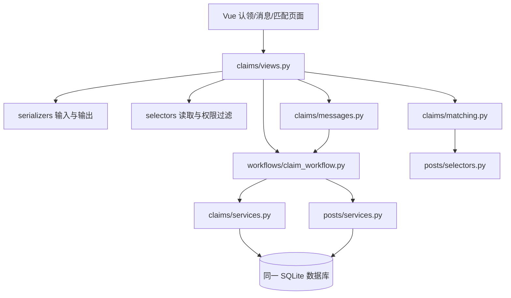
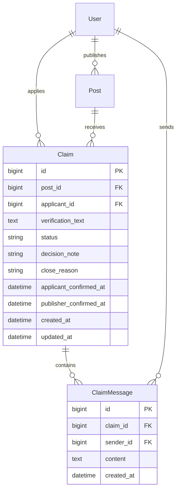
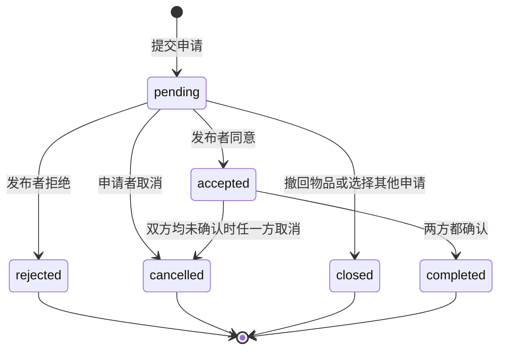
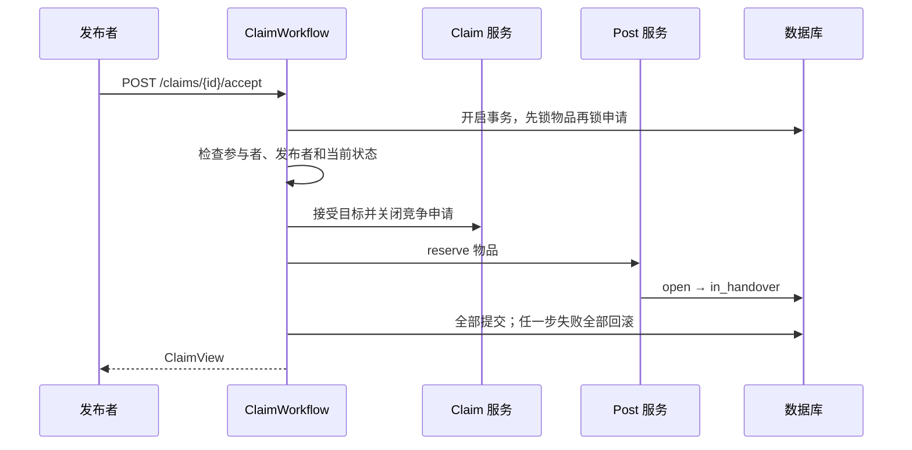

# 成员 C：失物认领子系统

日期：2026-10-10。本文覆盖需求分析、设计、编码成果及验证记录，可作为个人课程报告的技术底稿。团队分工、共享字段以[共同字段与接口约定](../共同字段与接口约定.md)为准，操作说明见[项目 README](../../README.md)。

## 1. 背景、目标与职责

校园拾获者公开发布物品后，需要核实申请者是否确为失主，再商量交接。认领子系统围绕这一过程保存私有证明、审核决定、双方沟通和交接确认，避免只凭标题相似就认定归属。失主可以从自己发布的寻物信息查看规则匹配线索，找到可能对应的招领物品后主动申请。系统通过两方分别确认保证单方点击不会直接完成归还。

C 独立负责三个功能模块及其前后端、数据操作、测试与报告：认领流程模块、站内沟通模块、规则匹配模块。用户登录身份依赖 A，物品及其可见性依赖 B；不负责完整注册登录、真实学校认证、物品发布、图片管理或管理员争议裁决。

## 2. 需求分析

### 2.1 角色与用例

| 角色 | 用例 | 结果 |
|---|---|---|
| 失主/申请者 | 对他人进行中的招领信息提交证明 | 生成待核实申请 |
| 申请者 | 查询我的认领、取消待审申请 | 查询本人申请；取消后保留历史 |
| 招领发布者 | 查看收到的申请、核实、同意或拒绝 | 选中一人进入交接；其他待审申请关闭 |
| 认领双方 | 发送与查看文字消息 | 同一申请内的私有会话 |
| 认领双方 | 交接前取消、实际交接后各自确认 | 双方未确认可取消重开；双确认后完成 |
| 寻物或招领发布者 | 查询本人进行中信息的匹配 | 得到公开线索、分数及原因 |
| 非参与者 | 尝试读取申请、证明或消息 | 统一返回 404 |

### 2.2 可检验需求

| 编号 | 需求 | 实现/验证入口 |
|---|---|---|
| R01 | 登录且完成校园身份绑定，才能对他人的 `found/open` 信息申请 | `create_claim`；认领规则测试 |
| R02 | 证明为 10～1000 字，服务端生成身份和状态，禁止伪造字段 | 严格输入序列化器；只读字段测试 |
| R03 | 同一人对同一物品最多一个有效申请 | 条件唯一约束；并发创建测试 |
| R04 | 只有发布者能审核；拒绝必须说明原因 | `accept_claim`、`reject_claim` |
| R05 | 一件物品只选一个交接对象；关闭其他待审申请 | 锁定顺序、事务、并发同意测试 |
| R06 | 单方确认不完成，双方确认才一起完成申请和物品 | `confirm_handover`；双向/重复确认测试 |
| R07 | 已同意且双方未确认时任一方可取消；一方确认后禁止取消 | `cancel_claim`；取消和重开测试 |
| R08 | 申请和消息只对双方可见；终态会话只读 | 权限函数、消息终态测试 |
| R09 | 消息采用增量游标、有序读取、按 ID 去重；退出/换页停止轮询 | `message_batch`、`useClaimMessages` |
| R10 | 匹配遵守公开硬条件，返回精确规则分及加分原因 | `list_match_candidates`、`matching.py` |
| R11 | 任一跨模块步骤失败全部回滚；重复操作不覆盖首次确认 | 三种故障注入回滚测试 |
| R12 | 支持申请列表角色切换、状态筛选和分页；手机布局可操作 | 列表测试、Chrome 手机尺寸验收 |

### 2.3 非功能需求

- 隐私：公开匹配不读取认领证明和会话；用户摘要不包含账号、密码、真实姓名、卡号。
- 一致性：所有状态写操作在服务端校验，跨模块操作使用同一事务；先锁物品，再按申请 ID 升序锁申请。
- 可追踪：申请及消息不物理删除；原始认领证明提交后不可覆盖，补充内容写入会话。
- 可用性：提交/发送期间禁用按钮，错误显示在页面；结果未知时先查询，不自动重发。
- 可维护性：HTTP 校验、读取查询、权限规则和事务流程分开组织；依赖 A/B 的适配点明确。

## 3. 系统设计

### 3.1 分层与调用关系

`workflows/claim_workflow.py` 组织跨模块事务，底层服务不会反向导入流程。消息写入复用同样的物品→申请锁顺序，避免终态写入竞态。匹配即时计算、不落库。

### 3.2 数据模型

数据库内部使用自增整数主键，对外统一输出字符串。外键采用保护删除；状态、关闭原因和确认时间之间有检查约束。索引覆盖物品状态申请、申请者状态时间及会话消息顺序。

两个条件唯一约束分别限制 `(post_id, applicant_id)` 在 `pending/accepted` 时唯一，以及 `post_id` 在 `accepted` 时唯一。额外内部字段 `cancellation_stage` 记录取消前状态，确保“发布者不能重复取消一条原本待审、由申请者取消的申请”的权限不会丢失；该字段不返回 API。

### 3.3 状态机

| 操作 | 申请变化 | 物品变化 |
|---|---|---|
| 提交 | 新增 `pending` | 保持 `open` |
| 同意 | 目标 `accepted`；竞争 `pending` → `closed` | `open` → `in_handover` |
| 单方确认 | 保持 `accepted`，记录当前一方时间 | 保持 `in_handover` |
| 第二方确认 | `accepted` → `completed` | `in_handover` → `completed`，记录完成时间 |
| 交接前取消 | `accepted` → `cancelled` | `in_handover` → `open` |
| 撤回 | 全部 `pending` → `closed` | `open` → `withdrawn` |
| 恢复 | 历史不变 | `withdrawn` → `open` |

同意、拒绝、取消、确认在符合原操作者权限且当前就是目标状态时返回当前对象。重复确认不覆盖时间。恢复物品和取消交接都不复活历史申请。

### 3.4 事务与并发方案

SQLite 不提供 `select_for_update()` 行锁，因此本实现配置 `transaction_mode=IMMEDIATE`：事务开始即获取数据库写锁，再读取与修改状态。业务仍采用物品→按 ID 升序的申请锁顺序，并保留数据库唯一约束作为最终防线。该方案适用于本地课程演示，写事务在整个 SQLite 文件上串行；未来更换数据库时需重新验证并发和锁策略。[Django SQLite 事务说明](https://docs.djangoproject.com/en/5.2/ref/databases/#sqlite-notes)、[select_for_update 说明](https://docs.djangoproject.com/en/5.2/ref/models/querysets/#select-for-update)。

### 3.5 匹配算法

先筛选：相反类型、同校区、同类别、`open`、他人发布；按 `lost/found` 角色判断时间，满足 `0 ≤ 拾获时间−丢失时间 ≤ 30 天`。

| 规则 | 分数 | `reasons` 值 |
|---|---|---|
| 类别相同（所有候选必满足） | 40 | `category_same` |
| 地点 ID 相同 | 30 | `location_same` |
| 间隔不超过 72 小时 | 20 | `time_near` |
| 标题小写、去空白及 Unicode 标点后，有共同连续二字符片段 | 10 | `keyword_overlap` |

分数范围 40～100（候选必有类别分），排序为 `score DESC, created_at DESC, id DESC`。返回默认前 10、最多 20 条。分数不是归属概率，不自动申请、自动交接或自动关闭寻物信息。

### 3.6 页面与消息生命周期

| 页面 | 路由 | 内容 |
|---|---|---|
| 申请页 | `/claims/new?post_id=...` | 读取物品、证明表单、身份/状态提示 |
| 申请列表 | `/me/claims?role=applicant/publisher` | 角色切换、筛选、分页、详情入口 |
| 申请详情 | `/claims/:id` | 证明、状态进度、审核、交接、消息 |
| 匹配页 | `/posts/:id/matches` | 规则分、原因、招领申请入口 |

`useClaimMessages` 初次连续读取全部历史批次，以后每五秒增量查询，同时刷新申请状态。按消息 ID 去重，避免发送响应与轮询结果重复；切换会话、退出登录或组件卸载时停止定时器并取消旧请求。轮询采用前一次完成后再定时，避免请求堆积。发送结果不明时刷新列表并提示检查，不自动重发。Vue 组件使用文本插值，证明和消息中的 HTML 不作为标签执行。[Vue 生命周期中的侦听器清理](https://vuejs.org/guide/essentials/watchers.html#stopping-a-watcher)。

## 4. 编码成果

### 4.1 C 的后端接口

均以 `/api/v1` 为前缀，不带末尾斜杠。

| 方法 | 路径 | 行为 |
|---|---|---|
| POST | `/claims` | 创建申请，201 |
| GET | `/claims/{id}` | 双方读取申请 |
| GET | `/users/me/claims` | 按角色、状态、物品筛选和分页 |
| POST | `/claims/{id}/accept` | 发布者同意 |
| POST | `/claims/{id}/reject` | 发布者拒绝，原因必填 |
| POST | `/claims/{id}/cancel` | 按当前阶段权限取消 |
| POST | `/claims/{id}/confirm-handover` | 服务端识别当前确认方 |
| GET | `/claims/{id}/messages` | 增量历史消息 |
| POST | `/claims/{id}/messages` | 双方在有效申请内发消息，201 |
| GET | `/posts/{id}/matches` | 本人进行中信息的规则匹配 |

响应统一 `code/message/data`；错误另含对象 `errors`。未知字段、只读字段、超长文本和不合法查询返回 400；第三方认领访问 404；非法状态操作 409。列表超页返回空数组。

### 4.2 文件责任

`backend/claims/` 和 `frontend/src/modules/claims/` 是 C 的主要实现；`backend/workflows/claim_workflow.py` 是 C 主写的事务协调；`post_workflow.py` 为 B/C 的撤回恢复联调适配。`backend/tests/` 保存规则、消息、匹配、契约、事务及并发测试。`frontend/tests/e2e/` 保存真实多账号浏览器验收。

公共配置、身份与物品最小模型、演示适配接口是 C 独立验收所需的骨架；不等于完成 A/B 子系统。接入清单详见[联调与验收](../联调与验收.md#4-ab-接入清单)。

## 5. 测试与结果

2026-10-10，本机 Windows、Python 3.11、Node.js 24.15、SQLite、Chrome：

| 层次 | 结果 | 核心内容 |
|---|---|---|
| 后端自动测试 | 52/52 通过 | 权限、字段、状态、双确认、3 类故障回滚、4 项并发 |
| 前端组件与逻辑 | 21/21 通过 | 状态按钮、表单、消息游标去重、停止轮询、XSS 文本展示、401 |
| 真实浏览器 | 4/4 通过 | 多账号完整归还、竞争和隐私、取消重开、撤回恢复、手机匹配与认证限制 |
| 工程检查 | 通过 | Django check、迁移一致性、Vue 生产构建 |

详细测试文件、共同清单覆盖和边界见[联调与验收](../联调与验收.md)。测试使用隔离数据库，不依赖真实校园账号或真实物品。没有声称真实学校认证、生产部署、多机多人上线或线下实际归还已经完成。

## 6. 已知取舍和后续协作

消息使用五秒轮询，未提供 WebSocket、未读数、附件或任意私聊。匹配的候选会即时读取并按规则计算，适合课程数据量；大量数据时需增加数据库侧排序/候选预筛及性能测试。SQLite 串行写事务不是多机部署方案。

A 接入正式认证和绑定数据；B 接入正式物品模型、公开摘要及受控图片，并在撤回/恢复入口复用事务流程。双方实际确认后的争议、确认撤销及管理员功能不属于已约定的第一版范围。C 当前交付完成了既定的本地实现和验证，后续真实团队整合仍需三人共同验收。
