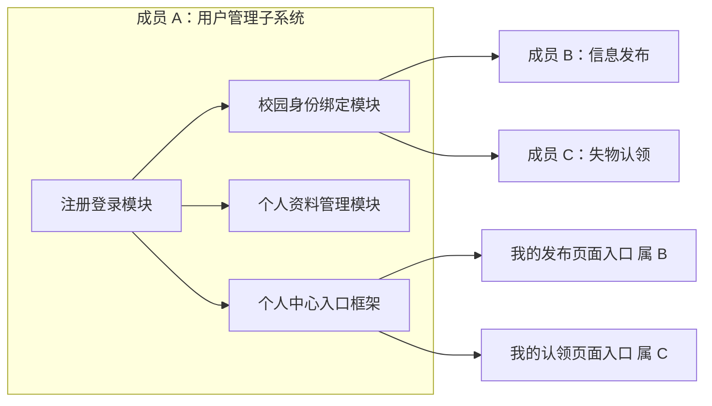
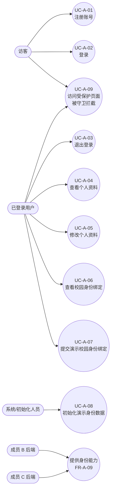
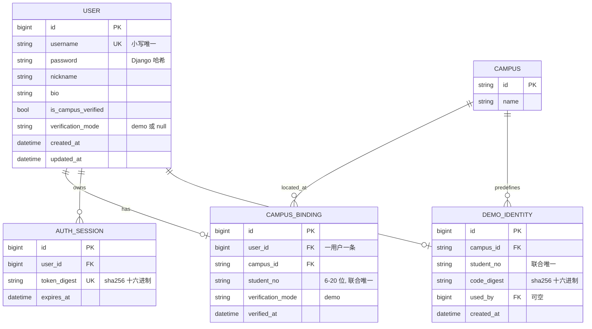

# 成员 A：用户管理子系统需求规格说明书

## 1. 文档信息与版本

| 项目 | 内容 |
|---|---|
| 文档名称 | 校园失物招领系统——成员 A 用户管理子系统需求规格说明书 |
| 文档编号 | SRS-A-001 |
| 文档版本 | v1.1 |
| 编写日期 | 2026-11-02 |
| 作者 | 成员 A（用户管理） |
| 文档状态 | 已评审，作为设计、编码与测试的依据 |
| 适用项目 | 软件工程课程项目：校园失物招领系统（Django 5.2 + DRF + Vue 3 + SQLite） |
| 需求来源 | 本说明书第 2 节需求基线（编号在团队内冻结）、[共同字段与接口约定](../共同字段与接口约定.md) 第 2、3.2、3.3、4、8 节、课程《课程项目说明》 |

### 1.1 版本记录

| 版本 | 日期 | 修订说明 | 修订人 |
|---|---|---|---|
| v0.1 | 2026-11-02 | 依据协作契约与共同字段约定，形成用户管理子系统需求初稿 | 成员 A |
| v1.0 | 2026-11-02 | 补齐用例规约、业务规则、需求追踪矩阵、验收标准；需求编号与契约第 2 节对齐，定稿 | 成员 A |
| v1.1 | 2026-11-02 | 按 CR-A-08 对齐共同契约 §4：校园身份被他人占用由 400 改为 409 `DUPLICATE_RESOURCE`；400 仅保留身份不存在/绑定码摘要不匹配；同步 UC-A-07、FR-A-07、接口摘要与 AC-A-06 | 成员 A |

## 2. 引言

### 2.1 目的

本文定义校园失物招领系统中成员 A 负责的**用户管理子系统**的需求边界、功能与非功能需求、业务规则、数据与接口约束及验收标准。读者对象为：项目负责人（Lead）、成员 B（信息发布与浏览）、成员 C（失物认领）、实现者、验证者与课程评阅教师。

本文的用途有三点：

1. 作为设计与编码的输入：每条功能需求都能落到具体接口、校验规则与数据约束；
2. 作为测试的依据：每条需求都有对应测试用例（见[测试用例](../test/A-用户管理-测试用例.md)）；
3. 作为课程验收的说明材料：明确成员 A 的个人贡献边界与三人的协作接口。

### 2.2 范围

**在范围内**：账号注册、登录、退出登录、登录身份（Bearer 令牌）校验、本人资料查看与修改、校园身份绑定（演示认证）的查看与提交、登录与绑定的频率限制、演示身份数据初始化、四个前端页面及个人中心入口框架，以及为 B/C 提供的身份与公开用户摘要能力。

**不在范围内**：信息发布与浏览（B）、失物认领与站内沟通与规则匹配（C）、真实学校统一身份认证、短信/邮箱验证、密码找回与修改密码、账号注销、解绑或更换校园身份、管理员后台与争议裁决（第四子系统，第一版不开发）。

### 2.3 术语与缩略语

| 术语 | 说明 |
|---|---|
| A / B / C | 分别指用户管理、信息发布和浏览、失物认领三个子系统的负责人及对应代码模块 |
| UserSelf | 本人资料响应结构：`id/username/nickname/bio/is_campus_verified/verification_mode/created_at/updated_at` |
| UserSummary | 公开用户摘要：仅 `id/nickname/is_campus_verified/verification_mode`，供 B/C 使用 |
| 演示认证（demo） | 第一版未接入学校认证服务，使用预置“校区 + 测试学号 + 一次性绑定码”模拟校园身份核验，页面必须标注“演示认证” |
| 一次性绑定码 | 服务端预置、以 `sha256` 摘要保存、使用后随身份作废的校验码；明文只在初始化命令或隔离测试环境中出现 |
| 脱敏学号 | 保留末 4 位、其余字符替换为 `*` 的学号展示值，如 `20260001` → `****0001` |
| Bearer 令牌 | 登录成功后签发的随机访问令牌，有效期 24 小时，服务端只保存其 SHA-256 摘要，可撤销 |
| 严格校验 | 请求中出现未知字段、只读字段、重复参数或非对象 JSON 时返回 400，不静默忽略 |
| 固定窗口限流 | 以固定时间窗（60 秒）计数并拦截超限请求的限流算法 |
| 幂等 | 同一命令或请求重复执行不产生重复数据或额外副作用 |
| 共同契约 | [共同字段与接口约定](../共同字段与接口约定.md)，三人共享的字段、接口、权限与错误码依据 |

### 2.4 参考资料

1. [共同字段与接口约定](../共同字段与接口约定.md) 第 2、3.2、3.3、4、8 节：全局响应包装、错误码、字段字典、A 模块接口定义与共同验收清单 T01～T14。
2. [项目文件结构说明](../项目文件结构说明.md) v0.3：目录规划、分层职责、文件归属。
3. [联调与验收](../联调与验收.md)：成员 C 已执行验收记录，以及 A/B 接入清单（身份能力、公开摘要、路由与前端会话要求）。
4. [README](../../README.md)：环境、启动与验证命令。
5. 课程《课程项目说明》：要求每位同学独立完成至少两个功能模块的需求分析、系统设计、编码与测试，并清晰界定个人贡献边界，提交项目验收与实验报告。
6. Django 5.2 与 Django REST framework 3.16 官方文档：用户模型、认证、事务、测试相关实现依据。

## 3. 项目概述

### 3.1 背景与目标

校园失物招领系统面向在校师生：拾获者发布招领信息，失主检索并提交认领申请，双方站内沟通后完成交接。系统要求发布信息与发起认领的用户已完成校园身份核验，以保证参与者可追溯。

成员 A 负责系统的**身份与账户基础层**：任何人先注册账号并登录，才能获得受保护的业务能力；完成校园身份绑定后，才能发布信息与发起认领。由于课程环境无法接入真实学校认证服务，第一版采用**预置测试身份的演示绑定**，并以页面文案与文档明确标注，不声称真实校园认证。

### 3.2 子系统边界与个人贡献

| 维度 | 成员 A（本文） | 成员 B | 成员 C |
|---|---|---|---|
| 功能模块 | 注册登录；校园身份绑定；个人资料管理（含个人中心入口框架） | 信息发布与维护；列表与详情浏览；搜索筛选 | 认领流程；双方站内沟通；规则匹配 |
| 提供能力 | 登录身份、令牌、`require_campus_verified`、`UserSummary`、演示身份初始化 | 校区/类别/地点字典、公开信息与图片 | 认领、消息、匹配 |
| 依赖关系 | 依赖 B 的 `Campus` 字典与校区列表接口（缺失时前端降级） | 依赖 A 的登录与认证前置 | 依赖 A 的登录、认证与公开摘要；依赖 B 的信息状态 |
| 不负责 | 信息、图片、认领、消息、管理员 | 账户与身份 | 账户与身份 |

A 的贡献边界以本文第 6 节功能需求与第 9 节接口清单为准；三人的共享字段与协作接口以共同契约为准。个人中心页面框架与导航由 A 提供，但“我的发布”列表与接口属 B、“我的认领/收到的申请”列表与接口属 C。

### 3.3 模块划分

| 模块 | 包含需求 | 说明 |
|---|---|---|
| 注册登录 | FR-A-01、02、03、08、10 | 账号生命周期、令牌与会话、登录限流 |
| 校园身份绑定 | FR-A-06、07、10、11 | 演示身份校验、绑定事务、绑定限流、演示数据初始化 |
| 个人资料管理 | FR-A-04、05、09 | 本人资料读写、公开摘要、身份能力输出 |
| 个人中心入口框架 | FR-A-12 | 四个页面、路由守卫、导航与会话刷新 |

## 4. 角色与用例

### 4.1 角色

| 角色 | 说明 | 可执行用例 |
|---|---|---|
| 访客 | 未登录的浏览器用户 | UC-A-01、UC-A-02；浏览公开信息 |
| 注册用户 | 已注册但未登录 | UC-A-02 |
| 已登录用户 | 持有效 Bearer 令牌 | UC-A-03、UC-A-04、UC-A-05、UC-A-06、UC-A-07 |
| 已认证用户 | 已登录且完成校园身份绑定 | 具备 B/C 的写业务前置条件（由 B/C 接口校验） |
| 系统/初始化人员 | 执行管理命令的开发者或运维 | UC-A-08 |
| 其他子系统 | B、C 通过内部函数调用身份能力 | 无独立前端用例，体现在 FR-A-09 |

第一版不设管理员角色，不包含审核、封禁、解绑等管理用例。

### 4.2 用例图

### 4.3 用例规约

#### UC-A-01 注册账号

| 项目 | 内容 |
|---|---|
| 参与者 | 访客 |
| 前置条件 | 无 |
| 触发 | 在注册页填写账号、昵称、密码、确认密码并提交 |
| 主流程 | 1. 前端即时校验账号正则、密码长度、昵称长度、两次密码一致；2. 提交 `POST /api/v1/auth/register`；3. 服务端严格校验并创建用户，账号存小写、密码哈希存储；4. 返回 201 与本人资料，不签发令牌 |
| 备选/异常 | 账号已存在 → 409 `DUPLICATE_RESOURCE`；字段非法或未知字段 → 400 `VALIDATION_ERROR` 并给出字段错误；并发注册同账号最多一个成功 |
| 后置条件 | 新用户可登录；未登录状态不变（不自动登录） |
| 关联需求 | FR-A-01、NFR-A-01、NFR-A-04 |

#### UC-A-02 登录

| 项目 | 内容 |
|---|---|
| 参与者 | 访客、注册用户 |
| 前置条件 | 账号已注册且 `is_active=true` |
| 触发 | 在登录页输入账号密码并提交，或从受保护页面被跳转后登录 |
| 主流程 | 1. 提交 `POST /api/v1/auth/login`；2. 服务端账号转小写后校验密码；3. 新建独立 `AuthSession`，签发 24 小时令牌并保存摘要；4. 返回令牌、类型、过期时间与本人资料；5. 前端保存内存会话并跳转 `?next=` 目标或演示工作台 |
| 备选/异常 | 账号不存在、密码错误、账号禁用 → 统一 401 “账号或密码错误”；超过限流 → 429 并带 `Retry-After` |
| 后置条件 | 浏览器内存中持有令牌；服务端存在对应会话记录 |
| 关联需求 | FR-A-02、FR-A-08、FR-A-10、FR-A-12 |

#### UC-A-03 退出登录

| 项目 | 内容 |
|---|---|
| 参与者 | 已登录用户 |
| 前置条件 | 持有效令牌 |
| 触发 | 点击导航“退出登录” |
| 主流程 | 1. 前端调用 `POST /api/v1/auth/logout`；2. 服务端删除当前令牌对应会话；3. 前端清空内存会话并跳转 `/demo`（保持 C 的既有行为） |
| 备选/异常 | 令牌已失效 → 401，前端按未登录处理并清理会话；不影响同一账号的其他会话 |
| 后置条件 | 当前令牌立即失效；其他会话不受影响 |
| 关联需求 | FR-A-03、FR-A-08、FR-A-12 |

#### UC-A-04 查看个人资料

| 项目 | 内容 |
|---|---|
| 参与者 | 已登录用户 |
| 前置条件 | 持有效令牌 |
| 触发 | 打开 `/me/profile` |
| 主流程 | 1. 页面调用 `GET /api/v1/users/me`；2. 服务端返回 `UserSelf` 全部字段；3. 页面展示账号（只读）、注册时间、认证状态、昵称、简介 |
| 备选/异常 | 未登录 → 401，路由守卫跳转登录；请求失败 → 页面显示错误提示，不展示半成品数据 |
| 后置条件 | 无数据变更 |
| 关联需求 | FR-A-04、FR-A-12、NFR-A-01 |

#### UC-A-05 修改个人资料

| 项目 | 内容 |
|---|---|
| 参与者 | 已登录用户 |
| 前置条件 | 持有效令牌 |
| 触发 | 在个人资料页修改昵称或简介后点击保存 |
| 主流程 | 1. 前端校验长度并提交 `PATCH /api/v1/users/me`；2. 服务端校验至少一个字段、字段长度与字段白名单；3. 保存并返回完整 `UserSelf`；4. 前端同步内存会话中的用户资料并提示成功 |
| 备选/异常 | 空对象 → 400；未知/只读字段（如 `username`、`is_campus_verified`）→ 400；超长 → 400 字段错误 |
| 后置条件 | 资料更新，`updated_at` 变化；公开摘要中的昵称随之更新 |
| 关联需求 | FR-A-05、FR-A-12 |

#### UC-A-06 查看校园身份绑定

| 项目 | 内容 |
|---|---|
| 参与者 | 已登录用户 |
| 前置条件 | 持有效令牌 |
| 触发 | 打开 `/me/campus-binding` |
| 主流程 | 1. 页面调用 `GET /api/v1/users/me/campus-binding`；2. 未绑定时返回 `data:null` 并展示绑定表单；3. 已绑定时返回脱敏学号、校区、认证方式与绑定时间，只读展示 |
| 备选/异常 | 未登录 → 401 并跳转登录；请求失败 → 页面提示错误，不误判为未绑定 |
| 后置条件 | 无数据变更 |
| 关联需求 | FR-A-06、FR-A-12、NFR-A-01 |

#### UC-A-07 提交演示校园身份绑定

| 项目 | 内容 |
|---|---|
| 参与者 | 已登录用户 |
| 前置条件 | 已登录且尚未绑定；已获得某测试身份的可用一次性绑定码；存在有效 `campus_id` |
| 触发 | 在绑定页选择校区、填写学号与绑定码并提交 |
| 主流程 | 1. 前端校验格式后提交 `POST /api/v1/users/me/campus-binding`；2. 服务端在同事务内锁定演示身份、校验校区/学号/绑定码；3. 创建绑定、标记身份已使用、置用户认证标记；4. 返回 201 与脱敏绑定视图；5. 前端重新读取绑定与本人资料，更新“演示认证”状态 |
| 备选/异常 | 已绑定 → 409；校区不存在 / 学号格式 / 绑定码长度 → 400 字段错误；身份已被他人占用 → 409 `DUPLICATE_RESOURCE`；身份不存在或绑定码摘要不匹配 → 400，错误归 `binding_code`；并发绑定同一身份胜者 201、败者 409；超限 → 429 |
| 后置条件 | 用户获得演示认证；该身份不可被再次使用；失败时用户认证状态与身份均不变 |
| 关联需求 | FR-A-07、FR-A-10、NFR-A-03、FR-A-12 |

#### UC-A-08 初始化演示身份数据

| 项目 | 内容 |
|---|---|
| 参与者 | 系统/初始化人员（`seed_demo_users` 命令） |
| 前置条件 | `DEMO_MODE=True` |
| 触发 | 执行 `manage.py seed_demo_users`（可带 `--reset-codes`） |
| 主流程 | 1. 确保演示校区存在；2. 幂等创建 6 个测试身份并保存绑定码摘要，打印可用学号与绑定码；3. 为已有演示认证账号在无绑定时补建绑定；4. 输出可用身份数量提示 |
| 备选/异常 | 非演示模式 → `CommandError` 且不写数据；身份已存在且未使用 → 保持原码并提示可 `--reset-codes`；已使用身份不重置码、不重复绑定 |
| 后置条件 | 环境具备可执行的演示绑定数据；重复执行不产生重复记录 |
| 关联需求 | FR-A-11、NFR-A-07 |

#### UC-A-09 未登录访问受保护页面

| 项目 | 内容 |
|---|---|
| 参与者 | 访客 |
| 前置条件 | 浏览器内存会话为空 |
| 触发 | 直接访问受保护页面（个人资料、校园身份绑定等） |
| 主流程 | 1. 路由守卫检查会话与路由元数据；2. 跳转 `/login?next=<原路径>`；3. 登录成功后回跳原路径 |
| 备选/异常 | `next` 不以 `/` 开头或以 `//` 开头 → 拒绝并跳默认页，避免开放重定向 |
| 后置条件 | 用户停留在登录页；登录后进入目标页 |
| 关联需求 | FR-A-12 |

## 5. 业务规则

| 编号 | 规则 | 对应需求 |
|---|---|---|
| BR-A-01 | 账号由 4～32 位字母、数字、下划线组成，全校唯一，统一按小写存储与比对；注册后不可修改 | FR-A-01 |
| BR-A-02 | 密码长度 8～64 字符，按原值校验（不裁剪空白、不改大小写），仅以 Django 密码哈希保存，任何响应不返回明文或哈希 | FR-A-01、NFR-A-01 |
| BR-A-03 | 登录成功建立独立会话；令牌 24 小时有效，服务端只保存 SHA-256 摘要；令牌明文只在登录响应中出现一次 | FR-A-02、FR-A-08、NFR-A-01 |
| BR-A-04 | 登录失败一律返回 401 “账号或密码错误”，不区分账号不存在、密码错误与账号禁用，避免枚举账号 | FR-A-02 |
| BR-A-05 | 退出登录只撤销当前令牌；旧令牌立即失效；同一账号其他会话继续有效 | FR-A-03 |
| BR-A-06 | 一个用户最多一条校园身份绑定；第一版不开放解绑与更换 | FR-A-06、FR-A-07 |
| BR-A-07 | 校园身份绑定只接受“预置校区 + 预置学号 + 一次性绑定码”三者同时匹配且身份未被使用；不提供客户端自设认证结果的能力 | FR-A-07、NFR-A-01 |
| BR-A-08 | 同一“校区 + 学号”联合唯一；绑定码仅以 `sha256` 摘要保存，使用后身份作废 | FR-A-07、NFR-A-03 |
| BR-A-09 | 用户认证标记 `is_campus_verified`/`verification_mode` 只由绑定服务与初始化命令写入，任何 HTTP 请求不得直接赋值 | FR-A-07、FR-A-09、NFR-A-04 |
| BR-A-10 | 学号对外只返回脱敏值（保留末 4 位，其余替换为 `*`）；绑定码、令牌摘要、密码哈希不进入响应 | FR-A-06、NFR-A-01 |
| BR-A-11 | 所有请求严格校验字段白名单：未知字段、只读字段、重复参数、非对象 JSON 返回 400；普通文本去首尾空白，密码、令牌、绑定码不裁剪 | FR-A-01、FR-A-05、NFR-A-04 |
| BR-A-12 | 登录限每来源 IP 每分钟 10 次；绑定限每登录用户每分钟 5 次；超限返回 429 并带 `Retry-After` | FR-A-10 |
| BR-A-13 | 绑定创建、身份标记、用户认证标记必须在同一事务内提交；任一步失败整体回滚；并发同一身份最多一个成功 | FR-A-07、NFR-A-03 |
| BR-A-14 | 响应统一使用 `code/message/data` 包装，错误另含对象 `errors`；错误码遵循共同契约第 2.4 节，不向客户端泄露堆栈与 SQL | FR-A-01～12、NFR-A-01、NFR-A-04 |
| BR-A-15 | 前端令牌仅保存在内存，刷新页面后需重新登录；第一版不提供刷新令牌接口 | FR-A-12、NFR-A-05 |

## 6. 功能需求

说明：每个需求均以契约第 2 节编号为准；“关联用例”列给出[测试用例](../test/A-用户管理-测试用例.md)编号。

### 6.1 FR-A-01 账号注册

| 项目 | 内容 |
|---|---|
| 描述 | 访客使用唯一账号、密码与昵称注册；注册成功返回本人资料，**不自动登录、不返回令牌** |
| 输入 | `POST /api/v1/auth/register`，JSON：`username`（4～32 位字母/数字/下划线）、`password`（8～64 字符）、`nickname`（1～30 字） |
| 处理 | 严格校验字段白名单与格式；`username` 转小写；昵称去首尾空白；账号唯一性检查；使用 Django `set_password` 生成哈希；创建用户 |
| 输出 | 201，`data` 为 `UserSelf`（不含令牌与密码字段） |
| 异常 | 账号重复 → 409 `DUPLICATE_RESOURCE`（并发/已存在时稳定返回 409）；格式/长度/未知字段 → 400 `VALIDATION_ERROR` 并给字段错误；非 JSON → 400 |
| 优先级 | P0 |
| 关联用例 | TC-A-001～007 |

### 6.2 FR-A-02 登录

| 项目 | 内容 |
|---|---|
| 描述 | 账号密码正确时签发访问令牌并返回本人资料；失败时统一提示“账号或密码错误” |
| 输入 | `POST /api/v1/auth/login`，JSON：`username`、`password` |
| 处理 | 账号转小写；校验密码与 `is_active`；新建独立 `AuthSession`（令牌摘要 + 24 小时过期）；返回令牌明文与过期时间 |
| 输出 | 200，`data`：`access_token`、`token_type="Bearer"`、`expires_at`（UTC ISO8601）、`user`（`UserSelf`） |
| 异常 | 账号不存在/密码错误/账号禁用 → 401 `UNAUTHENTICATED`，文案统一；缺字段 → 400；超限 → 429（见 FR-A-10） |
| 优先级 | P0 |
| 关联用例 | TC-A-008～013 |

### 6.3 FR-A-03 退出登录

| 项目 | 内容 |
|---|---|
| 描述 | 撤销当前令牌，使旧令牌立即失效，不影响其他会话 |
| 输入 | `POST /api/v1/auth/logout`，空对象 `{}` |
| 处理 | 由认证类解析当前会话，删除 `request.auth` 对应 `AuthSession` 记录 |
| 输出 | 200，`data:null` |
| 异常 | 无令牌/已撤销/过期令牌 → 401 `UNAUTHENTICATED`；重复登出不成功、不报 500 |
| 优先级 | P0 |
| 关联用例 | TC-A-014～016 |

### 6.4 FR-A-04 查看本人资料

| 项目 | 内容 |
|---|---|
| 描述 | 返回本人 `UserSelf` 全部约定字段，不返回密码或哈希 |
| 输入 | `GET /api/v1/users/me`（无参数） |
| 处理 | 按令牌确定当前用户；从本人资料查询函数读取；按约定结构序列化 |
| 输出 | 200，`data` 为 `UserSelf`：`id`（字符串）、`username`、`nickname`、`bio`、`is_campus_verified`、`verification_mode`、`created_at`、`updated_at` |
| 异常 | 未登录/无效令牌 → 401 |
| 优先级 | P0 |
| 关联用例 | TC-A-021、022 |

### 6.5 FR-A-05 修改本人资料

| 项目 | 内容 |
|---|---|
| 描述 | 仅允许修改昵称与简介，至少提交一个字段；未知或只读字段返回 400；返回修改后的完整资料 |
| 输入 | `PATCH /api/v1/users/me`，JSON：可选 `nickname`（1～30 字）、`bio`（0～200 字，允许空串），至少一个 |
| 处理 | 严格校验白名单；空对象报错；长度校验；普通文本去首尾空白；保存并刷新 `updated_at` |
| 输出 | 200，`data` 为修改后的 `UserSelf` |
| 异常 | 空对象 → 400；未知/只读字段（`username`、`is_campus_verified`、`verification_mode`、`password_hash`、`id` 等）→ 400；超长 → 400 字段错误；未登录 → 401 |
| 优先级 | P0 |
| 关联用例 | TC-A-022～028 |

### 6.6 FR-A-06 查看校园身份绑定

| 项目 | 内容 |
|---|---|
| 描述 | 未绑定返回 `null`；已绑定返回脱敏学号、校区、认证方式与绑定时间 |
| 输入 | `GET /api/v1/users/me/campus-binding` |
| 处理 | 查询本人绑定记录（一用户最多一条）；有记录则序列化为绑定视图，学号脱敏 |
| 输出 | 200，`data` 为绑定视图 `{campus_id, student_no_masked, verification_mode, verified_at}` 或 `null` |
| 异常 | 未登录 → 401；无绑定不视为错误 |
| 优先级 | P1 |
| 关联用例 | TC-A-029、031、039、053 |

### 6.7 FR-A-07 演示校园身份绑定

| 项目 | 内容 |
|---|---|
| 描述 | 只接受预置“校区 + 学号 + 一次性绑定码”匹配且未使用的演示身份；成功置认证标记；已绑定或身份被占用返回 409；事务与并发受控 |
| 输入 | `POST /api/v1/users/me/campus-binding`，JSON：`campus_id`、`student_no`（6～20 位字母/数字）、`binding_code`（6～64 字符） |
| 处理 | 1. 限流（每用户每分钟 5 次）；2. 校验字段格式、校区存在性与是否已绑定（已绑定 409）；3. 事务内 `select_for_update()` 锁定演示身份，校验身份未被占用、绑定码摘要匹配；4. 创建 `CampusBinding`、置 `used_by`、置 `User.is_campus_verified=True` 与 `verification_mode="demo"`；5. 任一步失败整体回滚 |
| 输出 | 201，`data` 为绑定视图（脱敏学号、校区、认证方式、绑定时间） |
| 异常 | 已绑定 → 409 `DUPLICATE_RESOURCE`；`campus_id` 不存在 → 400 归该字段；学号格式非法 → 400 归该字段；绑定码长度非法 → 400 归该字段；身份已被他人占用 → 409 `DUPLICATE_RESOURCE`（消息“该校园身份已被绑定”）；身份不存在/绑定码摘要不匹配 → 400 `VALIDATION_ERROR` 归 `binding_code`（文案“绑定码无效或已被使用”）；并发同一身份 → 胜者 201、败者 409；超限 → 429 |
| 优先级 | P0 |
| 关联用例 | TC-A-030、032～038、049、050 |

### 6.8 FR-A-08 登录身份校验

| 项目 | 内容 |
|---|---|
| 描述 | Bearer 令牌 24 小时有效、服务端仅存摘要、可撤销；无效令牌返回 401；公开接口携带无效令牌同样 401 |
| 输入 | 请求头 `Authorization: Bearer <token>` |
| 处理 | 解析 Bearer 头；SHA-256 摘要后查询未过期会话且用户可用；成功设置 `request.user` 与 `request.auth`；失败抛认证异常；未带令牌的公开接口按匿名处理 |
| 输出 | 受保护接口可访问；认证失败为 401 `UNAUTHENTICATED` 且带 `WWW-Authenticate: Bearer` |
| 异常 | 无令牌访问受保护接口 → 401；格式错误（非 Bearer、多段、单段）→ 401；过期/已撤销 → 401；公开接口携带无效令牌 → 401 |
| 优先级 | P0 |
| 关联用例 | TC-A-008、014、017～020 |

### 6.9 FR-A-09 为 B/C 提供身份能力

| 项目 | 内容 |
|---|---|
| 描述 | 为其他子系统提供稳定的内部身份能力：`require_campus_verified(user)` 未认证返回 403 `IDENTITY_REQUIRED`；`user_summary`/`get_user_summaries` 只输出公开字段 |
| 输入 | 内部函数调用（非公开 HTTP 接口） |
| 处理 | 保留既有签名与语义；认证标记来自绑定结果；公开摘要固定为 `id/nickname/is_campus_verified/verification_mode` |
| 输出 | 校验通过无返回值或返回摘要字典/映射 |
| 异常 | 未认证 → `BusinessError("IDENTITY_REQUIRED", …, 403)`；查询不到用户时批量查询只返回存在的用户 |
| 优先级 | P0 |
| 关联用例 | TC-A-040～044、074、075 |

### 6.10 FR-A-10 频率限制

| 项目 | 内容 |
|---|---|
| 描述 | 登录按来源 IP、绑定按登录用户限流；超限返回 429 并带 `Retry-After` |
| 输入 | 登录与绑定请求；限流键分别为 `REMOTE_ADDR` 与 `request.user.pk` |
| 处理 | 固定窗口计数（60 秒）；登录上限 10 次、绑定上限 5 次；窗口内超限即拒绝；可由配置开关关闭（测试默认关闭，避免干扰回归） |
| 输出 | 正常业务响应；超限时 429 `RATE_LIMITED` + `Retry-After` 正整数秒 |
| 异常 | 限流键缺失（绑定未登录不可能到达）不影响其他用户；窗口结束后恢复 |
| 优先级 | P1 |
| 关联用例 | TC-A-045～048 |

### 6.11 FR-A-11 演示数据初始化

| 项目 | 内容 |
|---|---|
| 描述 | 幂等创建演示校区与 6 个一次性测试校园身份；为已有演示认证账号补绑定记录；输出可用绑定码 |
| 输入 | 命令 `manage.py seed_demo_users [--reset-codes]`；环境变量 `DEMO_MODE`、`DEMO_BINDING_CODE` |
| 处理 | 非 `DEMO_MODE` 抛 `CommandError`；确保 `campus_main` 存在；创建/保持 6 个身份的码摘要；`--reset-codes` 只重置未使用身份的码并打印；为 `publisher/applicant/competitor` 在无绑定时创建绑定（学号 20260001～3）并置 `used_by`；不认证 `unverified` 与普通用户 |
| 输出 | 命令输出：新建身份的“学号 + 绑定码”；已有身份数量提示；可用绑定码（`--reset-codes`） |
| 异常 | 非演示模式 → 非 0 退出、不写数据；重复执行不产生重复记录；已使用身份不打印码 |
| 优先级 | P1 |
| 关联用例 | TC-A-055～058 |

### 6.12 FR-A-12 前端页面

| 项目 | 内容 |
|---|---|
| 描述 | 提供登录、注册、个人资料、校园身份绑定四个页面；未登录访问受保护页面跳转登录并回跳；成功后刷新内存会话 |
| 输入 | 浏览器操作与 `?next=`、`?registered=`、`?username=` 查询参数 |
| 处理 | 页面调用 `modules/users/api.js` 的服务函数（经 `shared/http.js`）；登录成功由页面调用 `setSession`；注册成功不自动登录，跳转登录页并提示；路由守卫检查 `meta.requiresAuth`；绑定页成功后重新读取绑定与本人资料；校区列表接口不可用时降级为文本输入 |
| 输出 | 四个页面可完成各自流程；导航新增“登录/注册”“个人中心”；退出登录保持跳转 `/demo` |
| 异常 | 前端校验失败不发请求并显示字段错误；服务端字段错误按字段展示；409/400 给出明确提示；提交期间按钮禁用；`next` 非站内路径被拒绝 |
| 优先级 | P1 |
| 关联用例 | TC-A-059～071 |

## 7. 非功能需求

| 编号 | 需求 | 描述与度量 | 验证方式 |
|---|---|---|---|
| NFR-A-01 | 安全 | 密码使用 Django 密码哈希；令牌只存 SHA-256 摘要；响应中永不出现密码、哈希、学号明文、绑定码、令牌摘要；500 不泄露堆栈 | TC-A-030、051～054；响应全文扫描 |
| NFR-A-02 | 隐私 | 公开用户摘要仅含 `id/nickname/is_campus_verified/verification_mode`，不含账号、真实姓名、学号、联系方式；第一版不提供他人个人主页 | TC-A-043、053、070 |
| NFR-A-03 | 数据一致性 | 绑定与用户认证标记同一事务；一用户一条绑定；校区+学号联合唯一；并发绑定同一身份只能成功一次；绑定失败无任何副作用 | TC-A-033、038、049、050 |
| NFR-A-04 | 可维护性 | 按 `views/serializers/services/selectors/permissions/throttles` 分层；严格拒绝未知与只读字段；错误码与响应包装统一；模块间只通过服务函数协作 | TC-A-006、026、044、077；代码走查 |
| NFR-A-05 | 兼容性 | A 正式路由替换 `demo` 中登录/登出/本人资料入口后，C 的 52 项后端测试与 21 项前端测试仍通过；C 接口的身份前置与公开摘要语义不变 | TC-A-072～076 |
| NFR-A-06 | 可用性 | 表单前后端双重校验、字段级错误提示；提交期间禁用按钮；390px 手机宽度可操作且无横向溢出；页面使用文本插值不渲染 HTML | TC-A-059～071 |
| NFR-A-07 | 可复现 | 初始化与验证脚本可重复执行；测试使用隔离数据库；普通演示数据库不被测试污染；限流在测试中默认关闭 | TC-A-055、072、078 |

## 8. 数据需求

### 8.1 数据实体

### 8.2 字段与可见性

| 结构 | 字段 | 可见范围 |
|---|---|---|
| `UserSelf` | `id/username/nickname/bio/is_campus_verified/verification_mode/created_at/updated_at` | 仅本人 |
| `UserSummary` | `id/nickname/is_campus_verified/verification_mode` | 公开信息、认领双方等 B/C 场景 |
| 绑定视图 | `campus_id/student_no_masked/verification_mode/verified_at` | 仅本人 |
| 服务端内部 | `password`（哈希）、`token_digest`、`student_no`、`code_digest`、`used_by` | 不进入任何响应 |

### 8.3 数据约束与保留

| 约束 | 说明 |
|---|---|
| 账号唯一 | `username` 统一小写后唯一，注册后不可修改 |
| 一用户一绑定 | `CampusBinding.user` 一对一；第一版无解绑接口 |
| 校区+学号唯一 | 数据库联合唯一约束，防止同一身份被两人绑定 |
| 身份一次性 | `DemoIdentity.used_by` 非空即视为已使用；绑定码摘要不还原明文 |
| 会话可撤销 | 登出删除记录；过期记录不再通过认证；摘要唯一 |
| 时间与 ID | 时间统一 UTC ISO8601 输出；对外 ID 统一字符串；内部使用自增整数主键 |
| 删除策略 | 第一版不物理删除业务数据；用户删除属范围外（未开放接口） |

## 9. 接口需求摘要

全部路径挂 `/api/v1`，不带结尾斜杠；成功响应统一 `{code, message, data}`，失败另含 `errors` 对象。

| 方法 | 路径 | 权限 | 请求 | 成功 | 主要错误 |
|---|---|---|---|---|---|
| POST | `/auth/register` | 匿名 | `username, password, nickname` | 201 `UserSelf` | 400 字段/格式；409 `DUPLICATE_RESOURCE` |
| POST | `/auth/login` | 匿名 | `username, password` | 200 `{access_token, token_type, expires_at, user}` | 400；401 统一文案；429 `RATE_LIMITED` |
| POST | `/auth/logout` | 登录 | 空对象 | 200 `data:null` | 401 |
| GET | `/users/me` | 登录 | 无 | 200 `UserSelf` | 401 |
| PATCH | `/users/me` | 登录 | 可选 `nickname, bio`，至少一个 | 200 `UserSelf` | 400 空对象/未知字段/长度；401 |
| GET | `/users/me/campus-binding` | 登录 | 无 | 200 绑定视图或 `null` | 401 |
| POST | `/users/me/campus-binding` | 登录且未绑定 | `campus_id, student_no, binding_code` | 201 绑定视图 | 400 字段错误/身份不存在/绑定码不匹配；409 已绑定/身份被占用；429 |

错误码沿用共同契约第 2.4 节：400 `VALIDATION_ERROR`、401 `UNAUTHENTICATED`、403 `FORBIDDEN`/`IDENTITY_REQUIRED`、404 `NOT_FOUND`、409 `DUPLICATE_RESOURCE`/`STATE_CONFLICT`、429 `RATE_LIMITED`、500 `INTERNAL_ERROR`。详细请求/响应示例与校验矩阵见详细设计文档。

## 10. 约束与假设

| 类别 | 内容 |
|---|---|
| 认证约束 | 第一版使用**演示认证**，不接入真实学校认证服务；页面与文档必须标注“演示认证”，不得声称真实认证 |
| 功能约束 | 不开放解绑/更换校园身份、密码找回、修改密码、账号注销；不收集真实校园卡照片 |
| 会话约束 | 令牌保存在前端内存，刷新页面需重新登录；不引入刷新令牌接口 |
| 技术约束 | Django 5.2.18 + DRF 3.16.1 + SQLite；前端 Vue 3 + Vite + Vitest + Playwright，JavaScript 非 TypeScript |
| 并发约束 | SQLite 使用 `IMMEDIATE` 写事务串行化写操作；`select_for_update()` 的实际语义依赖数据库能力，唯一约束为最终防线；不承诺多机部署下的并发能力 |
| 外部依赖 | 校区字典 `Campus` 由 B 维护；校区列表接口可为空或不可用，前端须降级；认证前置与公开摘要须与 C 的既有调用签名兼容 |
| 数据依赖 | 演示身份由 `seed_demo_users` 预置；普通演示库与测试库分离；测试不得污染 `backend/db.sqlite3` |
| 环境假设 | Windows + PowerShell，Python 3.11，Node.js 20.19+/22.12+；依赖已安装；pip 安装使用清华镜像 |
| 课程约束 | 三位同学各自独立完成模块并界定贡献边界；需提交文档、测试与实验报告；第四子系统（系统管理）不开发 |

## 11. 验收标准

| 编号 | 验收项 | 判定标准 | 对应需求 | 证据位置 |
|---|---|---|---|---|
| AC-A-01 | 注册 | 合法注册 201 且不返回令牌；重复 409；非法输入 400；并发只成功一次 | FR-A-01 | TC-A-001～007 |
| AC-A-02 | 登录与令牌 | 正确登录返回令牌/类型/过期时间/资料；失败统一 401；令牌可撤销、24 小时过期、仅存摘要 | FR-A-02、FR-A-08 | TC-A-008～020 |
| AC-A-03 | 登出 | 撤销当前令牌、旧令牌 401、其他会话不受影响 | FR-A-03 | TC-A-014～016 |
| AC-A-04 | 资料读写 | GET 字段完整无敏感信息；PATCH 仅昵称/简介且严格校验 | FR-A-04、FR-A-05 | TC-A-021～028 |
| AC-A-05 | 绑定读取 | 未绑定 `null`；已绑定返回脱敏学号 | FR-A-06 | TC-A-029、031、039 |
| AC-A-06 | 绑定提交 | 成功 201 并置认证标记；已绑定/身份被他人占用 → 409；身份不存在/绑定码不匹配 → 400；失败无副作用；并发败者 409 | FR-A-07 | TC-A-030、032～038、049、050 |
| AC-A-07 | 身份能力 | 未认证 403 `IDENTITY_REQUIRED`；公开摘要仅四字段 | FR-A-09 | TC-A-040～044 |
| AC-A-08 | 限流 | 登录第 11 次、绑定第 6 次 429 且带 `Retry-After`；键隔离与窗口恢复 | FR-A-10 | TC-A-045～048 |
| AC-A-09 | 演示数据 | 幂等；非演示模式拒绝；`--reset-codes` 只重置未使用身份；演示账号补绑定 | FR-A-11 | TC-A-055～058 |
| AC-A-10 | 前端 | 四页面可用；守卫回跳；错误提示；390px 可操作；退出登录跳 `/demo` | FR-A-12、NFR-A-06 | TC-A-059～071 |
| AC-A-11 | 安全与隐私 | 响应无密码/哈希/学号明文/绑定码；500 不泄露内部信息 | NFR-A-01、NFR-A-02 | TC-A-051～054 |
| AC-A-12 | 兼容回归 | C 的 52 项后端、21 项前端测试全通过；构建与检查通过；旧令牌与伪造字段不越权 | NFR-A-05、NFR-A-07 | TC-A-072～078 |

### 11.1 与共同验收清单的映射（A 负责部分）

| 共同编号 | 场景 | A 侧验收点 | 对应测试 |
|---|---|---|---|
| T01 | 未登录发布；登录但未认证发布 | 未登录 401；已登录未认证 403 `IDENTITY_REQUIRED`；数据库不产生信息 | TC-A-075 |
| T13 | 退出后复用旧令牌；伪造用户 ID 字段 | 旧令牌 401；伪造 `user_id`/`applicant_id`/认证字段返回 400 或不生效 | TC-A-074 |
| （补充） | 绑定事务失败整体回滚（T14 属 B/C，A 侧同类验证单列） | 在创建绑定后、置认证标记前注入异常：无半成品数据 | TC-A-050 |

T02～T12 的其他场景由 B/C 负责，A 仅提供身份与公开摘要能力，结论由各自验收记录给出。

## 12. 需求优先级

| 优先级 | 需求 | 依据 |
|---|---|---|
| P0（必须交付） | FR-A-01、02、03、04、05、07、08、09 | 账号生命周期、令牌安全、资料与绑定主流程、跨子系统身份能力；任一失败则本模块不可交付 |
| P1（重要） | FR-A-06、10、11、12 | 绑定只读视图、限流、演示数据初始化与前端页面；影响验收完整性与可用性 |
| P0 非功能 | NFR-A-01、02、03、05 | 安全、隐私、一致性、兼容回归为硬门槛 |
| P1 非功能 | NFR-A-04、06、07 | 可维护性、可用性、可复现性通过评审与检查单保证 |

## 13. 附录 A：需求追踪矩阵

“设计落点”对应 [概要设计](../design/A-用户管理-概要设计.md) 与 [详细设计](../design/A-用户管理-详细设计.md) 中的模块划分、接口规格、校验矩阵、时序/状态图章节；表结构见 [数据库设计](../数据库设计.md)。

| 需求 | 用例 | 设计落点 | 代码文件（实现完成后核对） | 测试用例 |
|---|---|---|---|---|
| FR-A-01 | UC-A-01 | 接口规格、注册校验矩阵、注册时序图 | `backend/users/{serializers,services,views,urls}.py`、`backend/common/serializers.py` | TC-A-001～007 |
| FR-A-02 | UC-A-02 | 接口规格、令牌签发、登录时序图 | `backend/users/services.py`、`authentication.py`、`config/settings.py` | TC-A-008～013 |
| FR-A-03 | UC-A-03 | 会话状态图、登出时序 | `backend/users/services.py`、`authentication.py` | TC-A-014～016 |
| FR-A-04 | UC-A-04 | 字段与可见性表、本人资料查询 | `backend/users/selectors.py`、`serializers.py` | TC-A-021、022 |
| FR-A-05 | UC-A-05 | 校验矩阵、修改资料时序图 | `backend/users/serializers.py`、`services.py` | TC-A-023～028 |
| FR-A-06 | UC-A-06 | 绑定视图与脱敏算法 | `backend/users/serializers.py`、`selectors.py` | TC-A-029、031、039 |
| FR-A-07 | UC-A-07 | 绑定时序图、事务与并发、错误码表 | `backend/users/{services,views,serializers}.py`、`models.py`、`migrations/0002_*.py` | TC-A-030、032～038、049、050 |
| FR-A-08 | UC-A-02、03 | 认证设计、错误码策略 | `backend/users/authentication.py`、`config/settings.py` | TC-A-008、014、017～020 |
| FR-A-09 | — | 与 B/C 协作接口、权限设计 | `backend/users/services.py`、`permissions.py` | TC-A-040～044、074、075 |
| FR-A-10 | UC-A-02、07 | 限流算法（固定窗口、键设计） | `backend/users/throttles.py`、`config/settings.py` | TC-A-045～048 |
| FR-A-11 | UC-A-08 | 初始化流程与数据准备 | `backend/users/management/commands/seed_demo_users.py` | TC-A-055～058 |
| FR-A-12 | UC-A-01、02、04～07、09 | 前端组件/路由/守卫/错误处理设计 | `frontend/src/modules/users/**`、`frontend/src/router/index.js`、`frontend/src/App.vue` | TC-A-059～071 |
| NFR-A-01 | — | 安全设计 | `backend/users/{authentication,services,serializers}.py` | TC-A-030、051～054 |
| NFR-A-02 | — | 公开摘要设计 | `backend/users/services.py` | TC-A-043、053、070 |
| NFR-A-03 | — | 事务与并发设计 | `backend/users/services.py`、`models.py` | TC-A-033、038、049、050 |
| NFR-A-04 | — | 分层与文件职责 | `backend/users/**`、`backend/common/**` | TC-A-006、026、044、077 |
| NFR-A-05 | — | 与 C 契约兼容设计 | `backend/users/services.py`、`backend/demo/*`、`frontend/src/router` | TC-A-072～076 |
| NFR-A-06 | — | 前端可用性设计 | `frontend/src/modules/users/**`、`App.vue` | TC-A-059～071 |
| NFR-A-07 | — | 初始化与测试隔离 | `seed_demo_users.py`、`config/settings.py`、`scripts/*` | TC-A-055、072、078 |

需求的实际执行结果统一登记在 `docs/test/A-用户管理-测试报告.md` 与 `docs/verify/A-用户管理-完整性验证报告.md`，本文不预填结果。

## 14. 变更记录

| 版本 | 日期 | 变更内容 | 变更人 | 影响 |
|---|---|---|---|---|
| v0.1 | 2026-11-02 | 依据契约第 2 节建立需求编号与初稿 | 成员 A | 形成 FR/NFR 清单 |
| v1.0 | 2026-11-02 | 补齐 9 个用例规约、15 条业务规则、追踪矩阵与 T01/T13 映射；与契约第 2 节编号对齐 | 成员 A | 可作为设计与测试基线 |
| v1.1 | 2026-11-02 | 绑定“身份被他人占用”改为 409 `DUPLICATE_RESOURCE`（CR-A-08，Lead 复核裁定）；400 仅保留身份不存在/绑定码摘要不匹配；同步 UC-A-07、FR-A-07、接口摘要、AC-A-06 | 成员 A | 测试用例 TC-A-033/TC-A-049、过程说明与设计文档同步 |
| v1.2 | 2026-11-09 | 按契约 v0.3 新增 FR-A-13“我的发布”：A 直接查询 B 的 `Post` 表，提供 `GET /users/me/posts` 与 `/me/posts` 页面 | 成员 A | 新增接口、页面、后端 6 项/前端 5 项测试 |

## 15. 附录：契约 v0.3 增量需求（2026-11-09）

| 编号 | 需求 | 描述 | 验收标准 | 设计/代码 | 测试 |
|---|---|---|---|---|---|
| FR-A-13 | 我的发布 | 登录用户可在个人中心查看本人发布的寻物/招领信息，支持类型/状态筛选与分页；按契约 v0.3，由 A 直接查询 B 的 `Post` 表（`publisher_id` 过滤），B 不再提供该列表接口 | 1. 未登录 401；2. 仅返回本人发布，默认包含本人全部状态；3. 返回 `PostSummary` 结构，公开用户摘要不含账号；4. `post_type`/`status` 非法值 400；5. 分页结构与排序稳定（`-created_at,-id`）；6. 前端 `/me/posts` 可筛选、翻页、展示空态与错误重试 | `backend/users/{serializers,selectors,views,urls}.py`、`frontend/src/modules/users/{api.js,pages/MyPostsPage.vue,routes.js}`、`App.vue`、`ProfilePage.vue` | `backend/users/tests/test_my_posts.py`（6 项）、`frontend/src/modules/users/tests/my-posts.spec.js`（5 项） |

补充说明：契约 v0.3 中的发布权限拆分（`lost` 仅登录、`found` 需认证）、`lost` 认领流程、图片 `alt_text`、`resolve_note/reopen`、`request_id` 幂等属于 B/C 的实现范围，A 模块只提供认证状态（`is_campus_verified`）并在本文第 3.2 节约定范围内保持不变。
