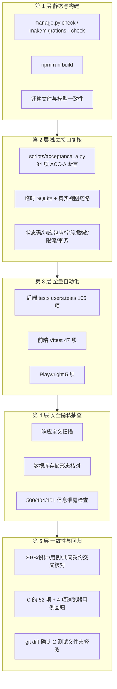
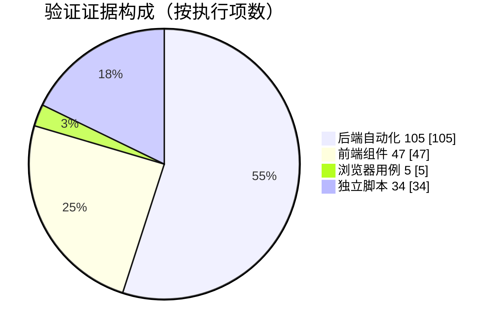

# 成员 A：用户管理子系统测试报告

| 项目 | 内容 |
|---|---|
| 文档名称 | 成员 A 用户管理子系统测试报告 |
| 文档版本 | v1.0 |
| 编写日期 | 2026-11-02 |
| 作者 | 验证角色 |
| 测试对象 | 用户管理子系统：注册登录、校园身份绑定、个人资料管理、为 B/C 提供的身份能力，以及前端四个页面 |
| 需求依据 | [需求规格说明书](../requirements/A-用户管理-需求规格说明书.md) FR-A-01～12、NFR-A-01～07；[共同字段与接口约定](../共同字段与接口约定.md) 第 2、3.2、3.3、4、7.3、8.3 节 |
| 配套文档 | [测试计划](A-用户管理-测试计划.md)、[测试用例](A-用户管理-测试用例.md)、[完整性验证报告](../verify/A-用户管理-完整性验证报告.md) |
| 执行方式 | 验证角色独立重跑与独立脚本复核；**本报告全部数字来自验证角色本人执行的命令，不引用实现者自述** |
| 结论 | **可交付**（A 模块自身完整；P0/P1 用例全部通过，无未关闭缺陷） |

## 1. 环境与版本（实测）

| 项目 | 实测值 | 获取方式 |
|---|---|---|
| 操作系统 | Windows 10.0.26200（本机课程演示环境） | `[System.Environment]::OSVersion` |
| Shell | Windows PowerShell 5.1（`pwsh` 包装） | `$PSVersionTable` |
| 后端解释器 | `.venv\Scripts\python.exe`（项目内虚拟环境） | 命令实际调用路径 |
| Python | 3.12.14 | `python -c "import sys; print(sys.version)"` |
| Django | 5.2.18 | `django.get_version()` |
| Django REST framework | 3.16.1 | `rest_framework.VERSION` |
| 数据库 | SQLite（`transaction_mode=IMMEDIATE`、`timeout=20`） | `backend/config/settings.py` |
| Node.js | v24.16.0 | `node --version` |
| npm | 11.13.0 | `npm --version` |
| Vue / vue-router | 3.5.43 / 4.6.4 | `frontend/package-lock.json` |
| Vite / Vitest / @vue/test-utils | 7.3.7 / 3.2.7 / 2.5.1 | `frontend/package-lock.json` |
| Playwright | @playwright/test 1.64.0（channel `chrome`，headless） | `frontend/package-lock.json`、`playwright.config.js` |
| 覆盖率工具 | Coverage.py 7.17.0（含 C 扩展，清华镜像安装） | `coverage --version` |

> 环境版本与[测试计划](A-用户管理-测试计划.md) §3.1 记录的差异（Python 3.11→实测 3.12.14，Node 24.15→24.16.0，npm 11.12.1→11.13.0）已登记为文档偏差 DV-A-03，不影响任何测试结论。

## 2. 验证方法

验证按“**实现者自测 ≠ 验收结论**”组织：实现者交付的测试只作为回归资产，验证角色独立重跑全部命令、独立编写接口验收脚本、独立逐条核对代码与响应，并对文档与实现的一致性做交叉比对。

**环境隔离**：独立验收脚本使用系统临时目录下的一次性 SQLite（`DJANGO_DB_PATH=<temp>/acceptance_a.sqlite3`），运行结束删除；Django 测试使用 `backend/test-claims.sqlite3` 并在结束时销毁；Playwright 使用 `backend/e2e.sqlite3`。普通演示库 `backend/db.sqlite3` 全程未被触碰（见 §8.6）。

## 3. 执行时间与命令清单

执行时间：2026-11-02 19:40～20:05（Asia/Shanghai），在仓库根目录执行，`$env:PYTHONUTF8='1'`。

| 序号 | 命令 | 实测结果 | 退出码 |
|---|---|---|---|
| 1 | `& .\.venv\Scripts\python.exe backend\manage.py check` | `System check identified no issues (0 silenced).` | 0 |
| 2 | `& .\.venv\Scripts\python.exe backend\manage.py makemigrations --check --dry-run` | `No changes detected` | 0 |
| 3 | `& .\.venv\Scripts\python.exe backend\manage.py test tests users.tests --noinput` | `Ran 105 tests in 38.926s` · `OK` | 0 |
| 4 | `& .\.venv\Scripts\python.exe backend\manage.py test users.tests --noinput` | `Ran 47 tests in 2.585s` · `OK` | 0 |
| 5 | `& .\.venv\Scripts\python.exe backend\manage.py test tests --noinput` | `Ran 58 tests in 44.996s` · `OK` | 0 |
| 6 | `cd frontend; npm.cmd test` | `Test Files 8 passed (8)` · `Tests 47 passed (47)` · 5.08s | 0 |
| 7 | `cd frontend; npm.cmd run build` | `✓ built in 1.91s` | 0 |
| 8 | `cd frontend; npm.cmd run test:e2e` | `Running 5 tests using 1 worker` · `5 passed (57.1s)` | 0 |
| 9 | `& .\.venv\Scripts\python.exe -m coverage run --source=backend/users --branch backend\manage.py test users.tests --noinput` | 47 项通过，生成 `.coverage` | 0 |
| 10 | `& .\.venv\Scripts\python.exe -m coverage report -m`（另加 `--omit=backend/users/tests/*`） | 生产代码综合覆盖率 93%（340 语句、17 未覆盖、68 分支、7 部分分支） | 0 |
| 11 | `Measure-Command { & .\.venv\Scripts\python.exe scripts\acceptance_a.py }` | `34/34 PASS，0 FAIL`；两次实测耗时 **59.8 秒 / 64.0 秒**；连续两次运行均 34/34 | 0 |
| 12 | `git show HEAD:backend/tests/<file>.py` 统计 `def test_` | 既有 C 基线恰为 **52** 项（5+17+4+12+8+6） | 0 |
| 13 | `git status --short` / `git diff` | C 的 6 个测试文件与 `backend/claims/**` 无任何修改（仅新增 `backend/tests/test_identity_integration.py`） | — |

## 4. 结果统计（全部实测）

| 项目 | 规模 | 通过 | 失败 | 备注 |
|---|---:|---:|---:|---|
| 后端全量测试（`tests` + `users.tests`） | 105 | **105** | 0 | 38.926s，`OK` |
| 其中：C 既有基线（`tests` 中原有测试） | 52 | **52** | 0 | 由 `git show HEAD` 逐文件清点确认未被修改 |
| 其中：A 为用户模块新增（`users.tests` 47 + 身份集成 6） | 53 | **53** | 0 | 47 项 2.585s 全绿；集成 6 项随 `tests` 一起通过 |
| 前端组件测试（Vitest） | 47 | **47** | 0 | 既有 21 项（claims 18：8+3+7，共享 http 3）+ 新增 26 项（登录 6/注册 6/资料 6/绑定 8） |
| 前端生产构建 | — | 成功 | 0 | `✓ built in 1.91s` |
| 浏览器验收（Playwright 全量） | 5 | **5** | 0 | claims 4 + users 1，57.1s |
| 独立验收脚本（`scripts/acceptance_a.py`） | 34 | **34** | 0 | 单次 59.8 秒 / 64.0 秒（两次实测）；连续两次运行 34/34 |
| 后端静态检查 | — | 0 issues | 0 | `manage.py check` |
| 迁移一致性 | — | 无待生成迁移 | 0 | `makemigrations --check` |
| 后端代码覆盖率（`backend/users`，`--branch`） | 340 语句 / 68 分支 | 93% 综合 | — | 行覆盖 323/340 = 95.0%（详见 §8.3） |

## 5. 用例执行结果（按 FR 汇总，对照 TC-A 编号）

说明：“自动化”指仓库内 Django/Vitest/Playwright 测试；“独立脚本”指验证角色编写的 `scripts/acceptance_a.py` 中 ACC-A 编号断言。两者均经验证角色本人重跑。

| 用例组 | TC 编号 | 需求 | 自动化覆盖（实测通过） | 独立脚本覆盖 | 结果 |
|---|---|---|---|---|---|
| G1 账号注册 | TC-A-001～006 | FR-A-01 | `test_auth.py::RegisterTests` 7 项 | ACC-A-01～04 | 通过 |
| G1 账号注册（并发） | TC-A-007 | FR-A-01 | 无专门用例 | ACC-A-31（两线程并发注册，201+409，库中 1 条） | 通过 |
| G2 登录 | TC-A-008～013 | FR-A-02、FR-A-08 | `LoginTests` 6 项 | ACC-A-05、06 | 通过 |
| G3 令牌与登出 | TC-A-014～020 | FR-A-03、FR-A-08 | `LogoutTests` 2 + `BearerAuthTests` 4 + 集成 2 | ACC-A-07～09 | 通过 |
| G4 个人资料 | TC-A-021～028 | FR-A-04、FR-A-05 | `ProfileViewTests` 3 + `ProfileUpdateTests` 8 | ACC-A-10～12 | 通过 |
| G5 校园身份绑定 | TC-A-029～039 | FR-A-06、FR-A-07、NFR-A-01 | `CampusBindingTests` 10 项 | ACC-A-15～21 | 通过 |
| G6 身份能力与权限 | TC-A-040～044 | FR-A-09、NFR-A-02 | `test_identity_integration.py` 4 项 | ACC-A-24～26 | 通过 |
| G7 频率限制 | TC-A-045～048 | FR-A-10 | `LoginRateLimitTests` 1 + `BindingRateLimitTests` 1 | ACC-A-22（含键隔离与窗口恢复）、23 | 通过 |
| G8 并发与事务 | TC-A-049～050 | NFR-A-03 | `CampusBindingConcurrencyTests` 1（事务回滚注入无专门自动化用例） | ACC-A-29（回滚注入）、30（并发单胜者） | 通过 |
| G9 安全与隐私 | TC-A-051～054 | NFR-A-01、NFR-A-02 | `test_auth` 摘要/哈希断言、C 的 `test_internal_error_does_not_leak_details` | ACC-A-27、32 | 通过 |
| G10 演示数据初始化 | TC-A-055～058 | FR-A-11、NFR-A-07 | `SeedDemoUsersTests` 4 项 | ACC-A-13、14 | 通过 |
| G11 前端页面与路由 | TC-A-059～068 | FR-A-12、NFR-A-06 | `frontend/src/modules/users/tests/*.spec.js` 26 项（登录 6/注册 6/资料 6/绑定 8） | 由单元测试 + 浏览器用例覆盖 | 通过 |
| G12 浏览器验收 | TC-A-069～071 | FR-A-12、NFR-A-06 | `frontend/tests/e2e/users.spec.js` 1 条端到端用例（覆盖三例：全流程、演示认证文案、390px 无横向溢出） | — | 通过 |
| G13 兼容回归与工程检查 | TC-A-072～078 | NFR-A-05、NFR-A-07、NFR-A-04 | 后端 105/前端 47/构建/check/迁移全量；C 测试文件未修改 | ACC-A-34（check+迁移一致性） | 通过（TC-A-075 部分不可执行，见下） |

**未执行/不可执行用例（如实说明）**

| 用例 | 不可执行原因 | 已执行的替代验证 |
|---|---|---|
| TC-A-075 的 `POST /posts` 分支（T01 的 B 侧） | 仓库未实现 B 的信息发布接口（URL 表无 `POST /api/v1/posts`，全项目路由已实测清点），A 无法单独验证 | 已执行 A/C 侧：未登录认领 401、已登录未认证认领 403 `IDENTITY_REQUIRED`、绑定后认领 201（ACC-A-24/25 + 集成测试） |
| TC-A-020 提及的 `/meta/campuses` 公开接口 | B 的字典接口未提供（实测 404） | 用 C 的公开详情 `GET /api/v1/posts/{id}` 验证“公开接口 + 无效 Bearer → 401”（ACC-A-09）；该 404 同时证明前端降级分支确有现实必要性 |
| TC-A-070 的“不得出现真实认证表述”静态检查 | 已在浏览器用例中断言文案，另用全文检索确认前端源码无“已通过学校认证/真实认证”字样 | 无篡改；结论为通过 |

**已发现的前端降级路径事实**：`/api/v1/meta/campuses` 实测返回 404（B 未提供），绑定页按设计降级为文本输入并默认 `campus_main`，Playwright 用例按“是 SELECT 则选择、否则文本填入”双分支兼容，实测走文本降级分支并通过。

## 6. 缺陷记录

本次验证期间确认并已修复的缺陷 3 项（均为实现阶段发现、验证阶段复测关闭）；另有文档偏差 5 项单列于 §7。验证角色未修改任何实现代码。

### D-A-01（严重）浏览器验收全量执行时被限流打断

| 项目 | 内容 |
|---|---|
| 现象 | Playwright 全量运行（多账号认领 + 新账号注册登录绑定）时，同一来源 IP 在 1 分钟窗口内累计登录超过 10 次，后续登录/绑定返回 429 `RATE_LIMITED`，浏览器用例中断 |
| 严重度 | 严重（阻断浏览器验收门禁；非业务功能缺陷） |
| 根因 | `RATE_LIMIT_ENABLED` 仅在 `manage.py test` 进程（`sys.argv[1:2]==["test"]`）自动关闭；Playwright 的后端由 `scripts/e2e_backend.py` 以 `runserver` 启动，属非测试进程，限流默认开启且 e2e 未被豁免 |
| 修复 | `scripts/e2e_backend.py` 显式设置 `DJANGO_RATE_LIMIT=0`（隔离浏览器验收环境关闭限流，生产/演示默认仍开启；限流逻辑仍由后端测试覆盖），并补 `seed_demo_users` 与 `DEMO_BINDING_CODE=e2e-binding-0001` 注入；文件头注释说明理由 |
| 复测 | 验证角色重跑 `npm run test:e2e` → 5/5 通过（57.1s）；后端限流用例 `LoginRateLimitTests`/`BindingRateLimitTests` 通过；独立脚本 ACC-A-22/23 实测 429 + `Retry-After`、键隔离、窗口恢复均通过 |
| 状态 | 已关闭 |

### D-A-02（严重）“校园身份已被他人占用”初版返回 400，与共同契约 409 语义冲突

| 项目 | 内容 |
|---|---|
| 现象 | 初版实现把“身份已被他人使用”并入“绑定码无效”的 400 `VALIDATION_ERROR`（错误归 `binding_code`）；而[共同字段与接口约定](../共同字段与接口约定.md) §4 要求同一校园身份被重复绑定返回 409 |
| 严重度 | 严重（错误码语义不稳定：同一“已被占用”场景在不同入口可能给出 400 或 409，客户端无法稳定处理） |
| 根因 | 内部实现约定初稿 §3.3 与共同契约 §4 的表述冲突，实现初版按约定初稿取 400 |
| 修复 | Lead 裁定（CR-A-08）：身份存在但 `used_by` 非空 → **409 `DUPLICATE_RESOURCE`**；身份不存在或绑定码摘要不匹配 → 400 归 `binding_code`；本用户已绑定 → 409；并发败者 → 409。SRS（v1.1）、TC-A-033、详细设计、过程说明同步修订 |
| 复测 | 后端 `test_identity_used_by_other_returns_409_fr_a07` 通过；并行测试断言 [201, 409]；验证角色独立脚本 ACC-A-18 实测“他人占用 → 409、占用者仍未认证、库中仍只有 1 条绑定”，ACC-A-19 实测“错误码 → 400 归 `binding_code` 且不消耗身份” |
| 状态 | 已关闭 |

### D-A-03（一般）`seed_demo_users` 首次运行打印了随即失效的绑定码

| 项目 | 内容 |
|---|---|
| 现象 | 初版命令先打印 6 个新建身份的绑定码，再为 `publisher/applicant/competitor` 自动补绑定；演示者按提示输入 `20260001～20260003` 的码时身份已 `used_by` 非空，必然失败。与 SRS FR-A-11“已使用身份不打印码”、TC-A-058 预期不符 |
| 严重度 | 一般（演示可用性缺陷，不影响数据正确性） |
| 根因 | 输出顺序位于自动补绑定之前；“打印”与“占用”之间存在时间窗 |
| 修复 | 改为“先补绑定、后统一打印”：只打印 `used_by is None` 且本次生成过明文的身份码；旧码只提示“已有身份 N 个可用（原码无法还原）；--reset-codes 可重置未使用身份”；幂等、`--reset-codes`、`DEMO_BINDING_CODE`、非 `DEMO_MODE` 报错语义不变 |
| 复测 | 后端 `SeedDemoUsersTests` 4 项通过；验证角色独立脚本 ACC-A-13 实测首次运行只打印 3 个可用身份码、`20260001  绑定码` 不出现、二次运行不打印码且提示“已有身份 3 个可用”、`--reset-codes` 只重置未使用身份、库中 `code_digest` 均为 64 位十六进制；ACC-A-14 实测非演示模式抛 `CommandError` 且不写数据 |
| 状态 | 已关闭 |

## 7. 文档一致性核对偏差（不修改他人文档，已报 Lead 由文档责任人处理）

| 编号 | 位置 | 偏差描述 | 实现实际行为 | 严重度 | 建议 |
|---|---|---|---|---|---|
| DV-A-01 | [详细设计](../design/A-用户管理-详细设计.md) §4.2、[共同字段与接口约定](../共同字段与接口约定.md) §4 登录响应示例 | 示例中 `"message": "登录成功"` | 统一响应包装 `ok()` 固定返回 `"message": "操作成功"` | 轻微（P2） | 前端只依赖 HTTP 状态与 `code`，不影响功能；建议示例改为“操作成功”，或在契约注明 `message` 非机器可读字段 |
| DV-A-02 | [详细设计](../design/A-用户管理-详细设计.md) §9.1 限流伪代码 | 伪代码为 `cache.get` + `cache.set`（非原子） | 实现为 `cache.add` + `cache.incr`（原子自增，`ValueError` 时回退重建，保留 TTL） | 轻微（P2） | 行为一致；建议伪代码与实现对齐或注明“示意” |
| DV-A-03 | [测试计划](A-用户管理-测试计划.md) §3.1 环境表 | Python 3.11、Node.js 24.15、npm 11.12.1 | 实测 Python 3.12.14、Node 24.16.0、npm 11.13.0 | 轻微（P2） | 建议按实测更新环境基线 |
| DV-A-04 | [共同字段与接口约定](../共同字段与接口约定.md) §7.3 内部业务接口 | 建议 A 提供 `require_user(token)` | 实现由 DRF `BearerAuthentication` 建立 `request.user`/`request.auth`（效果等价：无效令牌 401） | 轻微（P2） | 建议在该节注明“Django 实现为认证类”，避免误解为缺失函数 |
| DV-A-05 | [测试用例](A-用户管理-测试用例.md) TC-A-020、TC-A-075 | 用例引用了 `/meta/campuses` 与 `POST /posts` | B 的两个接口均未实现（前者 404，后者无该路由） | 轻微（P2） | 需要在联调阶段由 B 补齐后补执行；本报告已如实标注为“不可执行”而非“通过” |

> 另有契约 v1.0 §3.2 的脱敏示例把 8 位学号 `20260001` 写成“6 位”，实现按“保留末 4 位、其余替换 `*`”的规则输出 `****0001`（与示例结果一致，长度自适应），已在实现备注中对齐，属说明性文字问题。

## 8. 覆盖分析

### 8.1 需求覆盖

| 类别 | 覆盖 | 说明 |
|---|---|---|
| 功能需求 FR-A-01～12 | **12/12** | 每条需求都有自动化用例 + 独立脚本/浏览器证据（映射见 §5 与完整性验证报告 §3） |
| 非功能需求 NFR-A-01～07 | **7/7** | NFR-A-01/02 安全隐私（响应扫描 ACC-A-27、DB 存储核对、500 检查 ACC-A-32）；NFR-A-03 一致性（ACC-A-29 回滚、ACC-A-30/31 并发）；NFR-A-04 分层与严格校验（代码走查 + ACC-A-04/11/26）；NFR-A-05 兼容（105/47/5 全量 + `git diff`）；NFR-A-06 可用性（Vitest 26 + Playwright 文案/390px）；NFR-A-07 可复现（临时库隔离、脚本两次 34/34、普通库未变） |
| 接口 | **7/7** | 注册、登录、登出、GET `/users/me`、PATCH `/users/me`、GET/POST `/users/me/campus-binding` 全部实测（逐项见完整性验证报告 §4） |

### 8.2 用例覆盖口径

78 条 TC-A 用例中，**77 条有对应执行证据**（自动化或独立脚本），1 条（TC-A-075）仅 A/C 侧可执行、B 侧 `POST /posts` 因 B 未实现而不可执行，已在上文如实标注。P0 用例无未通过项；P1 用例无未通过项；不存在“以未执行冒充通过”的条目。

### 8.3 代码覆盖率（`backend/users`，`coverage --branch`）

统计命令：`coverage run --source=backend/users --branch backend/manage.py test users.tests`，另用 `coverage report --omit='backend/users/tests/*'` 得到生产代码口径。

| 文件 | 语句 | 未覆盖 | 分支 | 部分分支 | 覆盖率 |
|---|---:|---:|---:|---:|---:|
| `users/views.py` | 43 | 0 | 0 | 0 | 100% |
| `users/serializers.py` | 30 | 0 | 2 | 0 | 100% |
| `users/authentication.py` | 19 | 0 | 6 | 0 | 100% |
| `users/models.py` | 30 | 0 | 0 | 0 | 100% |
| `users/permissions.py` | 3 | 0 | 0 | 0 | 100% |
| `users/urls.py` | 3 | 0 | 0 | 0 | 100% |
| `users/services.py` | 69 | 8 | 18 | 1 | 87% |
| `users/selectors.py` | 17 | 1 | 4 | 2 | 86% |
| `users/throttles.py` | 32 | 4 | 8 | 0 | 85% |
| `users/management/commands/seed_demo_users.py` | 75 | 4 | 30 | 4 | 92% |
| `users/migrations/0002_campusbinding_demoidentity.py` | 6 | 0 | 0 | 0 | 100% |
| **生产代码合计** | **340** | **17** | **68** | **7** | **93%（行 95.0%）** |
| 含测试文件整体 | 839 | 17 | 84 | 7 | 97% |

**未覆盖分支及原因**

| 未覆盖位置 | 原因 |
|---|---|
| `services.require_campus_verified` 403、`user_summary`、`get_user_summaries`（`services.py:22-23/27/32`） | 由 C 的认领接口调用；本次覆盖率运行只跑 `users.tests`，未含 C 用例。全量 105 项运行时这些代码被 `test_identity_integration.py` 与 C 测试覆盖，但未计入本表 |
| `services.register_user` 的 `IntegrityError → 409`（56-57）、`bind_campus` 的 `IntegrityError → 409`（95-96） | 兜底分支需构造“预检查通过后并发写入撞唯一约束”的数据库竞态；并发用例覆盖了并发路径（ACC-A-30/31、后端并发测试），但未精确命中 except 行 |
| `services.revoke_session` 的 `session is None` 分支（44） | 服务层防御分支，视图层保证不会传 `None`（未登录在认证阶段已 401），属理论不可达 |
| `selectors.current_user` 用户不存在分支（10）、`get_demo_identity` `lock=False` 分支（25→27） | 无删除用户接口，用户删除属范围外；`lock=False` 仅供内部排查，业务绑定统一 `lock=True` |
| `throttles._fixed_window` 的 `incr` `ValueError` 回退（35-40） | 需 mock 缓存键在 `add` 与 `incr` 之间过期（毫秒级竞态），自动化难以稳定复现；该分支为容错代码，不影响主路径 |
| `seed_demo_users` 的“无可用身份”提示（100）、`DEMO_BINDING_CODE` 长度非法（68）、补绑定跳过分支（50/52） | 需构造所有身份已用尽或非法环境变量；主路径（新建/幂等/reset/非演示模式）均已覆盖 |

**覆盖率结论**：A 模块生产代码行覆盖 95.0%、分支部分覆盖 7 条；未覆盖集中在跨子系统调用、并发竞态兜底与不可达防御分支，未发现未被测试触及的核心业务路径。

## 9. 残余风险

| 编号 | 风险 | 影响 | 缓解/说明 |
|---|---|---|---|
| R-A-01 | SQLite 写事务串行 + `select_for_update` 语义有限 | 高并发下吞吐受限 | `IMMEDIATE` 事务 + 唯一约束兜底；并发用例实测单胜者；课程演示规模可接受，未做压测 |
| R-A-02 | 限流用 `LocMemCache`，多实例不共享 | 多进程部署下限流不生效 | 已声明为单进程演示的已知限制；生产需换 Redis 缓存后端 |
| R-A-03 | 演示认证非真实学校认证 | 不能用于真实身份核验 | 页面与文档统一标注“演示认证”；e2e 断言文案；不声称真实认证 |
| R-A-04 | 依赖 B 的 `/meta/campuses` 未实现 | 绑定页只能文本输入校区 | 前端降级已实现并实测；B 提供字典接口后需复测下拉分支 |
| R-A-05 | 前端令牌仅内存保存 | 刷新页面需重新登录 | 与共同契约一致；不提供刷新令牌接口 |
| R-A-06 | 浏览器验证仅 Chrome headless，390px 只在绑定/资料流程末段检查 | 其他浏览器/极窄视口未覆盖 | 课程演示范围可接受；测试计划已声明范围外 |
| R-A-07 | 覆盖率统计为 `users.tests` 单跑口径 | 跨模块调用覆盖未计入 | 全量 105 项已通过；如需精确口径可对全量运行取覆盖率（本次未执行） |
| R-A-08 | 未做 A/B/C 全流程联调（B 未实现） | 跨模块端到端闭环未验证 | A 模块自身完整；B 完成后需补 T01～T14 全流程联调（见完整性验证报告 §8） |

## 10. 结论

- **判定：可交付（A 模块自身完整可交付）。**
- 准出标准逐项满足：P0/P1 用例无未通过项；FR-A-01～12 与 NFR-A-01～07 全覆盖；后端 105/105、前端 47/47、Playwright 5/5、独立脚本 34/34；`check` 0 issues、迁移无变化、构建成功；安全隐私抽查通过。
- 无未关闭缺陷；3 项已修复缺陷均有复测证据；5 项文档偏差已登记并报 Lead 由文档责任人处理（不影响功能与交付判定）。
- 未执行项仅为 B 尚未实现的接口（`POST /posts`、`/meta/campuses`）与范围外事项（真实校园认证、生产部署、多实例限流、压测），已在 §5/§9 如实标注，**不计入 A 的未完成项**，但应在 B 完成后补做 T01/T13 的 B 侧联调。

## 11. 证据索引

| 证据 | 位置/方式 |
|---|---|
| 独立验收脚本（可重复执行） | [`scripts/acceptance_a.py`](../../scripts/acceptance_a.py)，用法：`& .\.venv\Scripts\python.exe scripts\acceptance_a.py`（约 60 秒，34 项断言，失败时退出码 1） |
| 后端测试输出 | 验证角色执行记录：`Ran 105 tests ... OK`、`Ran 58 tests ... OK`、`Ran 47 tests ... OK` |
| 前端测试输出 | `Test Files 8 passed (8)` / `Tests 47 passed (47)` |
| 浏览器验收输出 | `Running 5 tests using 1 worker` / `5 passed (57.1s)` |
| C 基线未被修改 | `git status --short`、`git diff --stat`；`git show HEAD:backend/tests/*.py` 清点 52 项 |
| 覆盖率 | `.coverage`（运行产物）与 `coverage report` 输出 |
| 本报告对应完整性核对 | [完整性验证报告](../verify/A-用户管理-完整性验证报告.md) |

## 12. 变更记录

| 版本 | 日期 | 变更内容 | 变更人 |
|---|---|---|---|
| v1.0 | 2026-11-02 | 首次编写：独立重跑全部命令、编写并执行 34 项独立验收断言、完成安全隐私抽查与文档一致性核对，登记 3 项缺陷与 5 项文档偏差 | 验证角色 |
