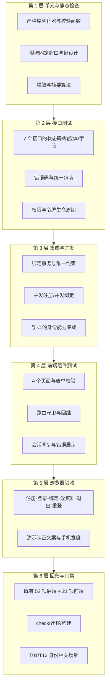

# 成员 A：用户管理子系统测试计划

| 项目 | 内容 |
|---|---|
| 文档名称 | 成员 A 用户管理子系统测试计划 |
| 文档版本 | v1.1 |
| 编写日期 | 2026-11-02 |
| 作者 | 成员 A（用户管理） |
| 测试对象 | 用户管理子系统：注册登录、校园身份绑定、个人资料管理，以及为 B/C 提供的身份能力 |
| 需求依据 | [需求规格说明书](../requirements/A-用户管理-需求规格说明书.md) 第 2、3 节；[共同字段与接口约定](../共同字段与接口约定.md) 第 2、3.2、3.3、4、8 节 |
| 配套文档 | [测试用例](A-用户管理-测试用例.md)、`docs/requirements/A-用户管理-需求规格说明书.md` |
| 计划性质 | 本文件只确定目标、范围、策略、准入准出与安排；不记录执行结果，执行结论写入 `docs/test/A-用户管理-测试报告.md` |

## 1. 测试目标

1. 验证 FR-A-01～FR-A-12 全部功能需求在正常、边界与异常输入下行为符合[共同字段与接口约定](../共同字段与接口约定.md)第 4 节与契约第 2 节。
2. 验证 NFR-A-01～NFR-A-07：密码与令牌安全存储、隐私脱敏、绑定事务一致性、分层可维护性、与 B/C 的兼容、表单可用性、环境可复现。
3. 验证 A 的正式路由接管演示入口后，成员 C 的既有 52 项后端测试与 21 项前端测试仍全部通过（共同契约 §8.3 的 T01、T13 中 A 负责部分）。
4. 为验收提供可核对证据：每条需求能追溯到设计、代码文件、用例与执行记录。

## 2. 测试范围

### 2.1 范围内

| 范围 | 内容 |
|---|---|
| 接口功能 | 注册、登录、登出、本人资料读取与修改、绑定读取与提交、错误码与统一响应包装 |
| 身份与安全 | Bearer 令牌签发/校验/撤销/过期、令牌摘要存储、密码哈希、严格字段校验、越权与伪造字段 |
| 校园身份绑定 | 演示身份校验、一次性绑定码、脱敏输出、重复与占用、并发唯一性、事务回滚 |
| 频率限制 | 登录按 IP 10 次/分钟、绑定按用户 5 次/分钟、429 与 `Retry-After`、键隔离与窗口恢复 |
| 演示数据 | `seed_demo_users` 幂等、`DEMO_MODE` 限制、`--reset-codes`、演示账号补绑定 |
| 前端 | 登录、注册、个人资料、校园身份绑定四个页面；路由守卫与回跳；导航与退出行为；移动宽度可用性 |
| 兼容回归 | `tests` 既有 52 项、前端既有 21 项、共享响应/认证契约、C 的接口与页面 |
| 工程检查 | `manage.py check`、迁移一致性、Vue 生产构建、测试数据库隔离 |

### 2.2 范围外

- B 的信息发布、图片、搜索与 C 的认领、消息、匹配业务规则本身（仅验证其身份前置条件与公开摘要字段）。
- **依赖成员 B 尚未实现的接口**：`/meta/campuses`（校区字典）与 `POST /posts`（发布信息）。对应 TC-A-020、TC-A-075：B 未接入时这两条不可完整执行，A 侧改为以成员 C 的公开详情接口验证“公开接口 + 无效/无 Bearer 令牌 401”、以认领接口验证 401/403；B 接入后补执行。TC-A-041 的 `POST /posts` 部分同此限制，`/claims` 部分可正常执行。
- 真实学校统一身份认证、短信/邮箱验证、OAuth 第三方登录、密码找回与修改密码。
- 账号注销、解绑与更换校园身份（第一版明确不开放）。
- 管理员后台、审计日志、多机部署、生产级压测与安全渗透测试。
- 浏览器兼容性矩阵（仅使用本机 Google Chrome 验证功能与移动宽度）。

## 3. 测试策略

采用“分层测试 + 需求追踪 + 独立复核”的策略：越靠近底层的缺陷越早发现，越靠近用户流程的缺陷用端到端覆盖；实现者自测只作为交付前提，验收结论由验证角色独立重跑与复核。



| 层次 | 方法 | 主要覆盖用例 |
|---|---|---|
| 单元与静态检查 | Django 测试断言校验函数、摘要与脱敏结果；`check`、`makemigrations --check` | TC-A-051～054、TC-A-077 |
| 接口测试 | DRF `APITestCase` 直接请求，断言状态码、`code`、`data`、`errors` 与数据库副作用 | G1～G7 大部分 |
| 集成与并发 | `TransactionTestCase`；线程加屏障，各线程独立数据库连接（参照 `backend/tests/test_concurrency.py`） | TC-A-007、030、038、049、050 |
| 前端组件测试 | Vitest + `@vue/test-utils`，mock `shared/http.js` / `modules/users/api.js`，`createMemoryHistory` 路由 | G11 |
| 浏览器验收 | Playwright，隔离后端 `8001`、前端 `5174`、`e2e.sqlite3`，固定绑定码 | G12 |
| 回归与门禁 | 全量命令重跑，比对既有测试数量与结果 | G13 |

### 3.1 环境与工具

| 项目 | 版本/说明 |
|---|---|
| 操作系统 | Windows（本机课程演示环境） |
| 后端 | Python 3.12.14、Django 5.2.18、Django REST framework 3.16.1 |
| 数据库 | SQLite（`transaction_mode=IMMEDIATE`），测试库与演示库分离 |
| 前端 | Node.js 24.16.0、npm 11.13.0、Vue 3.5.x、Vite 7.3.x、Vitest、`@vue/test-utils` |
| 浏览器 | 本机 Google Chrome，Playwright 1.64.0 |

> 以上为本机实际运行环境（2026-11-02 实测），与验证角色测试报告的环境记录一致；脚本、依赖版本与命令基线见下方命令块与 [README](../../README.md)。
| 命令入口 | 根目录 `scripts/verify.ps1`（可加 `-Browser`）；后端解释器为项目内 `.venv` |
| 环境变量 | `PYTHONUTF8=1`；测试与 e2e 使用独立数据库路径；`DEMO_BINDING_CODE` 仅供隔离环境 |

命令基线（详见契约第 1 节与 [README](../../README.md)）：

```powershell
& .\.venv\Scripts\python.exe backend\manage.py check
& .\.venv\Scripts\python.exe backend\manage.py makemigrations --check --dry-run
& .\.venv\Scripts\python.exe backend\manage.py test tests users.tests --noinput
Set-Location frontend
npm.cmd test
npm.cmd run build
npm.cmd run test:e2e
```

## 4. 准入与准出标准

### 4.1 准入标准（开始执行测试的条件）

1. 契约第 3、4 节规定的后端与前端文件已落地，`manage.py check` 无错误，迁移可生成且一致。
2. 测试数据初始化命令可在隔离环境成功执行，演示校区与测试身份可用。
3. 需求编号、接口路径、错误码以契约第 2、3 节为准，无未决的语义冲突。
4. 测试用例（78 条）已随本文档提交，执行人可读取。

### 4.2 准出标准（判定本模块可交付的条件）

| 类别 | 准出条件 |
|---|---|
| P0 用例 | 100% 通过，无未关闭的 P0/P1 缺陷 |
| P1 用例 | 通过率不低于 95%，未通过项有书面豁免与影响说明 |
| 需求覆盖 | FR-A-01～12、NFR-A-01～07 均至少有一条对应用例且被执行 |
| 回归 | 后端 `tests` 既有 52 项、前端既有 21 项全通过；`npm run build` 成功；`check` 0 issues；迁移无变化 |
| 安全抽查 | 响应中无密码、哈希、学号明文、绑定码、令牌摘要；旧令牌登出后 401 |
| 证据 | 测试报告记录环境、命令、统计、失败项与修复记录；验证报告给出逐条需求核对结论 |

## 5. 测试数据与环境隔离

| 项 | 策略 |
|---|---|
| 隔离测试库 | Django 测试使用 `TEST.NAME` 指定的独立文件库，运行结束销毁；不触碰 `backend/db.sqlite3` |
| 浏览器验收库 | 使用 `backend/e2e.sqlite3`，每次启动清空；普通演示库不参与 e2e |
| 演示数据 | 初始化命令幂等；绑定码仅存 `sha256` 摘要，明文只在命令输出或隔离测试配置中出现 |
| 账号数据 | 用例内注册专用账号（如 `alice_01`、`binder_01`），避免依赖演示账号状态 |
| 绑定身份 | 用例通过模型工厂或初始化命令构造 `DemoIdentity`，每例使用不同学号，避免相互消耗 |
| 限流状态 | 限流默认在测试中关闭；仅限流用例用 `override_settings(RATE_LIMIT_ENABLED=True)` 开启并在 `setUp` 清缓存 |
| 敏感信息 | 测试与文档不写真实密码、真实学号、真实令牌；截图只用演示数据 |

## 6. 用例总览与执行安排

### 6.1 用例统计

| 用例组 | 数量 | 优先级构成（P0/P1） |
|---|---:|---|
| G1 账号注册 | 7 | 4/3 |
| G2 登录 | 6 | 3/3 |
| G3 令牌与登出 | 7 | 2/5 |
| G4 个人资料 | 8 | 4/4 |
| G5 校园身份绑定 | 11 | 5/6 |
| G6 身份能力与权限 | 5 | 2/3 |
| G7 频率限制 | 4 | 2/2 |
| G8 并发与事务 | 2 | 1/1 |
| G9 安全与隐私 | 4 | 2/2 |
| G10 演示数据初始化 | 4 | 1/3 |
| G11 前端页面与路由 | 10 | 0/10 |
| G12 浏览器验收 | 3 | 1/2 |
| G13 兼容回归与工程检查 | 7 | 3/4 |
| **合计** | **78** | **30/48** |

明细见[测试用例](A-用户管理-测试用例.md)。用例执行顺序不改变编号；所有用例必须绑定具体环境（本地/隔离）与执行人。

### 6.2 执行批次与角色

| 批次 | 内容 | 执行者 | 时机 |
|---|---|---|---|
| B1 实现者自测 | 后端用户模块接口与前端组件测试随编码同步补充并本地运行 | 负责实现的成员 | 编码阶段 |
| B2 集成自测 | 绑定事务、并发、与 C 的身份集成、演示数据命令 | 负责实现的成员 | 后端定稿后 |
| B3 浏览器验收 | 注册-登录-绑定-改资料-退出-重登、390px 布局 | 前端实现者 | 前端与后端联调可用后 |
| B4 回归门禁 | 全量后端/前端/构建/check/迁移 | 实现者 | 交付前 |
| V1 独立验证 | 按本计划与用例独立重跑，逐条核对代码与真实 HTTP 行为 | 验证角色 | 实现完成后 |
| V2 文档一致性 | 文档需求编号、接口描述与实际实现比对 | 验证角色 | 与 V1 同时 |

本计划**不预置**各批次结果；批次完成后由执行人记录命令、环境与输出，最终统计进入测试报告。实现者自测通过不等于验收通过，V1 独立验证结论才是准出依据。

## 7. 风险与应对

| 风险 | 影响 | 概率 | 应对 |
|---|---|---|---|
| 演示认证被误解为真实学校认证 | 验收表述不实、用户误信 | 中 | 页面与文档统一标注“演示认证”；TC-A-070 检查文案；报告中声明边界 |
| SQLite 并发能力有限 | 并发绑定/注册出现锁等待或误判 | 中 | 事务 `IMMEDIATE`、唯一约束兜底、并发用例用独立连接；不承诺生产规模 |
| 限流开关影响全量回归 | 既有 52 项测试被 429 干扰 | 中 | 默认关闭、用例内 `override_settings` 开启并清缓存 |
| 依赖 B 的校区字典接口 | 绑定页校区列表不可用 | 高 | 前端降级为文本输入（TC-A-065）；后端只校验 `campus_id` 存在性 |
| 依赖 C 的接口做集成验证 | 身份能力回归无法闭环 | 中 | 使用 `tests.helpers` 模型工厂直接构造数据，降低对 C 页面状态的依赖 |
| 演示路由与正式路由重复 | 路径冲突导致 405/404 | 中 | 按契约 3.4 移除 demo 中登录/登出/本人资料；TC-A-076 专项检查 |
| 测试污染普通演示库 | 演示数据被改坏 | 低 | 独立测试库与 `e2e.sqlite3`；TC-A-078 核对普通库不变 |
| 网络与依赖安装受限 | 环境搭建失败 | 中 | 依赖已在仓库内安装；pip 使用清华镜像；文档记录版本基线 |

## 8. 缺陷管理与判定

| 严重度 | 判定 | 处理要求 |
|---|---|---|
| 致命 | 无法登录/注册；令牌可越权；绑定导致数据错乱；既有 52/21 项回归失败 | 立即修复，重新执行相关用例与回归 |
| 严重 | 错误码或状态码不符合契约；脱敏泄露学号；并发绑定双重成功；事务不回滚 | 交付前必须修复 |
| 一般 | 字段校验边界偏差；提示文案不准确；限流键设计不合理；前端降级缺失 | 交付前修复或书面说明 |
| 轻微 | 样式、排版、文档笔误 | 可排期修复 |

流程：执行人记录“用例编号、环境、实际结果、复现步骤、期望结果”→ 提交 Lead 汇总 → 修复后回归对应用例并在测试报告记录复验结论。缺陷不改变需求编号；若需求本身需变更，走过程说明中的变更控制记录。

## 9. 交付物

| 交付物 | 位置 | 责任 |
|---|---|---|
| 测试计划（本文） | `docs/test/A-用户管理-测试计划.md` | 成员 A |
| 测试用例（78 条） | `docs/test/A-用户管理-测试用例.md` | 成员 A |
| 测试报告（执行结果/统计/缺陷） | `docs/test/A-用户管理-测试报告.md` | 验证角色 |
| 完整性验证报告 | `docs/verify/A-用户管理-完整性验证报告.md` | 验证角色 |
| 需求规格说明书 | `docs/requirements/A-用户管理-需求规格说明书.md` | 成员 A |

## 10. 变更记录

| 版本 | 日期 | 变更内容 | 变更人 |
|---|---|---|---|
| v1.0 | 2026-11-02 | 首次编写，确定范围、策略、78 条用例总览、准入准出与执行安排 | 成员 A（用户管理） |
| v1.1 | 2026-11-02 | 按 verifier 文档偏差 DV-A-03/DV-A-05 修正：环境版本改为实测值（Python 3.12.14、Node.js 24.16.0、npm 11.13.0、Playwright 1.64.0）；范围外点名 B 未实现接口及 TC-A-020/TC-A-075 的 A 侧替代验证与补执行条件 | 成员 A（用户管理） |
