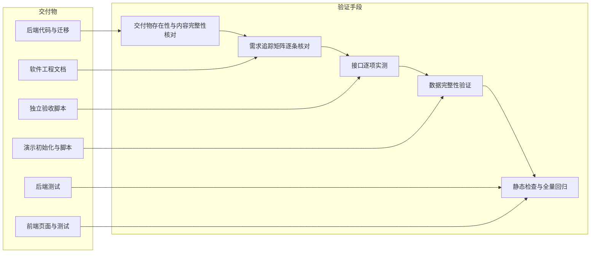
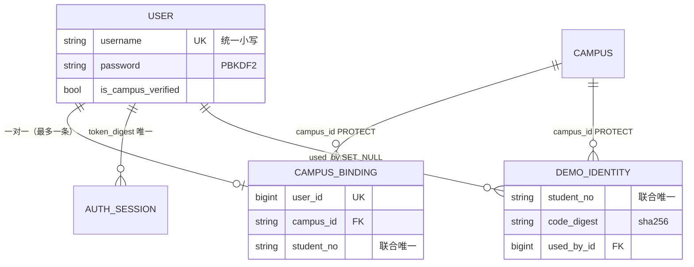

# 成员 A：用户管理子系统完整性验证报告

| 项目 | 内容 |
|---|---|
| 文档名称 | 成员 A 用户管理子系统完整性验证报告 |
| 文档版本 | v1.0 |
| 编写日期 | 2026-11-02 |
| 作者 | 验证角色 |
| 验证对象 | 成员 A（用户管理）全部交付物：后端代码与迁移、测试、演示初始化命令、前端四页面、软件工程文档、独立验收脚本 |
| 验证依据 | [需求规格说明书](../requirements/A-用户管理-需求规格说明书.md)；[测试计划](../test/A-用户管理-测试计划.md)与[测试用例](../test/A-用户管理-测试用例.md)；[共同字段与接口约定](../共同字段与接口约定.md) 第 2、3.2、3.3、4、7.3、8.3 节 |
| 配套文档 | [测试报告](../test/A-用户管理-测试报告.md)（执行统计、缺陷记录、覆盖率） |
| 独立性声明 | 本报告的依据是验证角色本人重跑的命令、本人编写的独立验收脚本（`scripts/acceptance_a.py`）与逐条代码/文档核对，未引用实现者自述的测试结论 |
| 完整性结论 | **A 模块自身完整、可交付**（详见 §9） |

## 1. 验证范围与方法

**判定原则**：模块“完整”指——契约与 SRS 规定的功能/接口/约束全部实现且有执行证据；既有子系统不被破坏；文档与实现一致（偏差登记）；未实现部分明确归属其他成员或范围外，**不把“B 尚未实现导致的全流程未联调”算作 A 未完成**。

## 2. 交付物清单核对

| 类别 | 交付物 | 路径 | 存在 | 内容完整性核对（实测） |
|---|---|---|---|---|
| 后端 | 4 个模型与约束 | `backend/users/models.py` | 是 | `User/AuthSession/CampusBinding/DemoIdentity` 与契约 §3.1 一致；联合唯一、一对一、`PROTECT/SET_NULL` 齐全 |
| 后端 | 迁移 | `backend/users/migrations/0002_campusbinding_demoidentity.py` | 是 | 依赖 `catalog.0001`+`users.0001`；两表与两个唯一约束；`0001` 未被改动；`makemigrations --check` 无变化 |
| 后端 | 序列化/视图/服务/查询/权限/限流/认证/路由 | `backend/users/{serializers,views,services,selectors,permissions,throttles,authentication,urls}.py` | 是 | 分层与契约 §3.4 一致；7 条路由无结尾斜杠；`require_campus_verified/user_summary/get_user_summaries/issue_session` 签名保留 |
| 后端 | 演示初始化命令 | `backend/users/management/commands/seed_demo_users.py` | 是 | 6 身份、固定/随机码、摘要入库、补绑定、幂等、`--reset-codes`、非 `DEMO_MODE` 报错；实测通过 |
| 后端 | 用户模块测试 | `backend/users/tests/{__init__,test_auth,test_profile,test_campus_binding}.py` | 是 | 47 项，全部通过（2.585s） |
| 后端 | 与 C 的身份集成测试 | `backend/tests/test_identity_integration.py` | 是 | 6 项，随全量 105 项通过 |
| 后端 | 共享/配置/演示适配改动 | `backend/common/serializers.py`、`backend/config/{settings,urls}.py`、`backend/demo/{urls,views}.py`、`backend/posts/serializers.py` | 是 | 仅新增 `timestamp`、限流开关/缓存、路由顺序；`demo` 仅移除登录/登出/本人资料；`posts` 仅改 `timestamp` 导入（不影响 C） |
| 后端 | 脚本与环境样例 | `scripts/{setup,verify}.ps1`、`scripts/e2e_backend.py`、`backend/.env.example` | 是 | `seed_demo_users` 已接入 setup/e2e；verify 覆盖 `tests users.tests`；`.env.example` 增补限流与演示码变量 |
| 前端 | API/路由/四页面/表单组件 | `frontend/src/modules/users/{api.js,routes.js,pages/*.vue,components/CampusBindingForm.vue}` | 是 | 路径统一走 `shared/http.js`；四页面与契约 §4.1/4.2 一致；绑定页含降级与脱敏展示 |
| 前端 | 导航与路由守卫改动 | `frontend/src/router/index.js`、`frontend/src/App.vue` | 是 | 守卫 `requiresAuth → /login?next=`；退出登录仍 `replace('/demo')`（保持 C 行为）；新增登录/注册/个人中心入口 |
| 前端 | 组件测试 | `frontend/src/modules/users/tests/*.spec.js` | 是 | 26 项（登录 6/注册 6/资料 6/绑定 8），全部通过 |
| 前端 | 浏览器用例 | `frontend/tests/e2e/users.spec.js` | 是 | 1 条端到端用例覆盖注册→登录→绑定→改资料→退出→重登→文案→390px，实测通过 |
| 文档 | 需求规格说明书 | `docs/requirements/A-用户管理-需求规格说明书.md` | 是 | v1.1，FR/NFR/用例规约/业务规则/验收标准/T01·T13 映射/追踪矩阵齐全，含 mermaid |
| 文档 | 概要设计 | `docs/design/A-用户管理-概要设计.md` | 是 | 架构、模块划分、技术选型、关键决策、接口总览、错误码、安全、非功能、风险、追踪矩阵 |
| 文档 | 详细设计 | `docs/design/A-用户管理-详细设计.md` | 是 | 模型/类图、7 接口逐项规格与错误表、校验矩阵、时序图、状态图、事务并发、限流、脱敏、前后端分层、C 集成契约、追踪矩阵 |
| 文档 | 数据库设计 | `docs/数据库设计.md` | 是 | 全库 ER、A 的四表字段/约束/索引、共享表摘要、完整性规则（IC-01～）、迁移与初始化策略 |
| 文档 | 软件工程过程说明 | `docs/process/A-软件工程过程说明.md` | 是 | 过程模型、角色边界、阶段执行、评审记录、检查单、配置管理、质量保证、度量、风险、变更控制（含 CR-A-08） |
| 文档 | 测试计划 | `docs/test/A-用户管理-测试计划.md` | 是 | 目标/范围/策略/环境/准入准出/数据隔离/风险/交付物（78 用例总览） |
| 文档 | 测试用例 | `docs/test/A-用户管理-测试用例.md` | 是 | v1.1，TC-A-001～078 编号基线；TC-A-033/049 已按 CR-A-08 修订为确定性 409 |
| 脚本 | 独立验收脚本（本次新增） | `scripts/acceptance_a.py` | 是 | 34 项 ACC-A 断言，临时库隔离、单次约 60 秒，连续运行通过 |
| 报告 | 测试报告 | `docs/test/A-用户管理-测试报告.md` | 是 | 本验证配套产出 |
| 报告 | 完整性验证报告 | `docs/verify/A-用户管理-完整性验证报告.md` | 是 | 本文 |

> 契约第 5 节的 `docs/reports/A-用户管理.md`（课程个人报告）由 Lead 在收尾阶段按最终口径组织，不属于本次独立验证的判定对象；其存在性已在 Lead 的交付清单中单独跟踪。

## 3. 需求追踪矩阵（FR/NFR → 设计 → 代码 → 用例 → 实际结果）

“实际结果证据”列中，`test_*` 为仓库内自动化用例（验证角色重跑通过），`ACC-A-xx` 为独立脚本断言（`scripts/acceptance_a.py`，验证角色重跑通过）。

| 需求 | 设计章节 | 代码文件/函数 | 测试用例 | 实际结果证据 |
|---|---|---|---|---|
| FR-A-01 账号注册 | 概要 §6；详细 §3/4.1/5/6.1 | `users/serializers.py::RegisterInput`、`services.py::register_user`、`views.py::RegisterView`、`urls.py`、`common/serializers.py::StrictSerializer` | TC-A-001～007 | `test_auth.py::RegisterTests`(7) + ACC-A-01（201/字段/无令牌/PBKDF2）、ACC-A-02（409 大小写去重）、ACC-A-03（长度边界 400）、ACC-A-04（未知字段/数组 400）、ACC-A-31（并发注册 201+409） |
| FR-A-02 登录 | 概要 §5 KD-02、§6；详细 §3/4.2/6.2/9 | `services.py::login_user/issue_session`、`views.py::LoginView`、`authentication.py`、`settings.py` | TC-A-008～013 | `test_auth.py::LoginTests`(6) + ACC-A-05（token_type/expires_at/24h/摘要）、ACC-A-06（统一 401 文案，含停用账号） |
| FR-A-03 退出登录 | 概要 §6；详细 §4.3/6.3/7.1 | `services.py::revoke_session`、`views.py::LogoutView` | TC-A-014～016 | `test_auth.py::LogoutTests`(2) + ACC-A-07（旧令牌 401、第二会话 200、重复登出 401） |
| FR-A-04 查看资料 | 概要 §6；详细 §3.3/4.4 | `selectors.py::current_user`、`serializers.py::user_self`、`views.py::MeView.get` | TC-A-021、022 | `test_profile.py::ProfileViewTests`(3) + ACC-A-10（字段集合精确、无哈希/令牌） |
| FR-A-05 修改资料 | 概要 §6；详细 §4.5/5/6.4 | `serializers.py::UpdateProfileInput`、`services.py::update_profile` | TC-A-023～028 | `ProfileUpdateTests`(8) + ACC-A-11（成功/空对象/只读字段/updated_at）、ACC-A-12（1/30/31、200/201、去空白） |
| FR-A-06 查看绑定 | 概要 §6；详细 §3.3/4.6/10 | `selectors.py::get_campus_binding`、`serializers.py::binding_view/mask_student_no` | TC-A-029、031、039 | `CampusBindingTests` 相关 3 项 + ACC-A-15（未绑定 null）、ACC-A-16（绑定后读取）、ACC-A-21（20 位学号 16 个 `*` + 末 4 位） |
| FR-A-07 演示绑定 | 概要 §5 KD-01/05/06、§6；详细 §4.7/5/6.5/6.6/8/10 | `services.py::bind_campus`、`models.py`、`migrations/0002`、`selectors.py::get_campus/get_demo_identity` | TC-A-030、032～038、049、050 | `CampusBindingTests`(10，含占用 409/错误码 400/未知校区/学号格式) + ACC-A-16（201 脱敏+事务副作用）、17（重复 409 不消耗）、18（占用 409）、19（错误码 400 无副作用）、20（字段错误归位）、28（一次性）、29（回滚）、30（并发单胜者） |
| FR-A-08 令牌校验 | 概要 §6/§7；详细 §4.8/6.2/6.3/7.1 | `authentication.py::BearerAuthentication`、`settings.py::REST_FRAMEWORK` | TC-A-008、014、017～020 | `BearerAuthTests`(4，含公开接口无效令牌 401、过期 401) + `LogoutTests` + ACC-A-07/08/09（`WWW-Authenticate: Bearer`、四类异常头 401、公开详情无效令牌 401） |
| FR-A-09 身份能力 | 概要 §3.3/§8；详细 §13 | `services.py::require_campus_verified/user_summary/get_user_summaries`、`permissions.py` | TC-A-040～044、074、075 | `test_identity_integration.py`(4：未认证 403 IDENTITY_REQUIRED、绑定后认领 201、公开摘要四字段) + ACC-A-24/25/26（含 T13 伪造字段 400） |
| FR-A-10 频率限制 | 概要 §6；详细 §9 | `throttles.py::_fixed_window/enforce_login_rate_limit/enforce_binding_rate_limit`、`settings.py` | TC-A-045～048 | `LoginRateLimitTests`(1)、`BindingRateLimitTests`(1) + ACC-A-22（第 11 次 429 + Retry-After + 键隔离 + 窗口恢复）、ACC-A-23（第 6 次 429） |
| FR-A-11 演示数据 | 概要 §6；详细 §4.7/11 | `management/commands/seed_demo_users.py`、`scripts/{setup.ps1,e2e_backend.py}` | TC-A-055～058 | `SeedDemoUsersTests`(4) + ACC-A-13（先补绑定后打印、幂等、6 身份摘要、reset-codes）、ACC-A-14（非演示模式 CommandError 无写入） |
| FR-A-12 前端页面 | 概要 §3.1/3.3；详细 §12 | `frontend/src/modules/users/**`、`router/index.js`、`App.vue` | TC-A-059～071 | Vitest 26 项（登录/注册/资料/绑定完整分支）+ Playwright users 用例（全流程、文案、390px）+ ACC 无（前端由组件/浏览器覆盖） |
| NFR-A-01 安全 | 概要 §8；详细 §10.2 | `authentication.py`、`services.py`、`serializers.py`、`common/exceptions.py` | TC-A-030、051～054 | `test_auth` 摘要断言（`token_digest=sha256(token)`、库无明文）+ ACC-A-27（响应全文扫描）+ ACC-A-32（500 无堆栈/SQL/路径）+ DB 核对（PBKDF2、SHA-256 摘要、64 位十六进制） |
| NFR-A-02 隐私 | 概要 §8；详细 §3.3/10.2/13 | `services.py::user_summary`、`serializers.py::binding_view` | TC-A-043、053、070 | 集成测试公开摘要四字段 + ACC-A-25（`publisher` 无 username/bio + applicant 四字段）+ 前端源码无“真实认证”字样 |
| NFR-A-03 一致性 | 概要 §5 KD-05/§10 R2；详细 §8 | `services.py::bind_campus`（`transaction.atomic`+`select_for_update`+唯一约束）、`models.py` | TC-A-033、038、049、050 | `CampusBindingConcurrencyTests`(1) + ACC-A-29（注入异常→整体回滚）、ACC-A-30（线程并发 [201,409]，库中 1 条绑定、1 个认证用户）、ACC-A-17/18/19（失败无副作用） |
| NFR-A-04 可维护性 | 概要 §3.1/§9；详细 §11/5 | `backend/users/**` 分层、`common/serializers.py::StrictSerializer` | TC-A-006、026、044、077 | 代码走查（views→serializers/services/selectors/permissions/throttles 单向依赖）+ ACC-A-04/11/26（未知/只读字段 400）+ `manage.py check` 0 issues |
| NFR-A-05 兼容性 | 概要 §3.3/§7/§10；详细 §13 | `config/urls.py`（users→claims→demo）、`demo/{urls,views}.py`、`services.py` 保留签名、`App.vue` | TC-A-072～076 | 全量后端 105/105（含 C 基线 52 未修改）+ 前端 47/47 + Playwright 5/5（claims 4）+ `git diff` 确认 C 测试/claims 代码零修改 + 集成测试断言 `resolve("/api/v1/auth/login")` 命中 `users.views.LoginView` |
| NFR-A-06 可用性 | 概要 §9；详细 §12 | 前端四页面/组件、`App.vue` 响应式样式 | TC-A-059～071 | Vitest 26 项（校验/禁用/字段错误/降级）+ Playwright 文案与 390×844 `scrollWidth <= innerWidth` |
| NFR-A-07 可复现 | 概要 §9；详细 §9.2/11 | `settings.py`（TEST/RATE_LIMIT）、`seed_demo_users.py`、`scripts/*` | TC-A-055、072、078 | 临时库隔离（脚本自建/自删）；`db.sqlite3` 时间戳在测试前后不变（实测 19:41:19 早于全部测试运行）；脚本连续两次 34/34；`e2e.sqlite3` 每次重建 |

## 4. 接口逐项核对表（7/7 实测）

公共前缀 `/api/v1`，均不带结尾斜杠；成功响应 `{code, message, data}`，失败另含 `errors` 对象。

| # | 接口 | 权限 | 请求 | 成功响应（实测） | 错误码（实测） | 结论 |
|---|---|---|---|---|---|---|
| 1 | `POST /auth/register` | 匿名 | `username/password/nickname` | 201 `{code:"OK",message:"操作成功",data:UserSelf}`；无令牌、不自动登录 | 400 `VALIDATION_ERROR`（字段/未知字段/非对象）；409 `DUPLICATE_RESOURCE`（含大小写等价） | 通过 |
| 2 | `POST /auth/login` | 匿名（携带无效 Bearer 仍 401） | `username/password` | 200 `data:{access_token, token_type:"Bearer", expires_at, user:UserSelf}`；24h；库中仅 SHA-256 摘要 | 400 字段；401 `UNAUTHENTICATED`（统一“账号或密码错误”，含停用账号）；429 `RATE_LIMITED` + `Retry-After` | 通过 |
| 3 | `POST /auth/logout` | 登录 | 空对象 `{}` | 200 `data:null`；仅删除当前会话 | 401（无/坏/已撤销/过期令牌）；多余字段 400 | 通过 |
| 4 | `GET /users/me` | 登录 | 无 | 200 `UserSelf`（8 字段，`id` 为字符串，UTC ISO8601） | 401；响应无 password/hash/token_digest/学号 | 通过 |
| 5 | `PATCH /users/me` | 登录 | 可选 `nickname`(1～30)、`bio`(≤200，可空)，至少一个 | 200 完整 `UserSelf`；`updated_at` 变化；普通文本去首尾空白 | 400（空对象/未知/只读字段/长度）；401 | 通过 |
| 6 | `GET /users/me/campus-binding` | 登录 | 无 | 200 `null` 或 `{campus_id, student_no_masked, verification_mode:"demo", verified_at}` | 401；响应不含 `student_no` 明文 | 通过 |
| 7 | `POST /users/me/campus-binding` | 登录且未绑定 | `campus_id/student_no/binding_code` | 201 绑定视图（脱敏 `****0004`；事务内建绑定+置 `used_by`+置认证标记） | 400 字段/未知校区/身份不存在/绑定码不匹配（归 `binding_code`）；409 已绑定/身份被占用；429 第 6 次；失败无副作用 | 通过 |

**响应头抽查**：401 响应含 `WWW-Authenticate: Bearer`（ACC-A-08 实测）；429 响应含 `Retry-After` 正整数（ACC-A-22/23 实测）；500 响应仅 `code/message/data/errors` 且无堆栈/路径/SQL（ACC-A-32 实测）。

## 5. 数据完整性验证

| 完整性项 | 设计/契约要求 | 数据库实现 | 实测证据 | 结论 |
|---|---|---|---|---|
| 账号唯一 | 小写唯一 | `users_user.username` UNIQUE | ACC-A-02（含大小写变体 409，库中 1 条）；ACC-A-31（并发注册 201+409） | 通过 |
| 一用户一绑定 | `CampusBinding.user` 一对一 | OneToOneField + UNIQUE | ACC-A-17（重复绑定 409，库中仍 1 条） | 通过 |
| 校区+学号唯一 | `uniq_campus_student_no` | UniqueConstraint | ACC-A-18（他人占用 409，`student_no` 绑定仍 1 条）；并发 ACC-A-30 | 通过 |
| 演示身份唯一 | `uniq_demo_identity` | UniqueConstraint | `migrations/0002` 与 `数据库设计` 一致；ACC-A-13（6 身份幂等不重复） | 通过 |
| 会话摘要唯一 | `token_digest` 唯一 | UNIQUE | `test_auth.py::test_login_stores_only_token_digest`；ACC-A-05 | 通过 |
| 外键策略 | 校区 `PROTECT`、会话/绑定 `CASCADE`、`used_by` `SET_NULL` | 模型与迁移一致 | 迁移文件与数据库设计 §5.3/5.4 逐项核对 | 通过 |
| 事务回滚 | 绑定、`used_by`、认证标记同一事务，失败整体回滚 | `transaction.atomic()` 包裹三步 | ACC-A-29（在 `user.save` 注入异常 → 500、无绑定、`used_by` 为 null、用户未认证） | 通过 |
| 并发单胜者 | 两用户绑定同一身份最多一个成功 | `IMMEDIATE` 事务 + 事务内读 `used_by` + 唯一约束 | ACC-A-30（线程+独立连接：[201,409]，1 条绑定、1 个认证用户）；后端 `CampusBindingConcurrencyTests` | 通过 |
| 脱敏 | 学号只出末 4 位 | `mask_student_no`（末尾 4 位，其余 `*`） | ACC-A-16（`****0004`，响应无 `20260004`）、ACC-A-21（20 位 → 16 个 `*` + `3404`） | 通过 |
| 敏感存储形态 | 密码 PBKDF2、绑定码 SHA-256、令牌摘要 | Django 密码哈希、`sha256` 摘要 | ACC-A-01（`pbkdf2_sha256$` 前缀 + `check_password`）、ACC-A-05（摘要=sha256(token)、64 位小写、无明文令牌）、ACC-A-13/28（`code_digest` 64 位且≠明文） | 通过 |
| 一次性绑定码 | 使用后身份作废、不可再用 | `used_by` 非空即拒绝；摘要匹配才成功 | ACC-A-28（成功后被他人使用 → 409）、ACC-A-19（错误码 400 不消耗、随后正确码可成功） | 通过 |
| 普通库不被污染 | 测试/e2e 不触碰 `db.sqlite3` | 测试库 `TEST.NAME`、e2e 独立文件 | 实测 `backend/db.sqlite3` 最后修改时间 19:41:19，早于全部测试与 e2e（19:44 之后）；测试库结束自动销毁 | 通过 |

## 6. 共同验收清单映射（T01 / T13 中 A 负责部分）

| 共同编号 | 场景 | A 侧验收点 | 实测证据 | 结论 |
|---|---|---|---|---|
| T01 | 未登录发布；登录但未认证发布 | 未登录 401；已登录未认证 403 `IDENTITY_REQUIRED`；不产生数据 | C 的认领写入口实测：ACC-A-24（未登录 401 / 未认证 403 且 `Claim` 数量不变）；后端 `test_unauthenticated_claim_is_401_fr_a08`、`test_unverified_user_gets_403_identity_required_fr_a09` | **A 侧通过**；B 的 `POST /posts` 未实现，B 侧无法验证（不属于 A 缺陷） |
| T13 | 退出后复用旧令牌；伪造用户 ID 字段 | 旧令牌 401；伪造 `user_id`/`applicant_id`/认证字段 400 且身份仍由令牌决定 | ACC-A-07（登出后旧令牌 401）、ACC-A-09（公开接口无效 Bearer 401）、ACC-A-26（`applicant_id`/`user_id`/`is_campus_verified` → 400 且无越权数据）；后端 `test_logout_invalidates_token_for_claims_fr_a08`、`test_bad_bearer_even_on_public_post_is_rejected` | **通过**（A 部分；B/C 侧结论由各自验收记录给出） |
| T14（A 侧同类补充） | 事务中人为触发失败 | 绑定事务整体回滚 | ACC-A-29 | 通过（B/C 的 T14 由 B/C 验证） |

## 7. 静态检查与回归

| 检查项 | 命令/方法 | 结果 |
|---|---|---|
| Django 系统检查 | `manage.py check` | `System check identified no issues (0 silenced).` |
| 迁移一致性 | `manage.py makemigrations --check --dry-run` | `No changes detected` |
| 迁移文件审查 | 阅读 `0002_*` 与 `0001_*` | `0002` 只新增两表与两个唯一约束，依赖正确；`0001` 未修改 |
| 后端全量回归 | `manage.py test tests users.tests` | 105/105 通过（其中 C 基线 52 项文件未修改） |
| A 单模块回归 | `manage.py test users.tests` | 47/47 通过 |
| 前端组件回归 | `npm.cmd test` | 47/47 通过（既有 21 + 新增 26） |
| 前端构建 | `npm.cmd run build` | 成功（1.91s） |
| 浏览器全量回归 | `npm.cmd run test:e2e` | 5/5 通过（claims 4 + users 1） |
| C 兼容性静态确认 | `git status` / `git diff` / `git show HEAD:` | `backend/tests/` 仅新增 `test_identity_integration.py`，6 个既有测试文件零改动；`backend/claims/**`、`backend/posts/views|models|selectors|services` 零改动；`backend/posts/serializers.py` 仅把 `timestamp` 改为从 `common.serializers` 导入；`backend/demo/` 仅移除登录/登出/本人资料三条适配入口 |
| 前端既有行为确认 | 阅读 `router/index.js`、`App.vue` diff + e2e | 退出登录仍 `replace('/demo')`；`/demo`、`/me/claims` 等 C 路由未变；C 的 4 条浏览器用例通过 |
| 编码与可读性 | Python 严格 UTF-8 解码；`Get-Content -Encoding UTF8` | `scripts/acceptance_a.py` 为无 BOM UTF-8（49112 字节），严格解码通过 |

## 8. 未覆盖 / 未验证项（如实声明）

| 编号 | 项目 | 原因 | 影响与建议 |
|---|---|---|---|
| U-01 | B 的信息发布/字典接口（`POST /posts`、`GET /meta/campuses` 等） | B 模块尚未实现（实测路由表无 `POST /api/v1/posts`、`/meta/campuses` 返回 404） | T01/T13 的 B 侧无法闭环；A 侧身份前置已验证；B 完成后补做全流程联调 |
| U-02 | 真实校园统一身份认证、短信/邮箱验证、OAuth | 明确为第一版范围外（演示认证） | 页面与文档均标注“演示认证，不是真实学校认证”，无虚假陈述 |
| U-03 | 生产部署、HTTPS、静态资源与反向代理下的真实 IP 限流 | 课程项目为本地演示环境 | 限流键取 `REMOTE_ADDR`，反向代理场景需额外配置（设计已声明） |
| U-04 | 多实例/多进程下限流共享 | `LocMemCache` 单进程计数 | 已知限制；换 Redis 后可关闭该风险 |
| U-05 | 跨模块全流程（注册→登录→绑定→发布→列表→认领→同意→交接） | B 未实现，C 已实现但只能以演示数据适配验证 | 不把该缺口计入 A 未完成；A 的接口与身份能力已按契约提供给 B/C |
| U-06 | 并发压力与稳定性测试（吞吐、长稳压测） | 测试计划范围外 | 仅验证“正确性层面的并发唯一性”，不承诺 SLA |
| U-07 | 浏览器兼容矩阵（仅 Chrome headless + 390px 单流程） | 范围外（测试计划 §2.2 已声明） | 其他浏览器/真机未验证 |
| U-08 | 覆盖率“全量口径”（105 项一起跑并统计） | 本次覆盖率按 `users.tests` 单跑，以聚焦 A 代码 | 跨子系统调用（`require_campus_verified`、`user_summary`）未被计入本次覆盖，已解释原因；全量 105 项已通过 |
| U-09 | `docs/reports/A-用户管理.md`（课程个人报告） | 由 Lead 收尾阶段按最终口径组织，不属于独立验证判定对象 | 建议 Lead 交付前核对其数字与本报告一致 |
| U-10 | 5 项文档偏差的修正 | 验证角色不修改他人文档（契约 §7 写作用域约束） | 已在测试报告 §7 登记并报 Lead，由文档责任人处理；不影响功能与交付判定 |

## 9. 完整性结论

**判定：成员 A 用户管理子系统自身完整、可交付。**

依据：

1. **交付物完整**：契约 §3.6/§4.1/§5 要求的后端代码、迁移、命令、测试、前端四页面与组件、五份软件工程文档，以及 Lead 要求的测试报告/完整性验证报告/独立验收脚本均存在，内容与契约规定一致；前端构建产物可生成。
2. **需求闭环**：FR-A-01～12（12/12）与 NFR-A-01～07（7/7）均有“设计章节 → 代码文件/函数 → 测试用例 → 实测结果”四段证据链（§3）；7 个接口逐项实测通过（§4）。
3. **质量门禁全部通过**：`check` 0 issues、无待生成迁移、后端 105/105、前端 47/47、构建成功、Playwright 5/5、独立脚本 34/34（连续两次）、生产代码行覆盖 95.0%；无未关闭缺陷（3 项已修复并复测，5 项文档偏差已登记）。
4. **兼容性未被破坏**：C 的既有 52 项后端测试与 21 项前端测试文件零改动且全部通过，4 条 claims 浏览器用例通过；A 正式路由正确接管 demo 适配入口（集成测试断言 `resolve` 命中 `LoginView`）。
5. **边界声明清晰**：演示认证、SQLite 并发、单进程限流、内存令牌、依赖 B 字典接口等限制均在 SRS/设计与本报告中显式声明，未作超出实现的承诺。

**关于 A/B/C 全流程**：B 的信息发布与字典接口尚未实现，因此“注册→登录→绑定→发布→认领→交接”的全链路本就无法在本次验证中闭环。这属于项目整体联调进度问题，**不应计算为 A 模块未完成**：A 已按共同契约向 B/C 提供并实测了 `require_campus_verified`（403 `IDENTITY_REQUIRED`）、`UserSummary` 公开摘要、Bearer 认证与 7 个正式接口，C 的 52 项回归与 4 条浏览器用例在 A 接管认证后全部通过。待 B 完成后，应补做 T01/T13 的 B 侧联调与 TC-A-075 的 `POST /posts` 分支，届时 A 的身份能力可直接复用、无需改动。

## 10. 变更记录

| 版本 | 日期 | 变更内容 | 变更人 |
|---|---|---|---|
| v1.0 | 2026-11-02 | 首次编写：交付物清单核对、FR/NFR 追踪矩阵、7 接口逐项核对、数据完整性验证、T01/T13 映射、静态检查与回归、未验证项声明、完整性判定 | 验证角色 |
