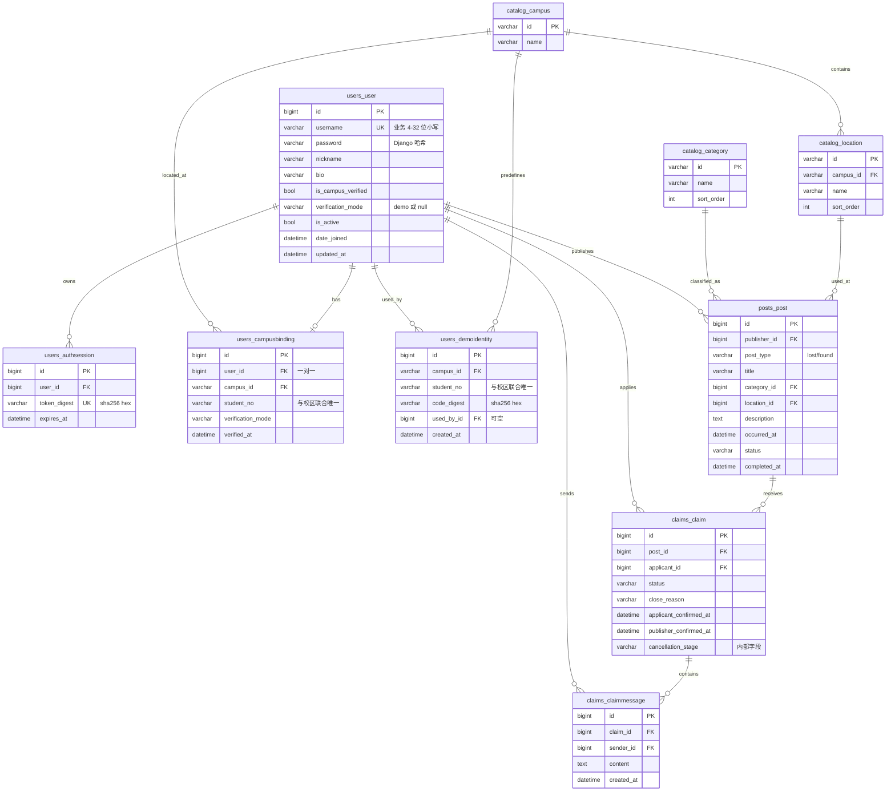

# 校园失物招领系统数据库设计

## 1. 文档信息与版本

| 项目 | 内容 |
|---|---|
| 文档名称 | 校园失物招领系统——数据库设计 |
| 文档编号 | DES-DB-001 |
| 文档版本 | v1.0 |
| 编写日期 | 2026-11-02 |
| 作者 | 成员 A（用户管理） |
| 文档范围 | 全库 ER 与表清单；A 负责的 `users_user`、`users_authsession`、`users_campusbinding`、`users_demoidentity` 与共享字典 `catalog_campus` 的字段、类型、约束、索引；`catalog_category/location`、`posts_post`、`claims_claim`、`claims_claimmessage` 摘要；命名/时间/完整性/迁移/初始化约定 |
| 上游文档 | [需求规格说明书](requirements/A-用户管理-需求规格说明书.md)、[概要设计](design/A-用户管理-概要设计.md)、[详细设计](design/A-用户管理-详细设计.md)、[共同字段与接口约定](共同字段与接口约定.md) |
| 数据库 | SQLite（课程演示）；ORM 为 Django 5.2.18 |
| 说明 | 表中“Django 类型”为模型定义；“SQLite 存储”为实际列类型（SQLite 类型亲和性弱，仅作参考）。API 对外 ID 一律字符串，内部为整数或字符串主键 |

### 1.1 版本记录

| 版本 | 日期 | 修订说明 | 修订人 |
|---|---|---|---|
| v1.0 | 2026-11-02 | 首次编写：全库 ER、A 的 4 张表与 `catalog_campus` 详细设计、共享表摘要、索引/约束/迁移/初始化约定、隐私与已知限制 | 成员 A |

## 2. 设计原则与约定

### 2.1 原则

1. **一个后端、一个数据库**：三个子系统共享同一 SQLite 文件与同一套迁移，不拆服务、不建独立库。
2. **谁定义谁迁移**：`users` 的表由 A 提供迁移（`0001`、`0002`），`catalog` 由 B 维护，`posts/claims` 由 B/C 维护；改字段必须生成新迁移并保证依赖顺序。
3. **约束下沉**：一用户一绑定、校区+学号唯一、令牌摘要唯一等关键规则用数据库约束兜底，不依赖应用层检查。
4. **隐私最小化**：敏感值（学号、绑定码、令牌、密码）入库即摘要或以受控列保存，API 层只输出脱敏值。
5. **时间统一 UTC**：`USE_TZ=True`，数据库存 UTC，接口输出 UTC ISO8601，页面按北京时间展示。
6. **框架列与业务列分离说明**：`users_user` 继承 `AbstractUser` 的框架保留列，A 的接口不使用、不返回，文档中单独标注。

### 2.2 通用约定

| 项目 | 约定 |
|---|---|
| 表命名 | `app_model` 小写（如 `users_campusbinding`），由 Django 生成 |
| 列命名 | `snake_case`；外键列为 `<关联模型>_id` |
| 主键 | A 的 4 张表与 posts/claims 使用 `BigAutoField`（SQLite 中为 `INTEGER PRIMARY KEY AUTOINCREMENT`）；`catalog` 字典使用 `CharField` 字符串主键 |
| 外键策略 | 业务历史数据使用 `PROTECT`（禁止删除被引用对象）；会话、绑定随用户使用 `CASCADE`；审计指针 `used_by` 使用 `SET_NULL` |
| 布尔 | `BooleanField` → SQLite `bool`，接口输出 JSON `true/false` |
| 时间 | `DateTimeField`，存 UTC；`auto_now_add` 创建时间、`auto_now` 更新时间 |
| 文本 | 普通文本去首尾空白后入库；`password`/`binding_code` 摘要前不裁剪 |
| 枚举 | `TextChoices` 存英文小写值，中文文案在前端映射 |
| 删除 | 第一版不物理删除业务数据；用户/认领/信息均无删除接口 |

## 3. 全库 ER 图

> 说明：`posts_post.campus_id` 不是数据库列，而是 `Post.campus_id` 属性（由 `location.campus_id` 派生）；ER 中不标注该列。
> Django 框架表（`auth_group`、`auth_permission`、`users_user_groups`、`users_user_user_permissions`、`django_migrations`、`django_content_type`、`sqlite_sequence`）由框架自动创建，不属于三个子系统的业务表，不在本设计展开。

## 4. 表清单

| 表名 | 所属 | 说明 | 记录量级（课程演示） |
|---|---|---|---|
| `users_user` | A | 用户账号与资料；含 `AbstractUser` 框架保留列 | 十～百级 |
| `users_authsession` | A | 登录会话（令牌摘要、过期时间） | 百级，随登出/过期清理 |
| `users_campusbinding` | A | 校园身份绑定，一用户一条 | 十～百级 |
| `users_demoidentity` | A | 预置演示校园身份与一次性绑定码摘要 | 固定 6 条 |
| `catalog_campus` | B | 校区字典（`campus_main`） | 1～数个 |
| `catalog_category` | B | 物品类别字典 | 数个 |
| `catalog_location` | B | 地点字典（关联校区） | 数个 |
| `posts_post` | B | 失物/招领信息 | 十～百级 |
| `claims_claim` | C | 认领申请 | 十～百级 |
| `claims_claimmessage` | C | 认领会话消息 | 百级 |

## 5. A 负责的表与共享校区表

### 5.1 `users_user`（用户）

业务使用列（A 的接口使用；其中 `username`、`password`、`date_joined` 属 `AbstractUser` 框架列，但被业务直接使用）：

| 字段 | Django 类型 | SQLite 存储 | 约束/默认 | 说明 |
|---|---|---|---|---|
| `id` | `BigAutoField` | `integer` | PK，自增 | 对外字符串输出 |
| `username` | `CharField(150, unique=True)` | `varchar(150)` | NOT NULL，UNIQUE | 框架列；业务层限制 4～32 位字母/数字/下划线，统一存小写；注册后不可改 |
| `password` | `CharField(128)` | `varchar(128)` | NOT NULL | Django 密码哈希（PBKDF2），不存明文 |
| `nickname` | `CharField(30)` | `varchar(30)` | NOT NULL | 1～30 字 |
| `bio` | `CharField(200, blank=True)` | `varchar(200)` | NOT NULL，默认 `""` | 0～200 字，允许空串 |
| `is_campus_verified` | `BooleanField(default=False)` | `bool` | NOT NULL | 认证标记；仅绑定服务/初始化命令写入 |
| `verification_mode` | `CharField(16, null=True, default=None)` | `varchar(16)` | NULL 允许 | `"demo"` 或 `NULL` |
| `date_joined` | `DateTimeField(default=now)` | `datetime` | NOT NULL | 注册时间；API `created_at` 取该列 |
| `updated_at` | `DateTimeField(auto_now=True)` | `datetime` | NOT NULL | 资料最近更新时间 |

框架保留列（A 的 API 不使用、不返回，但由 `AbstractUser` 存在）：

| 字段 | 类型 | 说明 |
|---|---|---|
| `last_login` | `datetime NULL` | Django 登录时间；本项目未使用（令牌会话自管） |
| `is_superuser` | `bool` | 框架超级用户标记；课程演示不使用 |
| `is_staff` | `bool` | 框架后台标记；不使用 |
| `is_active` | `bool` | 账号可用性；`false` 时登录返回 401 |
| `first_name` / `last_name` | `varchar(150)` | 框架列；不使用、不返回 |
| `email` | `varchar(254)` | 框架列；不使用（注册接口不接受 `email`） |
| `groups` / `user_permissions` | M2M（`users_user_groups`、`users_user_user_permissions`） | 框架权限关联；不使用 |

约束与索引：`username` 唯一索引（框架 `UnicodeUsernameValidator` 在本项目不参与业务校验，序列化器用更严格正则）；SQLite 唯一索引区分大小写，业务层统一小写入库保证唯一性生效。

### 5.2 `users_authsession`（登录会话）

| 字段 | Django 类型 | SQLite 存储 | 约束/默认 | 说明 |
|---|---|---|---|---|
| `id` | `BigAutoField` | `integer` | PK | — |
| `user_id` | `ForeignKey(User, CASCADE)` | `bigint` | NOT NULL，索引 | 删除用户时级联删除会话 |
| `token_digest` | `CharField(64, unique=True)` | `varchar(64)` | NOT NULL，UNIQUE | 令牌 SHA-256 十六进制；唯一索引支撑认证查询 |
| `expires_at` | `DateTimeField` | `datetime` | NOT NULL | 登录时刻 + 24 小时；**无独立索引**（按摘要定位后再判过期） |

`AuthSession` 没有 `created_at` 列；会话创建时间不影响业务语义，属已知取舍。

### 5.3 `users_campusbinding`（校园身份绑定）

| 字段 | Django 类型 | SQLite 存储 | 约束/默认 | 说明 |
|---|---|---|---|---|
| `id` | `BigAutoField` | `integer` | PK | — |
| `user_id` | `OneToOneField(User, CASCADE, related_name="campus_binding")` | `bigint` | NOT NULL，UNIQUE | 一用户最多一条绑定 |
| `campus_id` | `ForeignKey(catalog.Campus, PROTECT)` | `varchar(64)` | NOT NULL，索引 | 校区不可删除 |
| `student_no` | `CharField(20)` | `varchar(20)` | NOT NULL | 6～20 位字母/数字（序列化器校验）；仅服务端内部使用 |
| `verification_mode` | `CharField(16, default="demo")` | `varchar(16)` | NOT NULL，默认 `"demo"` | 第一版固定演示认证 |
| `verified_at` | `DateTimeField(auto_now_add=True)` | `datetime` | NOT NULL | 绑定时间；模型默认按该列倒序 |

约束与索引：`user_id` 唯一（一对一）；`(campus_id, student_no)` 联合唯一 `uniq_campus_student_no`；`campus_id` 外键索引。API 不返回 `student_no` 明文，只返回脱敏值。

### 5.4 `users_demoidentity`（演示校园身份）

| 字段 | Django 类型 | SQLite 存储 | 约束/默认 | 说明 |
|---|---|---|---|---|
| `id` | `BigAutoField` | `integer` | PK | — |
| `campus_id` | `ForeignKey(catalog.Campus, PROTECT)` | `varchar(64)` | NOT NULL，索引 | 所属校区 |
| `student_no` | `CharField(20)` | `varchar(20)` | NOT NULL | 测试学号 `20260001`～`20260006` |
| `code_digest` | `CharField(64)` | `varchar(64)` | NOT NULL | 一次性绑定码 SHA-256 十六进制（64 位）；不存明文 |
| `used_by_id` | `ForeignKey(User, SET_NULL, null=True, related_name="+")` | `bigint` | NULL 允许，索引 | 使用者；非空即视为已使用；用户删除时置空保留审计 |
| `created_at` | `DateTimeField(auto_now_add=True)` | `datetime` | NOT NULL | 创建时间 |

约束与索引：`(campus_id, student_no)` 联合唯一 `uniq_demo_identity`；`campus_id` 与 `used_by_id` 外键索引。

### 5.5 `catalog_campus`（校区字典，B 维护，A 引用）

| 字段 | Django 类型 | SQLite 存储 | 约束/默认 | 说明 |
|---|---|---|---|---|
| `id` | `CharField(64, primary_key=True)` | `varchar(64)` | PK | 字符串 ID，如 `campus_main` |
| `name` | `CharField(60)` | `varchar(60)` | NOT NULL | 中文名，如“主校区” |

第一版只有一个演示校区；即使只有一个，也保留字典结构，A 的绑定与 B 的地点都引用同一份 ID，禁止前端自造校区编号。

## 6. 共享表摘要

### 6.1 `catalog_category` / `catalog_location`（B 维护）

| 表 | 字段 | 说明 |
|---|---|---|
| `catalog_category` | `id varchar(64) PK`、`name varchar(60)`、`sort_order positive int default 0` | 物品类别；按 `sort_order ASC, id ASC` 排序 |
| `catalog_location` | `id varchar(64) PK`、`campus_id varchar(64) FK(PROTECT)`、`name varchar(60)`、`sort_order` | 地点；外键索引；信息发布时由地点推导校区 |

### 6.2 `posts_post`（B）

| 字段 | 类型 | 约束/说明 |
|---|---|---|
| `id` | `bigint PK` | 对外字符串 |
| `publisher_id` | `bigint FK(User, PROTECT)` | 发布者；公开摘要为 `UserSummary` |
| `post_type` | `varchar(8)` | `lost`/`found`；CheckConstraint `post_valid_type` |
| `title` | `varchar(60)` | 2～60 字（序列化器校验） |
| `category_id` | `bigint FK(Category, PROTECT)` | 类别 |
| `location_id` | `bigint FK(Location, PROTECT)` | 事件地点；由此派生校区，无单独 `campus_id` 列 |
| `description` | `text` | 10～2000 字（序列化器校验；DB 不限制长度） |
| `location_detail` | `varchar(100)` | 可空串补充说明 |
| `occurred_at` | `datetime` | 丢失/拾获时间 |
| `handover_note` | `varchar(200) NULL` | `found` 必填、`lost` 为 `NULL` |
| `status` | `varchar(16)` | `open/in_handover/completed/withdrawn`；默认 `open`；CheckConstraint `post_valid_status` |
| `created_at` / `updated_at` | `datetime` | 创建/更新时间 |
| `completed_at` | `datetime NULL` | 完成时间 |
| 索引 | — | `(status, post_type, category_id, occurred_at)` |

### 6.3 `claims_claim`（C）

| 字段 | 类型 | 约束/说明 |
|---|---|---|
| `id` | `bigint PK` | 对外字符串 |
| `post_id` | `bigint FK(Post, PROTECT)` | 目标信息 |
| `applicant_id` | `bigint FK(User, PROTECT)` | 申请者 |
| `verification_text` | `text` | 10～1000 字，仅双方可见 |
| `status` | `varchar(16)` | `pending/accepted/rejected/cancelled/completed/closed`；CheckConstraint `claim_valid_status` |
| `decision_note` | `varchar(500) NULL` | 审核说明 |
| `close_reason` | `varchar(32) NULL` | 仅 `closed` 时填 `post_withdrawn`/`another_claim_accepted`；CheckConstraint `claim_close_reason_consistent` |
| `applicant_confirmed_at` / `publisher_confirmed_at` | `datetime NULL` | 双方确认时间；CheckConstraint `claim_confirmation_consistent` |
| `cancellation_stage` | `varchar(16) NULL` | 内部字段，保留取消前阶段以判定权限；不返回 API |
| `created_at` / `updated_at` | `datetime` | — |
| 条件唯一 | — | `unique_active_applicant`：`(post_id, applicant_id)` 在 `pending/accepted` 时唯一；`unique_accepted_post`：`post_id` 在 `accepted` 时唯一 |
| 索引 | — | `(post_id, status)`、`(applicant_id, status, created_at)` |

### 6.4 `claims_claimmessage`（C）

| 字段 | 类型 | 约束/说明 |
|---|---|---|
| `id` | `bigint PK` | 消息顺序键 |
| `claim_id` | `bigint FK(Claim, PROTECT)` | 所属会话 |
| `sender_id` | `bigint FK(User, PROTECT)` | 发送者，服务端从令牌生成 |
| `content` | `text` | 1～1000 字纯文本 |
| `created_at` | `datetime` | 发送时间 |
| 索引 | — | `(claim_id, id)` 支撑按会话有序增量读取 |

## 7. 关系与完整性约束

### 7.1 关系清单

| 关系 | 基数 | 外键 | 删除策略 |
|---|---|---|---|
| 用户 → 会话 | 1 : N | `users_authsession.user_id` | CASCADE |
| 用户 → 绑定 | 1 : 0..1 | `users_campusbinding.user_id` | CASCADE |
| 校区 → 绑定 | 1 : N | `users_campusbinding.campus_id` | PROTECT |
| 校区 → 演示身份 | 1 : N | `users_demoidentity.campus_id` | PROTECT |
| 用户 → 演示身份（使用者） | 0..1 : N | `users_demoidentity.used_by_id` | SET_NULL |
| 校区 → 地点 | 1 : N | `catalog_location.campus_id` | PROTECT |
| 用户 → 信息 | 1 : N | `posts_post.publisher_id` | PROTECT |
| 类别/地点 → 信息 | 1 : N | `posts_post.category_id/location_id` | PROTECT |
| 信息 → 认领 | 1 : N | `claims_claim.post_id` | PROTECT |
| 用户 → 认领 | 1 : N | `claims_claim.applicant_id` | PROTECT |
| 认领 → 消息 | 1 : N | `claims_claimmessage.claim_id` | PROTECT |
| 用户 → 消息 | 1 : N | `claims_claimmessage.sender_id` | PROTECT |

### 7.2 关键完整性规则

| 编号 | 规则 | 实现 |
|---|---|---|
| IC-01 | 一个用户最多一条校园身份绑定 | `users_campusbinding.user_id` 一对一唯一 |
| IC-02 | 同一校区下学号唯一（一个身份只能绑定一次） | `uniq_campus_student_no` 联合唯一 |
| IC-03 | 演示身份与校区+学号一一对应 | `uniq_demo_identity` 联合唯一 |
| IC-04 | 绑定记录、身份占用、用户认证标记同事务提交 | 应用层 `transaction.atomic()`；数据库无跨表触发器 |
| IC-05 | 令牌摘要唯一、会话可撤销 | `users_authsession.token_digest` 唯一；登出删除行 |
| IC-06 | 一个用户对一条信息最多一条有效认领；一条信息最多一条 `accepted` 认领 | C 的条件唯一约束（SQLite 部分唯一索引） |
| IC-07 | 信息/认领状态取值合法 | B/C 的 CheckConstraint |
| IC-08 | 认领关闭原因与状态一致、确认时间与状态一致 | C 的 CheckConstraint |
| IC-09 | 被引用的用户/字典/信息不可物理删除 | 外键 `PROTECT`；用户删除级联仅限其会话与绑定 |
| IC-10 | 时间统一 UTC | `USE_TZ=True` + `auto_now/auto_now_add` |

## 8. 命名与 ID 规范

| 项目 | 规范 |
|---|---|
| 表/列 | Django 默认 `app_model` / `snake_case`；不手写表名 |
| A 表主键 | `BigAutoField`；对外 API 输出字符串（如 `"12"`），客户端不计算 ID |
| 字典主键 | 字符串业务 ID（`campus_main`），由初始化命令固定 |
| 外键列 | `<model>_id`；API 写入字段名带 `_id`（如 `campus_id`），响应使用嵌套对象或 `campus_id`（绑定视图直接用 `campus_id` 字符串） |
| ID 解析 | 后端把字符串 ID 解析为整数主键（`common/serializers.py:numeric_id` 限 1～19 位十进制）后再查询；不合法按 400/404 处理 |
| 枚举值 | 英文小写固定值（`demo`/`lost`/`found`/`open`…），中文文案仅前端映射 |
| 索引命名 | Django 自动命名；显式约束名：`uniq_campus_student_no`、`uniq_demo_identity`、`post_valid_status`、`claim_valid_status` 等 |

## 9. 时间与布尔约定

| 项目 | 约定 |
|---|---|
| 时区 | 数据库存 UTC（`USE_TZ=True`，`TIME_ZONE="Asia/Shanghai"` 仅影响展示） |
| 创建时间 | `auto_now_add=True`（如 `users_campusbinding.verified_at`、`users_demoidentity.created_at`） |
| 更新时间 | `auto_now=True`（`users_user.updated_at`） |
| 业务时间 | 显式赋值（`expires_at`、`occurred_at`、`completed_at`、确认时间） |
| API 输出格式 | `%Y-%m-%dT%H:%M:%S.%fZ`（`common/serializers.py:timestamp`，UTC），如 `2026-11-02T03:00:00.123456Z` |
| 页面展示 | `shared/utils/datetime.js` 转北京时间展示 |
| 布尔 | SQLite `bool`（0/1），API 输出 JSON 布尔值；查询参数使用 `true/false` |

## 10. 索引清单

| 表 | 索引/约束 | 字段 | 用途 |
|---|---|---|---|
| `users_user` | PRIMARY | `id` | 主键 |
| `users_user` | UNIQUE | `username` | 登录/注册查重 |
| `users_authsession` | PRIMARY | `id` | 主键 |
| `users_authsession` | UNIQUE | `token_digest` | 每次 Bearer 认证按摘要定位 |
| `users_authsession` | INDEX | `user_id` | 外键索引；按用户清理会话 |
| `users_campusbinding` | PRIMARY | `id` | 主键 |
| `users_campusbinding` | UNIQUE | `user_id` | 一用户一条绑定 |
| `users_campusbinding` | UNIQUE | `campus_id, student_no` | 身份唯一 |
| `users_campusbinding` | INDEX | `campus_id` | 外键索引 |
| `users_demoidentity` | PRIMARY | `id` | 主键 |
| `users_demoidentity` | UNIQUE | `campus_id, student_no` | 身份唯一 |
| `users_demoidentity` | INDEX | `campus_id`、`used_by_id` | 外键索引 |
| `catalog_location` | INDEX | `campus_id` | 按校区筛选地点 |
| `posts_post` | INDEX | `status, post_type, category_id, occurred_at` | 公开列表筛选/排序 |
| `posts_post` | INDEX | `publisher_id`、`category_id`、`location_id` | 外键索引 |
| `claims_claim` | INDEX | `post_id, status` | 按信息查申请 |
| `claims_claim` | INDEX | `applicant_id, status, created_at` | 我的申请列表 |
| `claims_claim` | UNIQUE（条件） | `post_id, applicant_id` WHERE `status IN (pending, accepted)` | 有效申请唯一 |
| `claims_claim` | UNIQUE（条件） | `post_id` WHERE `status='accepted'` | 唯一交接对象 |
| `claims_claimmessage` | INDEX | `claim_id, id` | 会话消息有序增量读取 |

## 11. 脱敏与隐私

| 数据 | 存储形态 | API 输出 | 说明 |
|---|---|---|---|
| 密码 | Django PBKDF2 哈希（`users_user.password`） | 不输出 | 仅比对，不可逆 |
| 令牌 | `users_authsession.token_digest`（SHA-256 hex） | 仅登录响应返回一次明文令牌 | 库中无明文令牌 |
| 绑定码 | `users_demoidentity.code_digest`（SHA-256 hex） | 不输出 | 仅在初始化命令输出中显示一次 |
| 学号 | `users_campusbinding.student_no` / `users_demoidentity.student_no` 明文存服务端 | 仅输出 `student_no_masked`（末 4 位保留，其余 `*`） | 公开摘要无学号字段 |
| 账号/简介 | `users_user.username/bio` 明文 | 仅本人（`UserSelf`） | 公开摘要不含账号与简介 |
| 认证标记 | `is_campus_verified`/`verification_mode` | 本人与公开摘要均输出 | 用于展示“演示认证” |

## 12. 迁移策略

| 迁移 | 生成日期 | 内容 | 依赖 |
|---|---|---|---|
| `users/0001_initial.py` | 2026-10-10 | `users_user`（含 AbstractUser 列与业务列）、`users_authsession` | `auth.0012_alter_user_first_name_max_length` |
| `users/0002_campusbinding_demoidentity.py` | 2026-11-02 | `users_campusbinding`、`users_demoidentity` 及两条联合唯一约束 | `catalog.0001_initial`、`users.0001_initial` |

约定：

1. **不改已发布迁移**（尤其 `0001`）；任何模型变更生成新迁移（如 `0003_*.py`）。
2. 迁移依赖顺序：`catalog` 先于 `users.0002`（绑定/身份引用校区）；`users` 先于 `posts`/`claims`（后者引用用户）。全库按 `catalog → users → posts → claims` 建表。
3. 门禁：`manage.py makemigrations --check --dry-run` 必须无变化；`manage.py check` 0 issues。
4. 测试使用 `settings.DATABASES["default"]["TEST"]["NAME"]` 指定的独立测试库，由测试框架创建/销毁；e2e 使用 `backend/e2e.sqlite3`；普通演示库 `backend/db.sqlite3` 不参与测试。
5. 迁移与模型必须同时提交；不手改数据库结构。

## 13. 初始化演示数据

`manage.py seed_demo_users`（仅 `DEMO_MODE` 可用，幂等）：

| 步骤 | 数据 | 说明 |
|---|---|---|
| 1 | `catalog_campus`：`campus_main`（主校区） | `get_or_create`，已存在则复用 |
| 2 | `users_demoidentity`：`20260001`～`20260006` 共 6 条 | `code_digest = sha256(绑定码)`；`DEMO_BINDING_CODE` 存在时统一用固定码（e2e 用），否则随机生成并打印一次 |
| 3 | 已有演示认证账号补绑定 | 对 `is_campus_verified=true` 且无绑定的 `publisher/applicant/competitor`，按顺序绑定 `20260001`～`20260003`，置 `used_by`；不打印已使用身份的码 |
| 4 | 输出 | 新建/重置身份的“学号 + 绑定码”明文（仅当次）；已有可用身份数量提示 |

规则：`--reset-codes` 只重置 `used_by IS NULL` 的身份；已使用身份码不变、不重复绑定；`unverified` 与普通注册用户不被自动认证；非 `DEMO_MODE` 抛 `CommandError` 且不写数据。

## 14. 已知限制

| 限制 | 说明 | 影响 |
|---|---|---|
| SQLite 并发能力 | 写事务在文件级串行；`transaction_mode=IMMEDIATE` 牺牲并发换取一致性 | 不适合多实例/高并发；迁移 PostgreSQL 需重验并发用例 |
| `users_authsession` 无冻结字段 | 无 `created_at`；`expires_at` 无独立索引 | 查询依赖 `token_digest` 唯一索引；清理过期会话需全表扫描（演示量级可接受） |
| 用户名大小写 | SQLite 唯一索引区分大小写；业务层统一小写入库 | 直接 SQL 写入大写可绕过唯一性；不提供管理接口 |
| 部分唯一约束依赖 SQLite | C 的条件唯一约束对应 SQLite 部分唯一索引；其他数据库语法不同 | 换库需回归迁移 |
| 演示认证 | 学号/绑定码为预置演示数据，非真实认证 | 不得视为真实身份核验 |
| 无解绑/删除 | 绑定、信息、认领均无删除接口 | 演示数据只能通过重建演示库清理 |
| 限流缓存 | `LocMemCache` 单进程计数 | 多实例部署限流不共享；换 Redis 需改配置 |
| 测试哈希器 | 测试基类将 `PASSWORD_HASHERS` 替换为 MD5（仅测试提速） | 生产配置不变；涉及哈希的断言仍按摘要验证 |

## 15. 变更记录

| 版本 | 日期 | 变更内容 | 变更人 | 影响 |
|---|---|---|---|---|
| v1.0 | 2026-11-02 | 首次编写：全库 ER、A 的 4 张表与 `catalog_campus` 详细设计、共享表摘要、索引/约束/迁移/初始化约定、隐私与已知限制；表结构依据 `users/0001_initial.py`、`users/0002_campusbinding_demoidentity.py` 与当前模型 | 成员 A（用户管理） | 作为设计/测试/验证阶段的数据库依据 |
