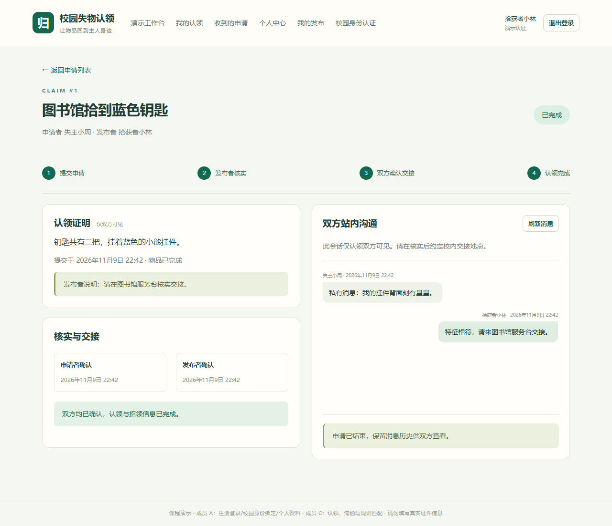
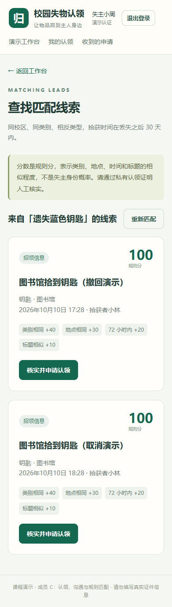

# 成员 C：联调与验收记录

日期：2026-10-10。验收对象是本仓库的成员 C 实现及其演示依赖，包含后端、Vue 页面和实际浏览器交互。本文不将 A/B 的适配骨架计为 A/B 完整子系统。

## 1. 环境与复现

Windows，Python 3.11，Django 5.2.18，DRF 3.16.1，Node.js 24.15，npm 11.12.1，Vue 3.5.43，Vite 7.3.7，Playwright 1.64.0，已安装的本机 Google Chrome。

后端生产构建不是本次内容；Django 已执行迁移和系统检查，前端已执行 Vite 生产构建。正常演示启动步骤见[README](../README.md)。

```powershell
Set-Location 'D:\失物招领'
.\.venv\Scripts\python.exe backend\manage.py check
.\.venv\Scripts\python.exe backend\manage.py makemigrations --check --dry-run
.\.venv\Scripts\python.exe backend\manage.py test tests --noinput -v 2
Set-Location frontend
npm.cmd test
npm.cmd run build
npm.cmd run test:e2e
```

也可以在根目录运行 `scripts/verify.ps1 -Browser`。浏览器测试自动启动隔离后端 `8001`、隔离前端 `5174`，结束后关闭这两个测试服务；每次启动清空 `backend/e2e.sqlite3`。正常演示用的 `backend/db.sqlite3` 不参与这些测试。

## 2. 实际结果

| 检查 | 最终结果 | 证据/范围 |
|---|---|---|
| Django `check` | 0 issues | 配置、模型与路由系统检查 |
| 迁移一致性 | No changes detected | 已提交模型对应的迁移源码 |
| 后端自动测试 | **52/52 通过** | 最终回归约 11 秒；测试文件见下表 |
| 前端自动测试 | **21/21 通过** | 4 个测试文件；组件和逻辑测试 |
| Vite 生产构建 | **通过** | 生成 `frontend/dist`，已忽略 |
| Chrome 浏览器 | **4/4 通过** | 最终运行约 40 秒，包含 390px 手机尺寸 |
| PowerShell 入口脚本 | 语法检查通过 | setup、start-backend、start-frontend、verify；其核心安装/迁移/启动命令已实际执行 |

| 后端文件 | 项数 | 核心场景 |
|---|---:|---|
| `backend/tests/test_claim_rules.py` | 17 | 身份、类型、本人限制、重复、字段、角色筛选、数据库唯一约束 |
| `backend/tests/test_handover_flow.py` | 12 | 竞争关闭、双确认、重复确认、取消、撤回恢复、故障回滚 |
| `backend/tests/test_messages.py` | 6 | 双方读写、越权、终态只读、游标、有序增量、内容校验 |
| `backend/tests/test_matching.py` | 8 | 硬过滤、角色时间方向、30 天/72 小时边界、排序、公开字段 |
| `backend/tests/test_api_contract.py` | 5 | Bearer、过期撤销、独立会话、非法 JSON、错误包装 |
| `backend/tests/test_concurrency.py` | 4 | 同人并发申请、竞争同意、并发确认、撤回与发消息竞态 |

并发测试用线程屏障同时发起两个请求，每个工作线程使用独立数据库连接，读取同一个实际 SQLite 文件。不是用顺序调用模拟并发，也不据此声称已通过生产规模压测或多机部署验证。

故障注入在“物品写入之后”或“关闭申请之后”抛出异常，验证申请、竞争申请、物品状态及确认时间整体回滚，覆盖同意、第二方确认、撤回三条流程。

### 2.1 浏览器场景

1. **多账号归还**：失主提交申请和私有消息，第三人提交竞争申请，拾获者核实和回复，选择失主后竞争申请关闭；第三人重新登录访问目标申请只看到 404，证明和消息均未渲染；第一方确认仍交接中，第二方确认后两边均显示已完成。
2. **交接前取消**：拾获者同意后取消，物品重新开放；失主能再次提交，得到新的申请 ID。
3. **撤回与恢复**：拾获者撤回存在待审申请的物品，申请自动关闭；恢复物品后旧申请仍关闭。
4. **匹配与认证限制**：390px 页面显示规则分和原因，从匹配跳转到认领表单；退出并登录未认证账号后显示身份限制，没有提交表单，页面无横向溢出。

浏览器验收发现并修复了“主动退出登录与保护路由守卫争抢跳转”的问题；最终四个场景均通过。未知发送结果的处理、轮询卸载及跨会话旧响应隔离另由前端自动测试验证。

桌面完成页面：



手机匹配页面：



以上截图来自隔离测试数据库，文字均为演示数据。

## 3. 与共同验收清单的对应

| 原编号 | 本次结论 | 验证方法/剩余范围 |
|---|---|---|
| T01～T04 | A/B 功能未包含 | 未实现正式发布、图片、编辑或公开搜索；不能据适配入口判定通过 |
| T05 | 通过 | 对 `lost` 申请 400，对本人 `found` 申请 403 |
| T06 | 通过 | 同人并发申请只有一条 201，另一条 409 |
| T07 | 通过（使用 B 最小状态适配） | 并发同意只有一个成功；竞争关闭；物品交接中 |
| T08 | 通过（使用 B 最小状态适配） | 单方保持交接；双确认同时完成；重复不覆盖时间 |
| T09 | 通过 | 确认前可取消重开；已有一方确认则 409 |
| T10 | C 与物品状态联调部分通过 | 撤回关闭、恢复保留历史、隐藏撤回详情；**真实图片权限尚待 B 接入** |
| T11 | 通过 | 非参与者 404；终态发送 409；双方保留历史读取 |
| T12 | 通过（使用 B 最小候选适配） | 排除不公开、完成、本人及同类型候选；结果只含公开字段 |
| T13 | C 与演示身份部分通过 | 注销令牌不能复用；伪造认领/发信身份字段 400；完整 A/B 待联调 |
| T14 | 通过（使用 B 最小状态适配） | 三条跨模块流程的写入后故障均回滚 |

“通过”指本仓库具体实现与数据下已执行的验证。A/B 替换模型、认证和图片后，应再次执行共同验收，不能直接沿用适配阶段的集成结论。

## 4. A/B 接入清单

### 4.1 A：用户与登录身份（2026-11-02 已接入）

- 保留 `settings.AUTH_USER_MODEL = "users.User"`，外部关联通过 `settings.AUTH_USER_MODEL` 引用；本次未改变 C 使用的用户字段语义。
- C 使用 `request.user.pk`、`nickname`、`is_campus_verified`、`verification_mode`；后两项由 A 的绑定服务与初始化命令写入，任何 HTTP 请求不得直接赋值。`require_campus_verified` 未认证时仍返回 `403 IDENTITY_REQUIRED`，`user_summary`/`get_user_summaries` 只提供约定公开字段（已由 `backend/tests/test_identity_integration.py` 覆盖）。
- Bearer 认证保持“服务端只存令牌摘要、24 小时到期、当前会话可撤销”；正式入口 `users/urls.py` 已接管登录/登出/本人资料，`demo/urls.py` 同步移除重复适配接口，路径与方法不再重复。
- 前端保持 `shared/session.js` 的内存会话接口；正式登录成功后写入 `{access_token, user}`，失效/退出清空。登录页为 `/login`，受保护页面守卫跳转并带 `next` 回跳；为兼容成员 C 的既有浏览器用例，点击“退出登录”后仍回到 `/demo`。
- A 的接口、页面、测试与验收结果见[完整性验证报告](verify/A-用户管理-完整性验证报告.md)与[测试报告](test/A-用户管理-测试报告.md)。

### 4.2 B：物品与图片

- 当前 `posts.Post`、`catalog` 覆盖 C 所需字段；B 接入时保留关系和语义，变更模型需同步迁移和 C 适配，不要另建一套互不关联的物品表。
- `get_post_for_claim(post_id, lock)` 返回物品、发布者、类别、地点和校区。锁定读取必须处于同一个数据库事务。
- `set_handover_state(post_id, transition)` 只接受 `reserve/complete/reopen`，检查合法的前后状态，不自行提交事务。
- `list_match_candidates(source_post)` 保持相反类型、同校区同类别、公开进行中、非本人及时间硬条件。
- 将正式 `PostSummary`/`PostDetail` 输出接入 `posts/serializers.py`。当前 `cover_image:null`、`images:[]` 是演示适配，真实受控图片由 B 实现，不能将上传目录直接公开。
- 正式撤回/恢复 HTTP 入口可调用 `workflows/post_workflow.py`；`close_pending_claims` 已由 C 提供。严格遵守先物品、后按 ID 升序申请的统一锁顺序。
- B 详情页“申请认领”跳转 `/claims/new?post_id=...`，本人“查找匹配”跳转 `/posts/:id/matches`。C 会重新从服务端校验权限和状态。

### 4.3 公共骨架

- C 的路由在 `claims/urls.py`；匹配虽然以 `/posts` 开头仍由 C 实现，B 不重复挂载。
- `demo/urls.py` 仅在 `DEBUG && DEMO_MODE` 挂载；正式 A/B 接入时可设置 `DJANGO_DEMO_MODE=0`。当前关闭演示后 C 接口仍在，但演示登录、物品详情和工作台数据不再可用。
- C 前端页面和 API 独立位于 `modules/claims/`。A 可将 `/me/claims` 挂入正式个人中心布局，保留 `role` 参数区分列表。
- 采用另一数据库或真实并发部署前，应更新配置、迁移并重跑事务及并发测试。本次未安装/验证 PostgreSQL、MySQL，也未进行性能容量承诺。

## 5. 当前未验收范围

成员 A 已在本仓库完成用户管理子系统的本地实现与验证（见第 6 节）；成员 B 的完整发布/浏览/图片与字典 HTTP 接口仍未接入。真实校园身份服务、公开网络部署、真实多人操作、线下物品交接、多实例限流与数据库并发方案均未验收。第一版也不包含争议裁决、单方确认撤销、管理员、附件、任意私聊和未读通知系统。

## 6. 成员 A：用户管理联调与验收记录（2026-11-02）

本节记录成员 A 本轮交付的实际验证结果。环境：Windows、Python 3.12（项目 `.venv`）、Django 5.2.18、DRF 3.16.1、SQLite、Node.js 24.16、Chrome。详细测试项、缺陷与残余风险见[测试报告](test/A-用户管理-测试报告.md)；需求到代码/测试的逐条追踪见[完整性验证报告](verify/A-用户管理-完整性验证报告.md)。

| 检查 | 实际结果 | 范围/证据 |
|---|---|---|
| Django `check` | 0 issues | 配置、模型、路由系统检查 |
| 迁移一致性 | No changes detected | `users/migrations/0002_campusbinding_demoidentity.py` 已提交 |
| 后端自动测试 | **105/105 通过** | 成员 A 新增 53 + 成员 C 基线 52（`backend/users/tests/`、`backend/tests/test_identity_integration.py`） |
| 前端单元测试 | **47/47 通过** | 既有 21 + 成员 A 新增 26（`frontend/src/modules/users/tests/`） |
| Vite 生产构建 | 通过 | `frontend/dist`（已忽略） |
| Chrome 浏览器验收 | **5/5 通过** | 成员 C 认领 4 项回归 + 成员 A 用户流程 1 项（`frontend/tests/e2e/users.spec.js`） |
| 初始化脚本 | 实际执行通过 | `scripts/setup.ps1`：迁移、`seed_demo`、`seed_demo_users` 输出可用一次性绑定码 |

### 6.1 共同验收清单中与 A 相关的项

| 编号 | 本次结论 | 依据/边界 |
|---|---|---|
| T01 | A 侧通过 | 未登录访问受保护接口返回 401；已登录未绑定身份执行认领返回 403 `IDENTITY_REQUIRED`，数据库不产生记录（B 的发布接口未接入，403 场景以认领接口验证） |
| T13 | A 侧通过 | 退出后复用旧令牌 401；伪造 `user_id`/`is_campus_verified` 等只读字段返回 400；公开用户摘要不含账号与学号 |
| T02～T12 | 不属于 A | 依赖 B/C 的物品、图片、认领流程状态；C 的既有回归 4 项已随本次验证重跑通过 |

### 6.2 本次联调发现与处理

1. **全量浏览器用例触发登录限流**：成员 C 的 4 个浏览器用例在约 40 秒内登录 10 次，触发“10 次/分钟/IP”的登录限流，导致随后成员 A 用例登录 429。处理：浏览器验收的隔离环境 `scripts/e2e_backend.py` 显式 `DJANGO_RATE_LIMIT=0`；限流策略仍由后端测试用 `override_settings` 单独覆盖，正常演示默认开启。
2. **绑定“身份被占用”响应码对齐**：实现初稿将“身份已被他人占用”归入 400（绑定码错误），与共同契约第 4 节“同一校园身份被重复绑定返回 409”不一致。处理：按共同契约改为 409 `DUPLICATE_RESOURCE`，400 仅保留“身份不存在/绑定码摘要不匹配”；已登记变更记录 CR-A-08。
3. **初始化命令输出顺序**：初版先打印 6 个绑定码再为演示账号补绑定，导致前 3 个码打印后立即失效。处理：先为演示账号补绑定，再只打印仍可用的 3 个身份码。

### 6.3 未完成/后续接入

- B 的字典 HTTP 接口（`/meta/campuses` 等）未接入，绑定页在校区列表不可用时降级为文本输入（默认 `campus_main`）并提示；B 接入后无需改绑定流程，只需提供字典接口。
- 真实校园认证、解绑/换绑、管理员审核与争议裁决不属于第一版；生产部署需替换 SQLite 与进程内限流方案。
